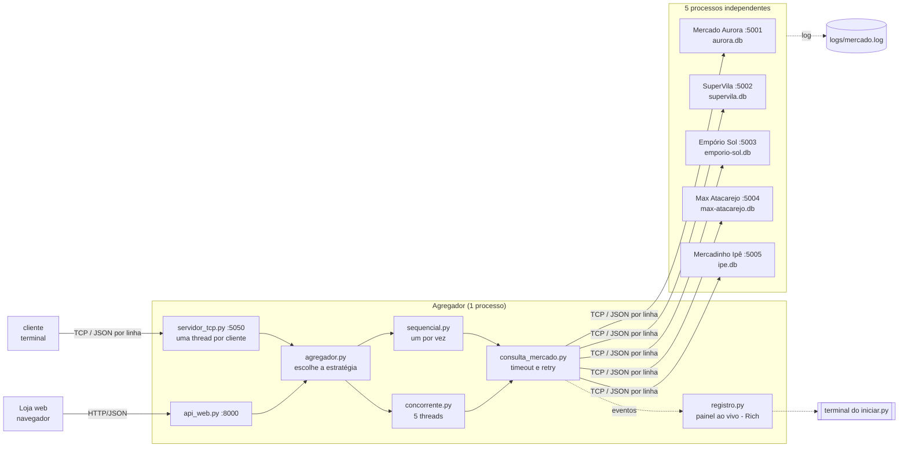
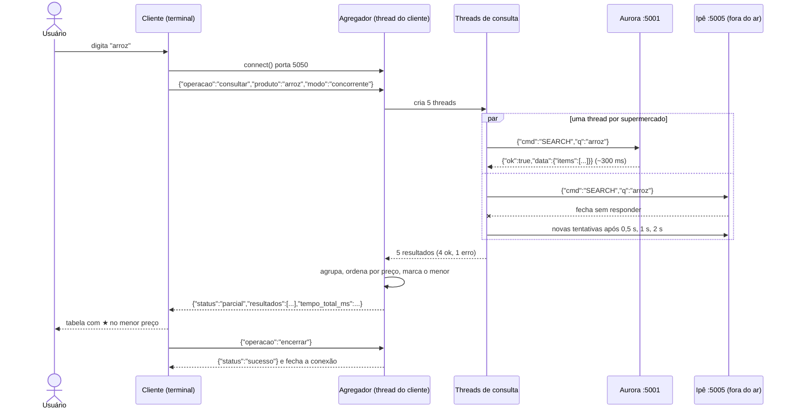
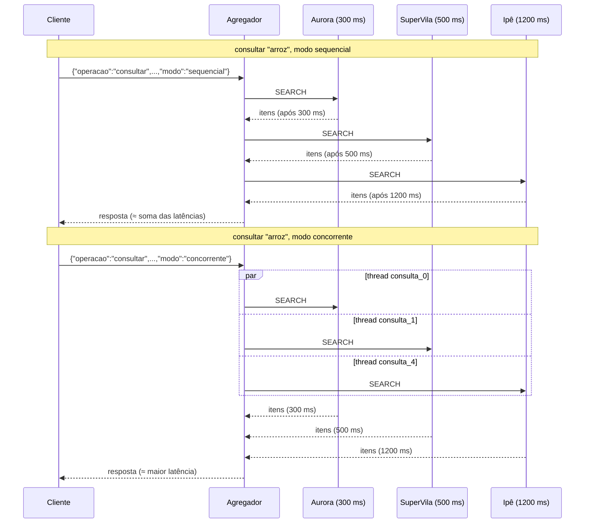

# Arquitetura

## Visão geral

Figura: `docs/relatorio/figuras/fig-02-arquitetura.png` (gerada por `scripts/diagramas.py`).

Os três componentes pedidos na seção 6 do enunciado:

| Componente | Processo | Porta |
|---|---|---|
| **Cliente** | `cliente/` (terminal, TCP) ou a loja web (navegador, HTTP) | — |
| **Agregador** | `agregador.api_web` (servidor TCP + FastAPI no mesmo processo) | 5050 (TCP), 8000 (HTTP) |
| **Serviços independentes** | 5 × `mercados.servidor`, um processo por supermercado | 5001–5005 (TCP) |



Os protocolos do sistema:

| Trecho | Protocolo | Por quê |
|---|---|---|
| Cliente de terminal → agregador | **TCP puro**, uma mensagem JSON por linha (`operacao`, `produto`...) | Requisito do trabalho: cliente e agregador são processos distintos que conversam por socket. Formato do enunciado (seção 8). |
| Loja web → agregador | HTTP/1.1 + JSON | Três rotas simples (busca, cesta, mercados). |
| Agregador → mercados | **TCP puro**, uma mensagem JSON por linha | Requisito do trabalho; mostra o que o HTTP esconde (fronteiras de mensagem, timeouts, conexão recusada). |

A web é só a vitrine da loja. O que acontece por trás de cada pesquisa (conexões, threads, tempos, novas tentativas, falhas) é mostrado no painel ao vivo que o agregador desenha no terminal do `iniciar.py`.

## Componentes

| Arquivo | Responsabilidade |
|---|---|
| `comum/config.py` | Lista dos mercados (id, nome, porta, latência inicial, perfil de preço), timeout e retry. |
| `comum/protocolo.py` | Protocolo: cada mensagem é um JSON numa linha. `send` / `receive`. |
| `mercados/catalogo.py` | Catálogo gerado: 95 tipos × 10 marcas fictícias × sabores × tamanhos = 1.740 SKUs. |
| `mercados/gerar_bancos.py` | Gera um SQLite por mercado (sortimento próprio, preço, estoque e EAN). |
| `mercados/banco.py` | Consultas SQL de um mercado (busca e cesta). |
| `mercados/servidor.py` | Servidor TCP de um mercado (`socketserver.ThreadingTCPServer`): uma thread por conexão. Simula latência e queda; devolve em cada resposta a thread que atendeu; grava uma linha por consulta em `logs/<mercado>.log`. |
| `agregador/consulta_mercado.py` | `query_market`: conecta, envia, espera a resposta e mede. Se o mercado está fora do ar, tenta de novo (0,5 s → 1 s → 2 s). Nunca lança exceção. |
| `agregador/sequencial.py` | `consultar()`: um laço `for`; pergunta a um mercado, espera, passa ao próximo. |
| `agregador/concorrente.py` | `consultar()`: `ThreadPoolExecutor` com uma thread por mercado; `submit` dispara todas, `result` espera. |
| `agregador/agregador.py` | `Aggregator.execute`: escolhe a estratégia (dicionário `ESTRATEGIAS`), mede o tempo e avisa o `registro`. Também `markets_status` e `configure_market` (STATUS/CONFIG por TCP). |
| `agregador/registro.py` | Painel ao vivo no terminal (Rich): um quadro por pesquisa, com uma barra por mercado redesenhada 12 vezes por segundo, e uma linha de status com os mercados e os clientes conectados. Recebe os eventos de qualquer thread (trava). `SILENCIOSO=1` desliga. |
| `agregador/servidor_tcp.py` | Servidor TCP do agregador (porta 5050): operações `consultar`, `comparar`, `cesta`, `mercados`, `configurar`, `encerrar`. Uma thread por cliente (`cliente-1`, `cliente-2`...). |
| `agregador/consolidacao.py` | Junta as ofertas: menor preço, ordenação, paginação, cesta mais barata. |
| `agregador/api_web.py` | As 3 rotas da loja; ao iniciar, liga o servidor TCP da porta 5050 no mesmo processo. |
| `iniciar.py` | Sobe os 5 mercados (log de cada um em `logs/`) e o agregador (dono do terminal, onde desenha o painel); encerra tudo no Ctrl+C. |
| `cliente/` | Cliente de terminal: abre uma conexão TCP com o agregador e a mantém durante a sessão. Classe `ClienteAgregador` reaproveitada pelos experimentos. |
| `experimentos/` | Executa os 5 experimentos obrigatórios pelo cliente TCP e gera CSV, tabelas e gráficos. |
| `frontend/` | React + TypeScript + Tailwind. Só a loja: busca, produto, cesta e o seletor Sequencial / Concorrente. |

## Modelo de threads

```mermaid
flowchart TB
    subgraph Agregador
        AP[Pool de threads do FastAPI<br/>pedido-http]
        TA[Servidor TCP :5050<br/>thread accept + cliente-1, cliente-2...]
        TP[ThreadPoolExecutor<br/>consulta_0 … consulta_4]
    end
    subgraph "Cada mercado"
        AC[Thread principal<br/>accept()]
        H1[Thread da conexão 1]
        H2[Thread da conexão 2]
    end
    AP -- modo concorrente --> TP
    TA -- modo concorrente --> TP
    TP -- connect --> AC
    AC -- cria --> H1 & H2
```

- O servidor TCP do agregador roda numa thread própria (`serve_forever`), que só faz `accept()`. Cada cliente conectado ganha uma thread (`cliente-1`, `cliente-2`...), que lê os pedidos daquele cliente, um por vez, até ele encerrar. Com 8 clientes conectados há 8 dessas threads, e cada uma pode criar mais 5 no modo concorrente (Experimento 4).
- As rotas da loja são funções `def`; o FastAPI as roda num pool de threads (`pedido-http` no painel).
- No **modo sequencial**, a própria thread do pedido faz as 5 consultas em sequência; o painel mostra uma escada de barras, sempre a mesma thread, e "1 thread (a do pedido)" no rodapé.
- No **modo concorrente**, a thread do pedido cria um `ThreadPoolExecutor` com 5 workers (`consulta_0` a `consulta_4`), dispara as 5 consultas com `submit` e espera os resultados; o painel mostra as 5 barras saindo juntas e "5 threads de consulta" no rodapé.
- Os eventos de cada consulta chegam ao `registro.py` direto da thread que os gerou e atualizam o estado do painel sob uma trava (`threading.RLock`); uma thread do Rich redesenha o painel 12 vezes por segundo a partir desse estado. Quando a pesquisa termina, o quadro final é impresso acima da área ao vivo e fica no histórico do terminal.
- No mercado, o `accept()` roda na thread principal e cada conexão ganha uma `threading.Thread` (`Thread-7`, que o mercado devolve na resposta e o painel mostra ao lado da thread do agregador). Assim, o mercado atende consultas simultâneas, por exemplo de vários clientes ao mesmo tempo. O SQLite abre uma conexão por requisição, porque o objeto de conexão não pode ser compartilhado entre threads.

## Sequência de uma pesquisa (cliente de terminal, modo concorrente)

Figura: `docs/relatorio/figuras/fig-12-sequencia.png`.



## Sequência: sequencial × concorrente



## Decisões de projeto

- **Latência simulada.** Em `localhost`, uma consulta TCP leva menos de 1 ms e a diferença entre os modos desapareceria no ruído. Cada mercado dorme um tempo configurável (±15% de variação) antes de responder, imitando servidores remotos. A latência pode ser alterada em tempo de execução pelo comando `CONFIG`.
- **Uma conexão por consulta.** O cliente abre, usa e fecha a conexão. É simples, deixa explícito o custo do `connect` e evita compartilhar sockets entre threads. O servidor aceita várias mensagens na mesma conexão, então uma evolução com pool de conexões é possível.
- **Erros como dados.** `query_market` nunca levanta exceção: timeout, conexão recusada e mercado fora do ar viram `MarketResult(ok=False, error=...)`. A estratégia concorrente nunca perde as respostas boas por causa de uma ruim.
- **Servidor TCP e HTTP no mesmo processo.** O agregador é um processo só, com as duas portas, e as pesquisas do cliente de terminal e da loja aparecem no mesmo log. O servidor TCP também roda sozinho (`python -m agregador.servidor_tcp`), sem a parte web.
- **Web simples, detalhes no terminal.** A loja só mostra os produtos, os preços e o tempo total. O passo a passo de cada pesquisa fica num painel ao vivo no terminal (Rich): barras que crescem em tempo real, na mesma régua, mostram a escada do sequencial e as barras juntas do concorrente, sem depender de navegador. Os mercados gravam o log em arquivo para não disputar o terminal com o painel.
- **Uma estratégia por arquivo.** `sequencial.py` e `concorrente.py` têm a mesma assinatura (`consultar(mercados, pedido)`), então dá para compará-los lado a lado; o resto do agregador não muda conforme o modo.
- **Conexão persistente no cliente, curta nos mercados.** O cliente de terminal mantém uma conexão durante a sessão (evita um handshake por pesquisa e mostra o servidor atendendo vários pedidos na mesma conexão). Do agregador para os mercados é uma conexão por consulta, como descrito acima.
- **"Fora do ar" sem matar o processo.** O mercado continua aceitando conexões, mas fecha as de consulta sem responder, inclusive as que estavam esperando a latência quando ele caiu (a espera é um `threading.Event`, acordado na hora da queda); os comandos administrativos (`CONFIG`, `STATUS`) continuam funcionando para trazê-lo de volta. Para simular o processo morto de verdade, basta encerrar o processo: o agregador recebe "conexão recusada".
- **Bancos de tamanho realista.** Cada mercado guarda de 1.369 a 1.689 produtos. Uma busca pelo catálogo inteiro trafega cerca de 1,5 MB pelos cinco sockets, e o agregador junta perto de 7.700 ofertas antes de paginar.
- **Medições.** O agregador mede o tempo total e o de cada mercado (`time.perf_counter()`) e conta quantas threads distintas conversaram com os mercados (1 no sequencial, 5 no concorrente). Os números para o relatório vêm do `experimentos/`, que grava tudo em CSV.
- **Sem ORM no front.** Quem acessa o SQLite é o Python de cada mercado; o navegador só conversa com o agregador por HTTP.
