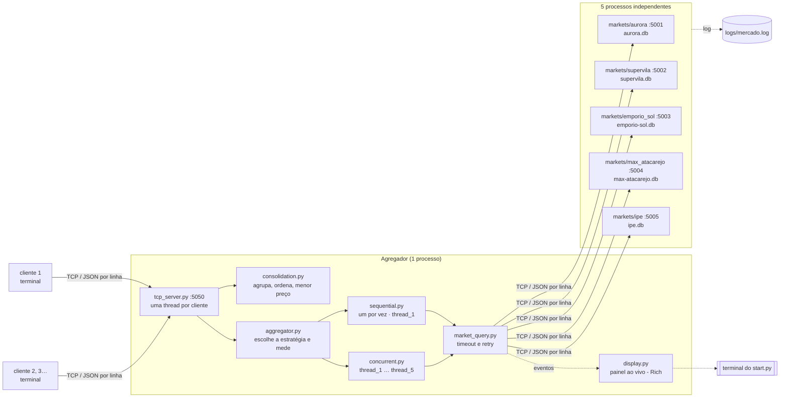
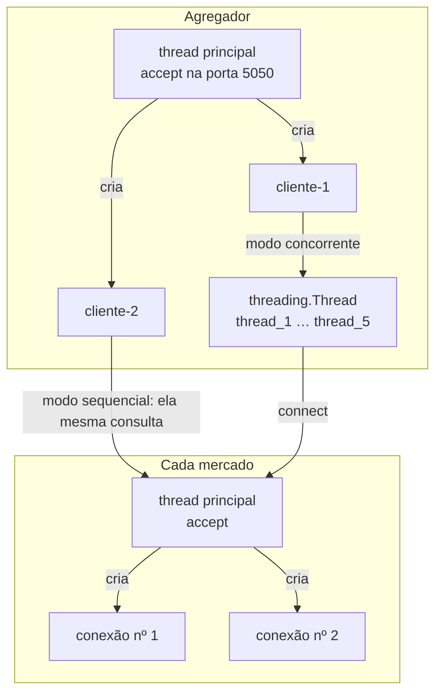
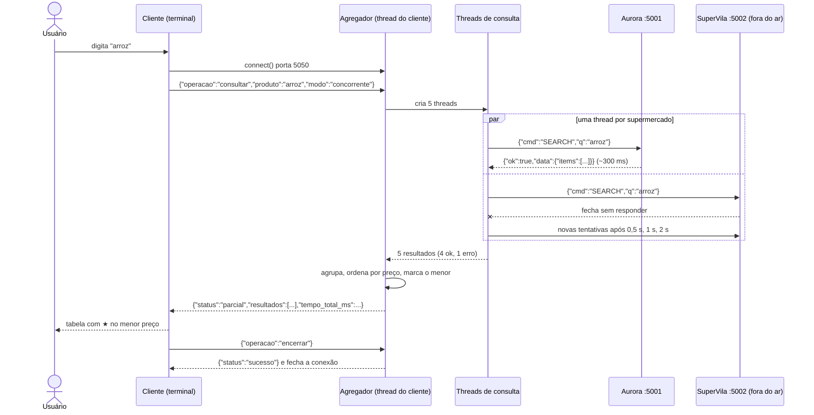
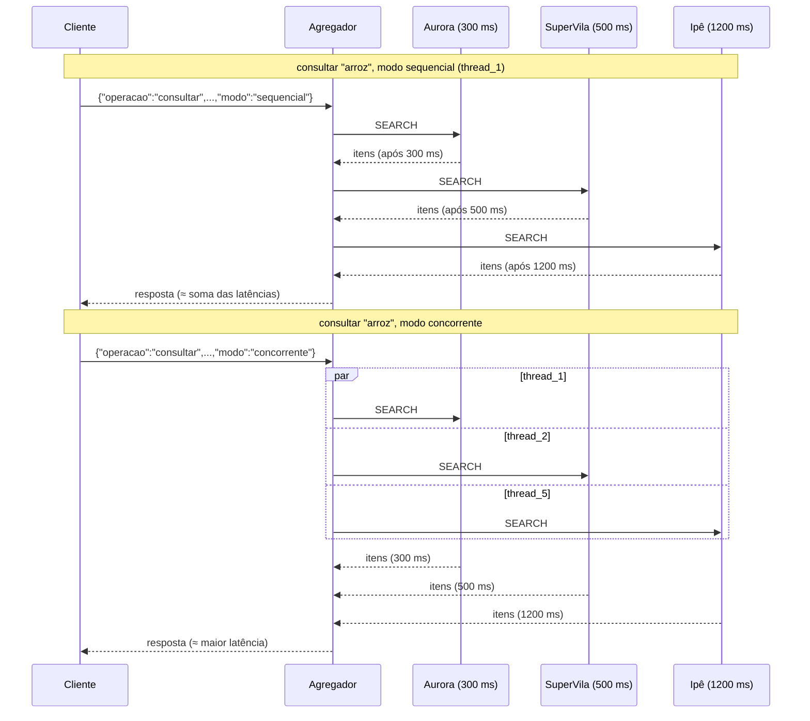

# Arquitetura

## Visão geral

Figura: `docs/relatorio/figuras/fig-02-arquitetura.png` (gerada por `scripts/diagrams.py`).

Os três componentes pedidos na seção 6 do enunciado, todos processos separados que conversam só por sockets TCP:

| Componente | Processo | Porta |
|---|---|---|
| **Cliente** | `python -m client` (terminal). Vários podem estar abertos ao mesmo tempo. | — |
| **Agregador** | `python -m aggregator.tcp_server` | 5050 (TCP) |
| **Serviços independentes** | 5 × `python -m markets.<mercado>`, um processo por supermercado, cada um com a própria pasta | 5001–5005 (TCP) |

O `start.py` sobe os seis servidores, gera os bancos na primeira vez e encerra tudo em ordem no Ctrl+C.



Os dois trechos de rede usam TCP puro, com uma mensagem JSON por linha (`docs/protocolo.md`):

| Trecho | Mensagens | Conexão |
|---|---|---|
| Cliente → agregador | formato do enunciado: `{"operacao": "consultar", "produto": "arroz", ...}` | persistente: aberta no início da sessão, várias operações, fechada com `encerrar` |
| Agregador → mercados | comandos curtos: `{"cmd": "SEARCH", "q": "arroz"}` | uma por consulta: connect, pergunta, resposta, close |

O que acontece por trás de cada pesquisa (conexões, threads, tempos, novas tentativas, falhas) aparece no terminal do `start.py`, em duas versões: o painel gráfico (padrão) e o modo cru (`--raw`), com uma linha por evento TCP dos dois lados.

## Estrutura de pastas

```
start.py                 sobe os 5 mercados e o agregador; Ctrl+C encerra tudo em ordem
common/                  o que todos os processos compartilham
  config.py              mercados (id, nome, porta, latência, pasta), timeout e retry
  protocol.py            send / receive: uma mensagem JSON por linha
  watchdog.py            encerra o processo filho se o start.py morrer
client/                  cliente de terminal
  connection.py          AggregatorClient: a conexão TCP com o agregador
  terminal.py            comandos (/seq, /con, /compare, /markets…) e exibição
aggregator/              o agregador
  tcp_server.py          servidor TCP da porta 5050: uma thread por cliente
  operations.py          as operações do cliente (consultar, comparar, ...), sem socket
  aggregator.py          escolhe a estratégia, mede o tempo, STATUS/CONFIG dos mercados
  sequential.py          estratégia sequencial: um mercado de cada vez
  concurrent.py          estratégia concorrente: uma thread por mercado
  market_query.py        uma consulta a um mercado: connect, send, receive, retry
  consolidation.py       junta as ofertas, ordena por preço, menor preço
  display.py             painel ao vivo (gráfico ou --raw)
markets/<mercado>/       um supermercado (código duplicado de propósito: são serviços independentes)
  server.py              servidor TCP: uma thread por conexão, latência e queda simuladas
  database.py            consultas SQL ao banco do próprio mercado
  <id>.db                o banco SQLite do mercado
tools/                   catálogo fictício e geração dos bancos
experiments/             os 5 experimentos obrigatórios, um arquivo cada
tests/                   49 testes pytest
scripts/                 diagramas e geração do relatório (DOCX/PDF)
```

## Componentes

| Arquivo | Responsabilidade |
|---|---|
| `common/config.py` | Lista dos mercados (id, nome, porta, latência inicial, perfil de preço, pasta), timeout (3 s) e retry (3 tentativas extras a partir de 0,5 s). |
| `common/protocol.py` | Protocolo: cada mensagem é um JSON numa linha. `send` / `receive`, usados pelos quatro lados. |
| `common/watchdog.py` | Thread que verifica a cada segundo se o `start.py` ainda está vivo; se não, encerra o processo (sem processos órfãos). |
| `tools/catalog.py` | Catálogo gerado: 95 tipos × 10 marcas fictícias × sabores × tamanhos = 1.740 SKUs. |
| `tools/seed_databases.py` | Gera um SQLite por mercado (sortimento próprio, preço, estoque), com semente fixa. |
| `markets/<mercado>/database.py` | Consultas SQL de um mercado (busca sem acentos, ordenada por preço). |
| `markets/<mercado>/server.py` | Servidor TCP de um mercado (`socketserver.ThreadingTCPServer`): cada conexão é atendida por uma thread nova (`conexão nº N`). Simula latência e queda; devolve em cada resposta qual conexão atendeu; grava uma linha por consulta em `logs/<mercado>.log`. |
| `aggregator/market_query.py` | `query_market`: conecta, envia, espera a resposta e mede. Se o mercado está fora do ar, tenta de novo (0,5 s → 1 s → 2 s). Nunca lança exceção. |
| `aggregator/sequential.py` | `search()`: um laço `for` na thread do próprio pedido (`thread_1`); pergunta a um mercado, espera, passa ao próximo. |
| `aggregator/concurrent.py` | `search()`: cria um `threading.Thread` por mercado (`thread_1` … `thread_5`); `start()` dispara todas, `join()` espera. |
| `aggregator/aggregator.py` | `Aggregator.execute`: escolhe a estratégia (dicionário `STRATEGIES`), mede o tempo e avisa o painel. Também `markets_status` e `configure_market` (STATUS/CONFIG por TCP). |
| `aggregator/consolidation.py` | Junta as ofertas dos cinco mercados por produto, ordena por preço e marca o menor. Funções puras, sem rede. |
| `aggregator/tcp_server.py` | Servidor TCP do agregador (porta 5050); as operações `consultar`, `comparar`, `mercados`, `configurar`, `encerrar` ficam em `operations.py`. Uma thread por cliente (`cliente-1`, `cliente-2`…). No Ctrl+C, espera as pesquisas em andamento. |
| `aggregator/display.py` | Painel no terminal (Rich). Gráfico: um quadro por pesquisa, com uma barra por mercado que cresce ao vivo; os quadros terminados ficam no histórico rolável. Raw: uma linha por evento (connect com a porta local, envio, resposta, close, nova tentativa). `QUIET=1` desliga. |
| `client/connection.py` | `AggregatorClient`: abre a conexão TCP com o agregador e a mantém durante a sessão. Reaproveitado pelos experimentos. |
| `client/terminal.py` | Interface do cliente: pesquisa e os comandos `/seq`, `/con`, `/compare`, `/markets`, `/down`, `/up`, `/latency`, `/json`, `/help`, `/exit`. |
| `experiments/` | Os 5 experimentos obrigatórios (`exp1_sequential.py` … `exp5_unavailability.py`) e o que eles compartilham (`shared.py`). Medem pelo cliente TCP e geram CSV, tabelas e gráficos. |

## Modelo de threads

Há dois níveis de concorrência, e é importante não confundi-los:

| Nível | Quem cria as threads | Quantas | Muda com o modo? |
|---|---|---|---|
| Entre clientes | `ThreadingTCPServer` do agregador | uma por cliente conectado | não: é sempre assim, nos dois modos |
| Dentro de uma pesquisa | a estratégia escolhida | sequencial: nenhuma nova (`thread_1` é a do pedido); concorrente: 5 | **sim**: é isso que os modos comparam |
| Em cada mercado | `ThreadingTCPServer` do mercado | uma por conexão recebida | não |



- A thread principal do agregador só faz `accept()`. Cada cliente conectado ganha uma thread (`cliente-1`, `cliente-2`…), que lê os pedidos daquele cliente, um por vez, até ele encerrar. Por isso dois clientes no modo sequencial são atendidos ao mesmo tempo: cada um tem a sua thread, e cada thread faz a sua pesquisa sequencial (Experimento 4).
- No **modo sequencial**, a própria thread do pedido (renomeada `thread_1`) faz as 5 consultas em sequência; o painel mostra uma escada de barras, sempre a mesma thread, e "1 thread: a do próprio pedido" no rodapé.
- No **modo concorrente**, a thread do pedido cria 5 `threading.Thread` (`thread_1` a `thread_5`), dispara as 5 consultas com `start()` e espera com `join()`; o painel mostra as 5 barras saindo juntas e "5 threads novas; o pedido só espera" no rodapé.
- Os eventos de cada consulta chegam ao `display.py` direto da thread que os gerou e atualizam o estado do painel sob uma trava (`threading.RLock`); uma thread do painel redesenha a parte ao vivo 12 vezes por segundo a partir desse estado. Quando a pesquisa termina, o quadro final vai para o histórico do terminal.
- No mercado, o `accept()` roda na thread principal e cada conexão ganha uma thread (`conexão nº 7`, que o mercado devolve na resposta e o painel mostra ao lado da thread do agregador). Assim, o mercado atende consultas simultâneas de vários clientes. O SQLite abre uma conexão por requisição, porque o objeto de conexão não pode ser compartilhado entre threads.

## Sequência de uma pesquisa (modo concorrente, um mercado fora do ar)

Figura: `docs/relatorio/figuras/fig-12-sequencia.png`.



## Sequência: sequencial × concorrente



## Decisões de projeto

- **Só TCP explícito.** Não há HTTP nem interface web: cliente, agregador e mercados conversam apenas por sockets TCP com o protocolo próprio. Assim, tudo o que o enunciado pede (fronteiras de mensagem, timeouts, conexão recusada, encerramento) fica visível no código e no painel.
- **Um supermercado por pasta.** Cada mercado tem o próprio `server.py`, `database.py` e banco, mesmo que o código seja quase igual. Fica evidente que são serviços independentes, que poderiam ser escritos por equipes diferentes ou rodar em outras máquinas.
- **Latência simulada.** Em `localhost`, uma consulta TCP leva menos de 1 ms e a diferença entre os modos desapareceria no ruído. Cada mercado espera um tempo configurável (±15% de variação) antes de responder, imitando servidores remotos. A latência pode ser alterada em tempo de execução pelo comando `CONFIG`.
- **Uma conexão por consulta aos mercados.** O agregador abre, usa e fecha a conexão. É simples, deixa explícito o custo do `connect` e evita compartilhar sockets entre threads.
- **Conexão persistente no cliente.** O cliente de terminal mantém uma conexão durante a sessão: evita um handshake por pesquisa e mostra o servidor atendendo vários pedidos na mesma conexão.
- **Erros como dados.** `query_market` nunca levanta exceção: timeout, conexão recusada e mercado fora do ar viram `MarketResult(ok=False, error=...)`. A estratégia concorrente nunca perde as respostas boas por causa de uma ruim.
- **Uma estratégia por arquivo.** `sequential.py` e `concurrent.py` têm a mesma assinatura (`search(markets, payload, emit, t0)`), então dá para compará-los lado a lado; o resto do agregador não muda conforme o modo.
- **O servidor é sempre multithread.** Atender vários clientes ao mesmo tempo (RNF03) vale para os dois modos; o modo só muda como uma pesquisa consulta os mercados. Usar um servidor de uma thread só no modo sequencial misturaria duas variáveis nos experimentos.
- **"Fora do ar" sem matar o processo.** O mercado continua aceitando conexões, mas fecha as de consulta sem responder, inclusive as que estavam esperando a latência quando ele caiu (a espera é um `threading.Event`, acordado na hora da queda); os comandos administrativos (`CONFIG`, `STATUS`) continuam funcionando para trazê-lo de volta. Para simular o processo morto de verdade, basta encerrar o processo: o agregador recebe "conexão recusada".
- **Encerramento em ordem.** O Ctrl+C chega só ao `start.py` (os filhos rodam em outra sessão). Ele avisa o agregador, que para de aceitar clientes, espera as pesquisas em andamento e fecha; só então os mercados são encerrados. Se o `start.py` morrer de repente, o `watchdog` de cada filho percebe e encerra o processo.
- **Bancos de tamanho realista.** Cada mercado guarda de 1.369 a 1.689 produtos. Uma busca pelo catálogo inteiro trafega cerca de 1,5 MB pelos cinco sockets.
- **Medições.** O agregador mede o tempo total e o de cada mercado (`time.perf_counter()`) e conta quantas threads distintas conversaram com os mercados (1 no sequencial, 5 no concorrente). Os números para o relatório vêm de `experiments/`, que grava tudo em CSV.
