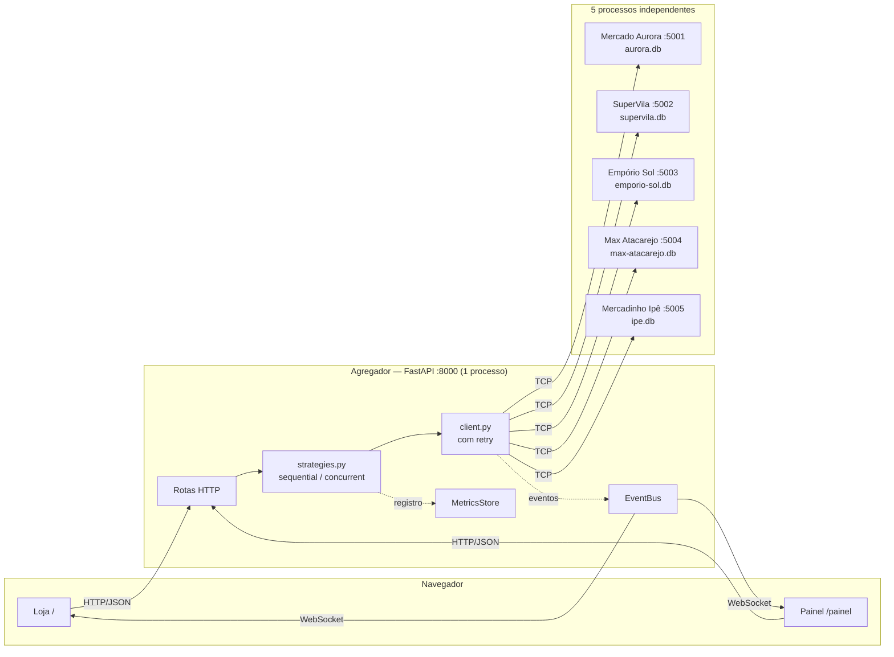
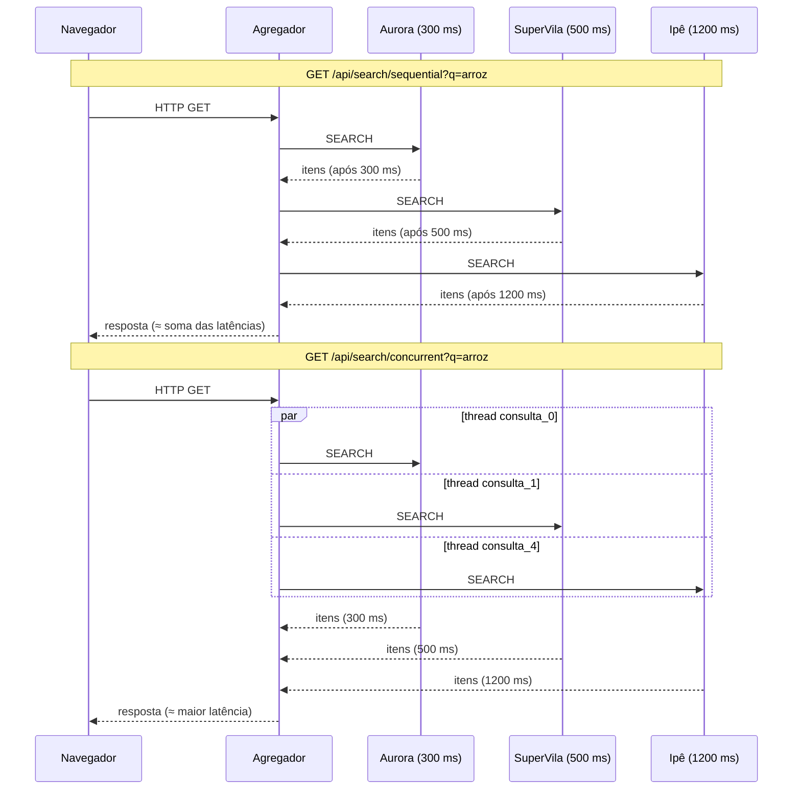

# Arquitetura

## Visão geral



Três protocolos aparecem no sistema:

| Trecho | Protocolo | Por quê |
|---|---|---|
| Navegador → agregador | HTTP/1.1 + JSON | Rotas REST simples, fáceis de testar no navegador e no `/docs` do FastAPI. |
| Agregador → mercados | **TCP puro**, uma mensagem JSON por linha | Requisito do trabalho; mostra o que o HTTP esconde (fronteiras de mensagem, timeouts, conexão recusada). |
| Agregador → painel | WebSocket | Empurra eventos assim que acontecem, sem o navegador ficar perguntando. |

## Componentes

| Arquivo | Responsabilidade |
|---|---|
| `backend/config.py` | Lista dos mercados (id, nome, porta, latência inicial, perfil de preço), timeout e retry. |
| `backend/protocol.py` | Protocolo: cada mensagem é um JSON numa linha. `send` / `receive`. |
| `backend/markets/catalog.py` | Catálogo gerado: 95 tipos × 10 marcas fictícias × sabores × tamanhos = 1.740 SKUs. |
| `backend/markets/seed.py` | Gera um SQLite por mercado (sortimento próprio, preço, estoque e EAN). |
| `backend/markets/database.py` | Consultas SQL de um mercado (busca e cesta). |
| `backend/markets/server.py` | Servidor TCP de um mercado (`socketserver.ThreadingTCPServer`): uma thread por conexão. Simula latência e queda. |
| `backend/aggregator/client.py` | `query_market`: conecta, envia, espera a resposta e mede. Se o mercado está fora do ar, tenta de novo (0,5 s → 1 s → 2 s). Nunca lança exceção. |
| `backend/aggregator/strategies.py` | `sequential()` (um por vez) e `concurrent()` (`ThreadPoolExecutor`, uma thread por mercado). |
| `backend/aggregator/core.py` | `Aggregator.execute`: roda a estratégia, mede tempo/CPU/threads e publica os eventos. |
| `backend/aggregator/compare.py` | Junta as ofertas: menor preço, ordenação, paginação, cesta mais barata. |
| `backend/aggregator/events.py` | Entrega os eventos das threads de consulta aos WebSockets (asyncio). |
| `backend/aggregator/metrics.py` | Histórico em memória, médias e CSV. |
| `backend/aggregator/main.py` | Rotas FastAPI. |
| `backend/run_all.py` | Sobe os 5 mercados e o agregador como subprocessos e encerra tudo no Ctrl+C. |
| `frontend/` | React + TypeScript + Tailwind. Loja, cesta e página "Comparar modos" (corrida, cenários dos mercados, eventos). Nomes e cores dos mercados vêm de `/api/markets`. |

## Modelo de threads

```mermaid
flowchart TB
    subgraph Agregador
        EL[Event loop asyncio<br/>WebSockets]
        AP[Pool de threads do FastAPI<br/>executa as rotas def]
        TP[ThreadPoolExecutor<br/>consulta_0 … consulta_4]
    end
    subgraph "Cada mercado"
        AC[Thread principal<br/>accept()]
        H1[Thread da conexão 1]
        H2[Thread da conexão 2]
    end
    AP -- modo concorrente --> TP
    TP -- connect --> AC
    AC -- cria --> H1 & H2
    TP -. call_soon_threadsafe .-> EL
```

- As rotas de consulta são funções `def` (não `async`). O FastAPI as roda num pool de threads, e as esperas de socket não travam o event loop que serve os WebSockets.
- No **modo sequencial**, a própria thread da rota faz as 5 consultas em sequência (o painel mostra "Threads usadas: 1").
- No **modo concorrente**, a rota cria um `ThreadPoolExecutor` com 5 workers; cada um faz uma consulta, e `as_completed` recolhe as respostas na ordem em que chegam ("Threads usadas: 5").
- Os eventos são gerados nessas threads e entregues ao event loop com `loop.call_soon_threadsafe`, a forma segura de falar com o asyncio a partir de outra thread.
- No mercado, o `accept()` roda na thread principal e cada conexão ganha uma `threading.Thread`. Assim, o mercado atende consultas simultâneas (por exemplo, duas abas fazendo busca ao mesmo tempo). O SQLite abre uma conexão por requisição, porque o objeto de conexão não pode ser compartilhado entre threads.

## Sequência: sequencial × concorrente



## Decisões de projeto

- **Latência simulada.** Em `localhost`, uma consulta TCP leva menos de 1 ms e a diferença entre os modos desapareceria no ruído. Cada mercado dorme um tempo configurável (±15% de variação) antes de responder, imitando servidores remotos. A latência pode ser alterada em tempo de execução pelo comando `CONFIG`.
- **Uma conexão por consulta.** O cliente abre, usa e fecha a conexão. É simples, deixa explícito o custo do `connect` e evita compartilhar sockets entre threads. O servidor aceita várias mensagens na mesma conexão, então uma evolução com pool de conexões é possível.
- **Erros como dados.** `query_market` nunca levanta exceção: timeout, conexão recusada e mercado fora do ar viram `MarketResult(ok=False, error=...)`. A estratégia concorrente nunca perde as respostas boas por causa de uma ruim.
- **"Fora do ar" sem matar o processo.** O mercado continua aceitando conexões, mas fecha as de consulta sem responder; os comandos administrativos (`CONFIG`, `STATUS`) continuam funcionando para trazê-lo de volta. Para simular o processo morto de verdade, basta encerrar o processo: o agregador recebe "conexão recusada".
- **Bancos de tamanho realista.** Cada mercado guarda de 1.369 a 1.689 produtos. Uma busca pelo catálogo inteiro trafega cerca de 1,5 MB pelos cinco sockets, e o agregador junta perto de 7.700 ofertas antes de paginar.
- **Medição de recursos.** Cada mercado devolve, junto com a resposta, a CPU gasta pela thread que a atendeu (`time.thread_time()`, que não conta o sleep da latência). O agregador mede a CPU do próprio processo durante a requisição (`psutil`), o pico de threads (`threading.active_count()` a cada evento) e a memória residente, e grava tudo no registro da requisição.
- **Métricas em memória.** Suficiente para a demonstração; o CSV preserva os dados para o relatório.
- **Sem ORM no front.** Quem acessa o SQLite é o Python de cada mercado; o navegador só conversa com o agregador por HTTP e WebSocket.
