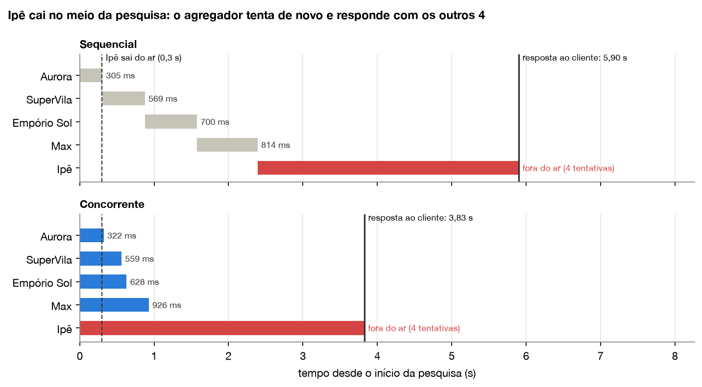

# Experimentos

Este documento cobre a seção 9 do enunciado: os cinco experimentos obrigatórios, com tabelas, gráficos, comparação entre as estratégias, discussão e conclusões sobre multithreading.

## Como reproduzir

Com o sistema no ar sem o painel (`python3.12 start.py --quiet`), em outro terminal, da raiz do projeto:

```bash
python3.12 -m experiments
```

O script leva cerca de 6 minutos e faz tudo pelo caminho real: **cliente → TCP → agregador → TCP → 5 mercados**. Ele usa a mesma classe do cliente de terminal (`AggregatorClient`), muda a latência e a disponibilidade dos mercados com a operação `configurar` (também por TCP) e, no fim, devolve os mercados à configuração padrão.

Cada experimento é um arquivo e também roda sozinho:

| Experimento | Arquivo | Rodar sozinho |
|---|---|---|
| 1 — consulta sequencial | `experiments/exp1_sequential.py` | `python3.12 -m experiments.exp1_sequential` |
| 2 — consulta concorrente | `experiments/exp2_concurrent.py` | `python3.12 -m experiments.exp2_concurrent` |
| 3 — simulação de latência | `experiments/exp3_latency.py` | `python3.12 -m experiments.exp3_latency` |
| 4 — múltiplos clientes | `experiments/exp4_multiple_clients.py` | `python3.12 -m experiments.exp4_multiple_clients` |
| 5 — indisponibilidade | `experiments/exp5_unavailability.py` | `python3.12 -m experiments.exp5_unavailability` |

| Saída | Conteúdo |
|---|---|
| `docs/relatorio/dados/exp1-sequencial.csv`, `exp2-concorrente.csv` | Experimentos 1 e 2, uma linha por pesquisa |
| `docs/relatorio/dados/exp3-latencia.csv` | Experimento 3, uma linha por pesquisa |
| `docs/relatorio/dados/exp4-multiplos-clientes.csv` | Experimento 4, uma linha por pesquisa e uma por lote (cliente 0 = tempo total) |
| `docs/relatorio/dados/exp5-indisponibilidade.csv` e `exp5-gantt.csv` | Experimento 5 e os tempos de cada mercado na pesquisa do gráfico |
| `docs/relatorio/dados/resultados-experimentos.md` | As tabelas abaixo, geradas a partir dos CSV |
| `docs/relatorio/figuras/fig-08` a `fig-11` | Os quatro gráficos |

`--analyze` refaz só tabelas e gráficos a partir dos CSV; `--only 4 5` mede só alguns experimentos; `--quick` faz poucas rodadas, só para testar.

## Ambiente e método

- MacBook com Apple M1 (8 núcleos), macOS, Python 3.12; todos os processos em `127.0.0.1`.
- Cinco mercados, cada um num processo, com latência simulada de ±15% em torno do valor configurado. Latências padrão: Aurora 300 ms, SuperVila 500 ms, Empório Sol 700 ms, Max Atacarejo 900 ms, Mercadinho Ipê 1200 ms.
- Pesquisa "arroz": 220 ofertas somando os cinco mercados.
- Timeout de 3 s por mercado; quando a conexão é recusada ou fechada sem resposta, até 3 novas tentativas, esperando 0,5 s, 1 s e 2 s.
- **Tempo medido:** o agregador mede cada pesquisa com `time.perf_counter()`, do início da primeira consulta até a última resposta (`tempo_total_ms`). O cliente também mede o tempo que viu, incluindo a ida e volta TCP até o agregador; a diferença ficou perto de 10 ms.
- **Ordem alternada:** nos experimentos com os dois modos, a ordem alterna a cada rodada (sequencial → concorrente, depois concorrente → sequencial), para que nenhum modo seja favorecido por cache ou aquecimento.
- **Modelo esperado:** com latências l₁ … lₙ, o sequencial deve levar cerca de **l₁ + … + lₙ** e o concorrente cerca de **max(l₁ … lₙ)**. O speedup máximo é a soma dividida pelo máximo.

Medições de 14/11/2026.

## Experimentos 1 e 2 — consulta sequencial e consulta concorrente

**Objetivo:** consultar os cinco mercados um após o outro (Exp. 1) e todos ao mesmo tempo com threads (Exp. 2), registrando o tempo total. 10 rodadas de cada, latências padrão.

| Experimento | Modo | Média | Mín. | Máx. | Desvio padrão | Visto pelo cliente | Previsto |
|---|---|---|---|---|---|---|---|
| 1 | Sequencial | 3,65 s | 3,43 s | 3,92 s | 177 ms | 3,66 s | 3,60 s (soma) |
| 2 | Concorrente | 1,19 s | 1,03 s | 1,32 s | 113 ms | 1,20 s | 1,20 s (maior) |

**Speedup médio: 3,1×** (limite teórico com essas latências: 3,6 ÷ 1,2 = 3,0×).


- O sequencial ficou 1,4% acima da soma das latências: além da espera, cada mercado gasta alguns milissegundos com conexão, SQLite e JSON, e esses custos também se somam.
- O concorrente ficou na maior latência (a do Mercadinho Ipê). Em algumas rodadas ficou abaixo de 1,2 s porque a latência de cada mercado varia ±15%; por isso o speedup medido passou um pouco do teórico.
- O concorrente foi mais rápido em todas as rodadas, sem sobreposição entre as faixas (pior concorrente 1,32 s; melhor sequencial 3,43 s).

## Experimento 3 — simulação de latência

**Objetivo:** configurar atrasos artificiais nos mercados e comparar os dois modos. 5 rodadas por cenário.

| Cenário | Latências | Sequencial | Previsto (soma) | Concorrente | Previsto (maior) | Speedup |
|---|---|---|---|---|---|---|
| Sem atraso | 0 ms em todos | 10 ms | 0 ms | 3 ms | 0 ms | 3,0× |
| 200 ms | 200 ms em todos | 1,02 s | 1,00 s | 231 ms | 200 ms | 4,4× |
| 500 ms | 500 ms em todos | 2,48 s | 2,50 s | 562 ms | 500 ms | 4,4× |
| 1000 ms | 1000 ms em todos | 5,05 s | 5,00 s | 1,09 s | 1,00 s | 4,6× |
| Padrão | 300 a 1200 ms | 3,65 s | 3,60 s | 1,18 s | 1,20 s | 3,1× |
| Um lento | padrão, Ipê com 2500 ms | 4,87 s | 4,90 s | 2,56 s | 2,50 s | 1,9× |
| Um em timeout | padrão, Ipê com 4000 ms | 5,43 s | 5,40 s | 3,00 s | 3,00 s | 1,8× |

O previsto limita cada latência ao timeout de 3 s.


- **Latências iguais dão o maior ganho.** Com cinco mercados iguais o limite teórico é 5×; o medido ficou entre 4,4× e 4,6×. O concorrente espera o mais lento de cinco sorteios de ±15%, que tende a ficar acima da média (1,09 s com 1000 ms configurados).
- **Latências diferentes reduzem o ganho.** No cenário padrão, o speedup é 3,6 ÷ 1,2 = 3,0×; o medido foi 3,1×.
- **Um mercado lento domina o concorrente.** Com o Ipê em 2500 ms, o concorrente passa a esperar só por ele (2,56 s) e o ganho cai para 1,9×.
- **O timeout limita o estrago.** Com o Ipê em 4000 ms, o agregador desiste aos 3 s: o concorrente responde em 3,00 s com os outros quatro mercados; o sequencial, em 5,43 s (os outros quatro somados mais o timeout). Os dois devolvem os preços dos quatro mercados que responderam.
- **Sem atraso** sobra o trabalho real (TCP, SQLite, JSON), feito em paralelo pelos cinco processos: 10 ms contra 3 ms. Com tempos tão pequenos, poucos milissegundos mudam muito a razão, então esse é o speedup menos estável da tabela (em medições anteriores ficou entre 1,6× e 3×).

## Experimento 4 — múltiplos clientes

**Objetivo:** executar pesquisas simultâneas a partir de clientes diferentes e observar o agregador. Cada cliente é uma conexão TCP própria com o agregador (porta 5050); todos começam juntos (barreira) e cada um faz 3 pesquisas seguidas. De 1 a 32 clientes, nos dois modos, latências padrão.

| Modo | Clientes | Pesquisas | Resposta média | Resposta máx. | Tempo total | Vazão | Falhas |
|---|---|---|---|---|---|---|---|
| Sequencial | 1 | 3 | 3,53 s | 3,64 s | 10,59 s | 0,28 pesquisas/s | 0 |
| Sequencial | 2 | 6 | 3,61 s | 3,86 s | 10,91 s | 0,55 pesquisas/s | 0 |
| Sequencial | 4 | 12 | 3,58 s | 3,91 s | 10,84 s | 1,11 pesquisas/s | 0 |
| Sequencial | 8 | 24 | 3,68 s | 3,92 s | 11,44 s | 2,10 pesquisas/s | 0 |
| Sequencial | 16 | 48 | 3,65 s | 4,00 s | 11,48 s | 4,18 pesquisas/s | 0 |
| Sequencial | 32 | 96 | 3,66 s | 4,00 s | 11,47 s | 8,37 pesquisas/s | 0 |
| Concorrente | 1 | 3 | 1,09 s | 1,12 s | 3,28 s | 0,92 pesquisas/s | 0 |
| Concorrente | 2 | 6 | 1,18 s | 1,35 s | 3,76 s | 1,60 pesquisas/s | 0 |
| Concorrente | 4 | 12 | 1,20 s | 1,31 s | 3,67 s | 3,27 pesquisas/s | 0 |
| Concorrente | 8 | 24 | 1,25 s | 1,37 s | 3,89 s | 6,18 pesquisas/s | 0 |
| Concorrente | 16 | 48 | 1,20 s | 1,38 s | 3,97 s | 12,10 pesquisas/s | 0 |
| Concorrente | 32 | 96 | 1,20 s | 1,41 s | 4,00 s | 23,97 pesquisas/s | 0 |


- **O tempo de cada pesquisa praticamente não muda com mais clientes.** Com 32 clientes, a resposta média foi 1,20 s no concorrente (1,09 s com um cliente) e 3,66 s no sequencial (3,53 s com um). O pior caso subiu cerca de 300 ms no concorrente.
- **A vazão cresce na proporção dos clientes:** 32 clientes completaram 96 pesquisas concorrentes em 4,00 s, 26 vezes a vazão de um cliente só.
- **Por quê:** o agregador atende cada cliente numa thread própria (`ThreadingTCPServer`), e cada mercado atende cada conexão numa thread própria. Com 32 clientes no modo concorrente, há 32 threads de cliente no agregador, cada uma com 5 threads de consulta (160 conexões simultâneas com os mercados), e cada mercado atende 32 consultas ao mesmo tempo. Como quase todo o tempo é espera (a latência simulada), essas threads não disputam CPU.
- **Os dois níveis de concorrência se somam:** entre clientes (threads do servidor) e dentro de cada pesquisa (threads de consulta). Mesmo no modo sequencial, 32 clientes são atendidos ao mesmo tempo (8,37 pesquisas/s, 30 vezes um cliente); o que muda é o tempo de cada um. Um servidor que atendesse um cliente por vez faria o 32º esperar as pesquisas dos outros 31.
- Nenhuma pesquisa falhou e todas tiveram resposta dos 5 mercados.
- **Limite:** com espera simulada, o gargalo não aparece até 32 clientes. Numa carga real, o limite viria da CPU (o GIL do Python serializa o trabalho de JSON no agregador), do número de threads por processo e da fila do `listen()` (64 conexões pendentes).

## Experimento 5 — indisponibilidade de serviço

**Objetivo:** desativar um mercado e observar o tratamento da falha. O alvo é a SuperVila (porta 5002, 500 ms), a segunda na ordem de consulta. Para desativar, o script envia `{"operacao": "configurar", "mercado": "supervila", "online": false}` por uma segunda conexão TCP, no momento indicado. Fora do ar, o mercado fecha as conexões de consulta sem responder, **inclusive as que já estavam em andamento**. 3 rodadas por cenário.

| Cenário | O que acontece | Modo | Tempo médio | Mercados com resposta | Tentativas (SuperVila) | Erro informado |
|---|---|---|---|---|---|---|
| Todos no ar | referência | Sequencial | 3,63 s | 5 de 5 | 1 | — |
| Todos no ar | referência | Concorrente | 1,14 s | 5 de 5 | 1 | — |
| Fora do ar antes | SuperVila sai do ar antes da pesquisa | Sequencial | 6,67 s | 4 de 5 | 4 | fora do ar (4 tentativas) |
| Fora do ar antes | SuperVila sai do ar antes da pesquisa | Concorrente | 3,51 s | 4 de 5 | 4 | fora do ar (4 tentativas) |
| Cai durante | SuperVila sai do ar 0,3 s depois do início | Sequencial | 6,74 s | 4 de 5 | 4 | fora do ar (4 tentativas) |
| Cai durante | SuperVila sai do ar 0,3 s depois do início | Concorrente | 3,82 s | 4 de 5 | 4 | fora do ar (4 tentativas) |
| Cai e volta | SuperVila cai em 0,3 s e volta em 1,0 s | Sequencial | 5,25 s | 5 de 5 | 3 | — |
| Cai e volta | SuperVila cai em 0,3 s e volta em 1,0 s | Concorrente | 2,33 s | 5 de 5 | 3 | — |



- **A pesquisa nunca falha por causa de um mercado.** Em todos os cenários com a SuperVila fora do ar o cliente recebeu os preços dos outros quatro, com `status: "parcial"` e o motivo (`fora do ar (4 tentativas)`).
- **Cai durante, concorrente:** a consulta à SuperVila já estava em andamento (esperando a latência) quando ela caiu. A conexão foi fechada na hora, aos 0,3 s, e o agregador começou as novas tentativas: 0,3 + 0,5 + 1 + 2 = 3,8 s, exatamente o medido (3,82 s). Os outros quatro já tinham respondido em 1,2 s.
- **Cai durante, sequencial:** a SuperVila é a segunda da fila, então a consulta a ela também já estava em andamento (começou logo depois dos ~0,3 s do Aurora). Ela desiste aos 3,8 s, e só então Empório Sol, Max e Ipê são consultados: os 3,5 s das tentativas se somam a todos eles (6,74 s em média).
- **Fora do ar antes:** o concorrente espera só as tentativas (3,5 s); o sequencial soma as tentativas aos outros quatro (6,67 s).
- **Cai e volta:** a 2ª tentativa (0,8 s) encontrou a SuperVila ainda fora do ar; a 3ª (1,8 s) já a encontrou de volta e a resposta veio após a latência dela. No concorrente, a SuperVila passou a decidir o tempo total (2,33 s, contra 1,14 s com todos no ar); no sequencial, a espera das tentativas se somou aos outros (5,25 s, contra 3,63 s).
- **A posição na fila importa no sequencial.** Um mercado que falha no começo da fila atrasa todos os seguintes; no concorrente não existe fila, e a falha custa o mesmo onde quer que o mercado esteja.
- **Custo do retry.** As novas tentativas recuperam um mercado que volta logo, mas, quando ele não volta, custam 3,5 s. No concorrente essa espera corre junto com os outros mercados; no sequencial, ela se soma a eles.
- **Processo parado de verdade** (matar o processo do mercado) produz `ConnectionRefusedError` no `connect()`, tratado da mesma forma ("conexão recusada (4 tentativas)"). Não entrou no script porque o `start.py` encerra tudo quando um processo morre; está coberto pelo teste `test_killed_market_gives_connection_refused` e pode ser mostrado à mão com `kill <pid>` de um mercado rodando sozinho (`python -m markets.supervila`).

## Comparação entre as estratégias

| Aspecto | Sequencial | Concorrente |
|---|---|---|
| Tempo de uma pesquisa | soma das latências (3,65 s) | maior latência (1,19 s) |
| Ganho | — | 3,1× no padrão; até 4,6× com latências iguais |
| Threads por pesquisa no agregador | 1 (a do próprio pedido, `thread_1`) | 1 + 5 (`thread_1` … `thread_5`) |
| Mercado lento (abaixo do timeout) | atrasa a pesquisa inteira pelo tempo dele | a pesquisa passa a durar o tempo dele |
| Mercado em timeout | soma dos outros + 3 s (5,43 s) | 3 s (3,00 s) |
| Mercado fora do ar | soma dos outros + 3,5 s de retry (6,67 s) | 3,5 s de retry (3,51 s) |
| Vários clientes | atendidos ao mesmo tempo; cada um espera a soma | atendidos ao mesmo tempo; cada um espera a maior |
| Vazão com 32 clientes | 8,4 pesquisas/s | 24,0 pesquisas/s |

## Conclusões sobre multithreading

1. **Threads compensam quando a tarefa espera E/S.** Cada consulta passa quase todo o tempo esperando a resposta da rede. Enquanto uma thread está bloqueada em `recv()`, ela libera o GIL do Python e as outras seguem. Por isso cinco threads reduziram o tempo a perto de um terço, como o modelo `soma ÷ máximo` previa.
2. **O ganho tem um teto:** a fonte mais lenta. Nenhum número de threads torna a pesquisa mais rápida que o mercado mais lento (Exp. 3, "Um lento"). Para melhorar além disso seria preciso cache ou responder sem esperar o mais lento.
3. **Sem espera, sobra pouco para ganhar.** Sem latência, a pesquisa inteira leva poucos milissegundos: criar threads e abrir conexões tem custo fixo, e o trabalho de CPU em Python não se paraleliza dentro de um processo por causa do GIL. O ganho que sobra vem dos cinco processos de mercado, que trabalham em paralelo de verdade.
4. **Concorrência no servidor é o que permite vários clientes.** Com uma thread por conexão, 32 clientes foram atendidos no mesmo tempo que um (Exp. 4), nos dois modos.
5. **Timeouts e retries são parte da concorrência.** Sem timeout, um mercado travado seguraria a pesquisa para sempre; com ele, o concorrente responde em 3 s com os outros. O retry com espera crescente recupera falhas curtas (Exp. 5, "Cai e volta"), mas custa 3,5 s quando a falha persiste: o valor do timeout e do retry é um compromisso entre não perder mercados e não fazer o usuário esperar.
6. **Concorrência não economiza trabalho.** As mesmas cinco consultas são feitas nos dois modos, só que sobrepostas. O custo é mais threads e mais conexões abertas ao mesmo tempo.

## Limitações

- Todos os processos rodam na mesma máquina, e a latência de rede é simulada com uma espera. Não há perda de pacotes, variação real de rota nem limite de banda.
- De 3 a 10 rodadas por cenário; mais repetições dariam intervalos de confiança mais estreitos.
- No Exp. 4, os 32 clientes simulados rodam como threads de um mesmo processo Python; com espera dominante isso não interfere, mas numa carga de CPU os próprios clientes disputariam o GIL.

## Ideias de experimentos adicionais

- Rodar os mercados em outras máquinas da rede (latência real em vez de simulada), trocando `MARKET_HOST`.
- Aumentar os clientes até encontrar o limite do agregador (centenas de conexões).
- Variar o número de mercados e o número de threads, para ver o speedup crescer com cada fonte e cair quando faltam threads.
- Comparar com uma versão `asyncio`, que atende muitas conexões numa única thread.
