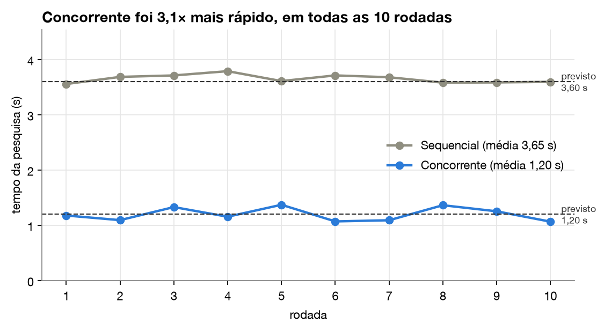
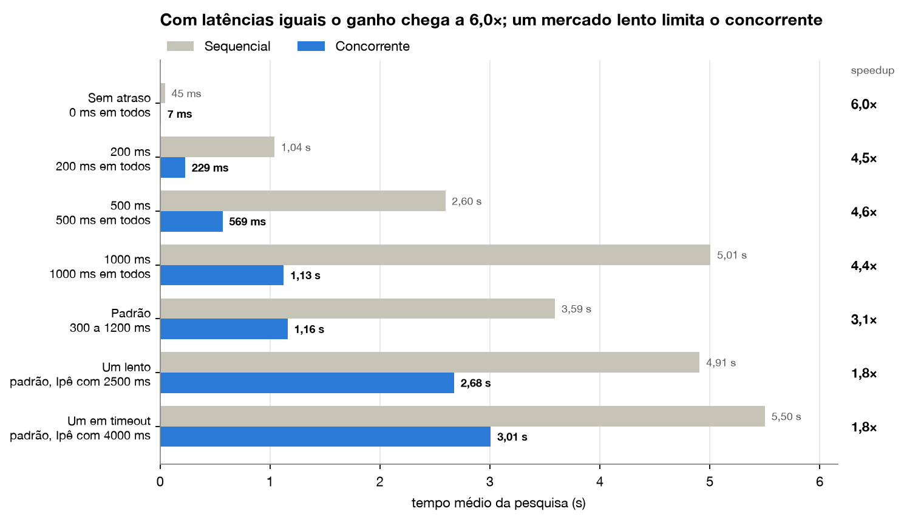
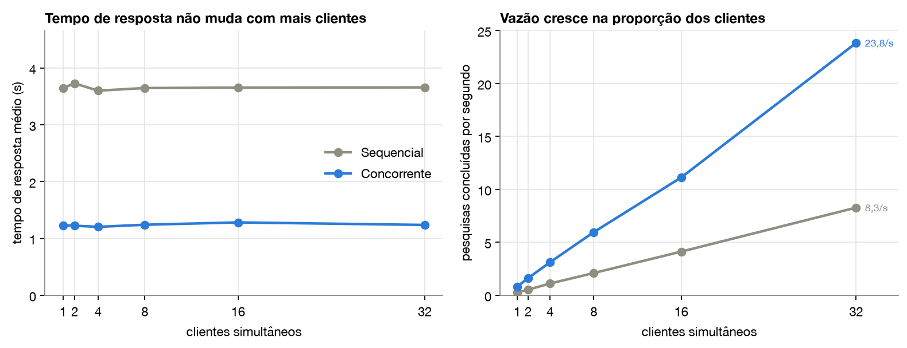

# Experimentos

Este documento cobre a seção 9 do enunciado: os cinco experimentos obrigatórios, com tabelas, gráficos, comparação entre as estratégias, discussão e conclusões sobre multithreading. No fim estão os experimentos complementares feitos antes (número de mercados, número de threads, volume de dados e consumo de CPU).

## Como reproduzir

Com o sistema no ar (`cd backend && .venv/bin/python iniciar.py --silencioso`, para o log das pesquisas não poluir o terminal), em outro terminal:

```bash
cd backend && .venv/bin/python -m experimentos
```

O script leva cerca de 6 minutos e faz tudo pelo caminho real: **cliente → TCP → agregador → TCP → 5 mercados**. Ele usa a mesma classe do cliente de terminal (`ClienteAgregador`), muda a latência e a disponibilidade dos mercados com a operação `configurar` (também por TCP) e, no fim, devolve os mercados à configuração padrão.

| Saída | Conteúdo |
|---|---|
| `docs/relatorio/dados/07-exp1-exp2-sequencial-concorrente.csv` | Experimentos 1 e 2, uma linha por pesquisa |
| `docs/relatorio/dados/08-exp3-latencia.csv` | Experimento 3, uma linha por pesquisa |
| `docs/relatorio/dados/09-exp4-multiplos-clientes.csv` | Experimento 4, uma linha por pesquisa e uma por lote (cliente 0 = tempo total) |
| `docs/relatorio/dados/10-exp5-indisponibilidade.csv` e `11-exp5-gantt.csv` | Experimento 5 e os tempos de cada mercado na pesquisa do gráfico |
| `docs/relatorio/dados/resultados-experimentos.md` | As tabelas abaixo, geradas a partir dos CSV |
| `docs/relatorio/figuras/fig-08` a `fig-11` | Os quatro gráficos |

`--analisar` refaz só tabelas e gráficos a partir dos CSV; `--so 4 5` mede só alguns experimentos.

## Ambiente e método

- MacBook com Apple M1 (8 núcleos), macOS, Python 3.12; todos os processos em `127.0.0.1`.
- Cinco mercados, cada um num processo, com latência simulada de ±15% em torno do valor configurado. Latências padrão: Aurora 300 ms, SuperVila 500 ms, Empório Sol 700 ms, Max Atacarejo 900 ms, Mercadinho Ipê 1200 ms.
- Pesquisa "arroz": 217 ofertas, cerca de 44 KB somando os cinco mercados.
- Timeout de 3 s por mercado; quando a conexão é recusada ou fechada sem resposta, até 3 novas tentativas, esperando 0,5 s, 1 s e 2 s.
- **Tempo medido:** o agregador mede cada pesquisa com `time.perf_counter()`, do início da primeira consulta até a última resposta (`tempo_total_ms`). O cliente também mede o tempo que viu, incluindo a ida e volta TCP até o agregador; a diferença ficou abaixo de 10 ms.
- **Ordem alternada:** nos experimentos com os dois modos, a ordem alterna a cada rodada (sequencial → concorrente, depois concorrente → sequencial), para que nenhum modo seja favorecido por cache ou aquecimento.
- **Modelo esperado:** com latências l₁ … lₙ, o sequencial deve levar cerca de **l₁ + … + lₙ** e o concorrente cerca de **max(l₁ … lₙ)**. O speedup máximo é a soma dividida pelo máximo.

Medições de 14/11/2026.

## Experimentos 1 e 2 — consulta sequencial e consulta concorrente

**Objetivo:** consultar os cinco mercados um após o outro (Exp. 1) e todos ao mesmo tempo com threads (Exp. 2), registrando o tempo total. 10 rodadas de cada, latências padrão.

| Experimento | Modo | Média | Mín. | Máx. | Desvio padrão | Visto pelo cliente | Previsto |
|---|---|---|---|---|---|---|---|
| 1 | Sequencial | 3,71 s | 3,39 s | 3,94 s | 149 ms | 3,72 s | 3,60 s (soma) |
| 2 | Concorrente | 1,16 s | 1,04 s | 1,35 s | 107 ms | 1,17 s | 1,20 s (maior) |

**Speedup médio: 3,2×** (limite teórico com essas latências: 3,6 ÷ 1,2 = 3,0×).



- O sequencial ficou 3% acima da soma das latências: além da espera, cada mercado gasta alguns milissegundos com conexão, SQLite e JSON, e esses custos também se somam.
- O concorrente ficou perto da maior latência (a do Mercadinho Ipê). Em algumas rodadas ficou abaixo de 1,2 s porque a latência de cada mercado varia ±15%; por isso o speedup medido passou um pouco do teórico.
- O concorrente foi mais rápido em todas as rodadas, sem sobreposição entre as faixas (pior concorrente 1,35 s; melhor sequencial 3,39 s).

## Experimento 3 — simulação de latência

**Objetivo:** configurar atrasos artificiais nos mercados e comparar os dois modos. 5 rodadas por cenário.

| Cenário | Latências | Sequencial | Previsto (soma) | Concorrente | Previsto (maior) | Speedup |
|---|---|---|---|---|---|---|
| Sem atraso | 0 ms em todos | 13 ms | 0 ms | 8 ms | 0 ms | 1,6× |
| 200 ms | 200 ms em todos | 1,04 s | 1,00 s | 233 ms | 200 ms | 4,5× |
| 500 ms | 500 ms em todos | 2,57 s | 2,50 s | 565 ms | 500 ms | 4,6× |
| 1000 ms | 1000 ms em todos | 4,98 s | 5,00 s | 1,13 s | 1,00 s | 4,4× |
| Padrão | 300 a 1200 ms | 3,62 s | 3,60 s | 1,15 s | 1,20 s | 3,1× |
| Um lento | padrão, Ipê com 2500 ms | 5,14 s | 4,90 s | 2,50 s | 2,50 s | 2,1× |
| Um em timeout | padrão, Ipê com 4000 ms | 5,49 s | 5,40 s | 3,01 s | 3,00 s | 1,8× |

O previsto limita cada latência ao timeout de 3 s.



- **Latências iguais dão o maior ganho.** Com cinco mercados iguais o limite teórico é 5×; o medido ficou entre 4,4× e 4,6×. O concorrente espera o mais lento de cinco sorteios de ±15%, que tende a ficar acima da média (1,13 s com 1000 ms configurados).
- **Latências diferentes reduzem o ganho.** No cenário padrão, o speedup é 3,6 ÷ 1,2 = 3,0×; o medido foi 3,1×.
- **Um mercado lento domina o concorrente.** Com o Ipê em 2500 ms, o concorrente passa a esperar só por ele (2,50 s) e o ganho cai para 2,1×.
- **O timeout limita o estrago.** Com o Ipê em 4000 ms, o agregador desiste aos 3 s: o concorrente responde em 3,01 s com os outros quatro mercados; o sequencial, em 5,49 s (os outros quatro somados mais o timeout). Os dois devolvem os preços dos quatro mercados que responderam.
- **Sem atraso** sobra o trabalho real (TCP, SQLite, JSON), feito em paralelo pelos cinco processos: 13 ms contra 8 ms (1,6×). O ganho é menor porque criar 5 threads e abrir 5 conexões tem um custo fixo comparável ao próprio trabalho.

## Experimento 4 — múltiplos clientes

**Objetivo:** executar pesquisas simultâneas a partir de clientes diferentes e observar o agregador. Cada cliente é uma conexão TCP própria com o agregador (porta 5050); todos começam juntos (barreira) e cada um faz 3 pesquisas seguidas. De 1 a 32 clientes, nos dois modos, latências padrão.

| Modo | Clientes | Pesquisas | Resposta média | Resposta máx. | Tempo total | Vazão | Falhas |
|---|---|---|---|---|---|---|---|
| Sequencial | 1 | 3 | 3,64 s | 3,76 s | 10,93 s | 0,27 pesquisas/s | 0 |
| Sequencial | 2 | 6 | 3,60 s | 3,82 s | 10,85 s | 0,55 pesquisas/s | 0 |
| Sequencial | 4 | 12 | 3,65 s | 3,92 s | 11,27 s | 1,06 pesquisas/s | 0 |
| Sequencial | 8 | 24 | 3,61 s | 3,96 s | 11,30 s | 2,12 pesquisas/s | 0 |
| Sequencial | 16 | 48 | 3,59 s | 3,93 s | 11,28 s | 4,25 pesquisas/s | 0 |
| Sequencial | 32 | 96 | 3,66 s | 3,99 s | 11,52 s | 8,33 pesquisas/s | 0 |
| Concorrente | 1 | 3 | 1,22 s | 1,32 s | 3,67 s | 0,82 pesquisas/s | 0 |
| Concorrente | 2 | 6 | 1,23 s | 1,38 s | 3,77 s | 1,59 pesquisas/s | 0 |
| Concorrente | 4 | 12 | 1,23 s | 1,39 s | 3,80 s | 3,16 pesquisas/s | 0 |
| Concorrente | 8 | 24 | 1,25 s | 1,39 s | 3,91 s | 6,15 pesquisas/s | 0 |
| Concorrente | 16 | 48 | 1,22 s | 1,44 s | 4,10 s | 11,70 pesquisas/s | 0 |
| Concorrente | 32 | 96 | 1,25 s | 1,47 s | 4,06 s | 23,66 pesquisas/s | 0 |



- **O tempo de cada pesquisa não muda com mais clientes.** Com 32 clientes, a resposta média foi a mesma de um cliente sozinho (1,25 s contra 1,22 s no concorrente; 3,66 s contra 3,64 s no sequencial). O pior caso subiu só 150 ms no concorrente.
- **A vazão cresce na proporção dos clientes:** 32 clientes completaram 96 pesquisas concorrentes em 4,06 s, 29 vezes a vazão de um cliente só.
- **Por quê:** o agregador atende cada cliente numa thread própria (`ThreadingTCPServer`), e cada mercado atende cada conexão numa thread própria. Com 32 clientes no modo concorrente, há 32 threads de cliente no agregador, cada uma com 5 threads de consulta (160 conexões simultâneas com os mercados), e cada mercado atende 32 consultas ao mesmo tempo. Como quase todo o tempo é espera (a latência simulada), essas threads não disputam CPU.
- **Os dois níveis de concorrência se somam:** entre clientes (threads do servidor) e dentro de cada pesquisa (threads de consulta). Mesmo no modo sequencial, 32 clientes são atendidos ao mesmo tempo; o que muda é o tempo de cada um.
- Nenhuma pesquisa falhou e todas tiveram resposta dos 5 mercados.
- **Limite:** com espera simulada, o gargalo não aparece até 32 clientes. Numa carga real, o limite viria da CPU (o GIL do Python serializa o trabalho de JSON no agregador), do número de threads por processo e da fila do `listen()` (64 conexões pendentes).

## Experimento 5 — indisponibilidade de serviço

**Objetivo:** desativar um mercado e observar o tratamento da falha. O alvo é o Mercadinho Ipê, o mais lento. Para desativar, o script envia `{"operacao": "configurar", "mercado": "ipe", "online": false}` por uma segunda conexão TCP, no momento indicado. Fora do ar, o mercado fecha as conexões de consulta sem responder, **inclusive as que já estavam em andamento**. 3 rodadas por cenário.

| Cenário | O que acontece | Modo | Tempo médio | Mercados com resposta | Tentativas no Ipê | Erro informado |
|---|---|---|---|---|---|---|
| Todos no ar | referência | Sequencial | 3,59 s | 5 de 5 | 1 | — |
| Todos no ar | referência | Concorrente | 1,24 s | 5 de 5 | 1 | — |
| Fora do ar antes | Ipê desativado antes da pesquisa | Sequencial | 6,00 s | 4 de 5 | 4 | fora do ar (4 tentativas) |
| Fora do ar antes | Ipê desativado antes da pesquisa | Concorrente | 3,52 s | 4 de 5 | 4 | fora do ar (4 tentativas) |
| Cai durante | Ipê desativado 0,3 s depois do início | Sequencial | 5,97 s | 4 de 5 | 4 | fora do ar (4 tentativas) |
| Cai durante | Ipê desativado 0,3 s depois do início | Concorrente | 3,82 s | 4 de 5 | 4 | fora do ar (4 tentativas) |
| Cai e volta | Ipê cai em 0,3 s e volta em 1,0 s | Sequencial | 3,68 s | 5 de 5 | 1 | — |
| Cai e volta | Ipê cai em 0,3 s e volta em 1,0 s | Concorrente | 3,04 s | 5 de 5 | 3 | — |


- **A pesquisa nunca falha por causa de um mercado.** Em todos os cenários o cliente recebeu os preços dos outros quatro, com `status: "parcial"` e o motivo da falha do Ipê (`fora do ar (4 tentativas)`).
- **Cai durante, concorrente:** a consulta ao Ipê já estava em andamento (esperando a latência) quando ele caiu. A conexão foi fechada na hora, aos 0,3 s, e o agregador começou as novas tentativas: 0,3 + 0,5 + 1 + 2 = 3,8 s, exatamente o medido (3,82 s).
- **Cai durante, sequencial:** quando a vez do Ipê chega (depois de 2,4 s, a soma dos outros quatro), ele já está fora do ar. O sequencial paga os 2,4 s mais os 3,5 s das tentativas: 5,97 s.
- **Fora do ar antes:** o concorrente espera só as tentativas (3,5 s); os outros quatro já responderam bem antes.
- **Cai e volta:** o mesmo evento afeta os modos de forma diferente. No concorrente, o Ipê caiu com a consulta em andamento; a 2ª tentativa (0,8 s) encontrou o mercado ainda fora do ar, a 3ª (1,8 s) já o encontrou de volta e a resposta veio após a latência dele: 3,04 s, com os 5 mercados. No sequencial, a consulta ao Ipê só começou aos 2,4 s, quando ele já tinha voltado: nada mudou.
- **Custo do retry.** As novas tentativas recuperam um mercado que volta logo, mas, quando ele não volta, custam 3,5 s. No concorrente essa espera corre junto com os outros mercados; no sequencial, ela se soma a eles.
- **Processo parado de verdade** (matar o processo do mercado) produz `ConnectionRefusedError` no `connect()`, tratado da mesma forma ("conexão recusada (4 tentativas)"). Não entrou no script porque o `iniciar.py` encerra tudo quando um processo morre; está coberto pelo teste `test_killed_market_gives_connection_refused` e pode ser mostrado à mão com `kill <pid>` de um mercado rodando fora do `iniciar.py`.

## Comparação entre as estratégias

| Aspecto | Sequencial | Concorrente |
|---|---|---|
| Tempo de uma pesquisa | soma das latências (3,71 s) | maior latência (1,16 s) |
| Ganho | — | 3,2× no padrão; até 4,6× com latências iguais; 1,6× sem latência |
| Threads por pesquisa no agregador | 1 (a do cliente) | 1 + 5 (uma por mercado) |
| Mercado lento (abaixo do timeout) | atrasa a pesquisa inteira pelo tempo dele | a pesquisa passa a durar o tempo dele |
| Mercado em timeout | soma dos outros + 3 s (5,49 s) | 3 s (3,01 s) |
| Mercado fora do ar | soma dos outros + 3,5 s de retry (6,00 s) | 3,5 s de retry (3,52 s) |
| Vários clientes | atendidos ao mesmo tempo; cada um espera a soma | atendidos ao mesmo tempo; cada um espera a maior |
| Vazão com 32 clientes | 8,3 pesquisas/s | 23,7 pesquisas/s |

## Conclusões sobre multithreading

1. **Threads compensam quando a tarefa espera E/S.** Cada consulta passa quase todo o tempo esperando a resposta da rede. Enquanto uma thread está bloqueada em `recv()`, ela libera o GIL do Python e as outras seguem. Por isso cinco threads reduziram o tempo a perto de um terço, como o modelo `soma ÷ máximo` previa.
2. **O ganho tem um teto:** a fonte mais lenta. Nenhum número de threads torna a pesquisa mais rápida que o mercado mais lento (Exp. 3, "Um lento"). Para melhorar além disso seria preciso cache ou responder sem esperar o mais lento.
3. **Sem espera, o ganho é pequeno.** Sem latência, o speedup cai para 1,6×: criar threads e abrir conexões tem custo fixo, e o trabalho de CPU em Python não se paraleliza dentro de um processo por causa do GIL. O ganho que sobra vem dos cinco processos de mercado, que trabalham em paralelo de verdade.
4. **Concorrência no servidor é o que permite vários clientes.** Com uma thread por conexão, 32 clientes foram atendidos no mesmo tempo que um (Exp. 4). Um servidor que atendesse um cliente por vez faria o 32º esperar 31 pesquisas.
5. **Timeouts e retries são parte da concorrência.** Sem timeout, um mercado travado seguraria a pesquisa para sempre; com ele, o concorrente responde em 3 s com os outros. O retry com espera crescente recupera falhas curtas (Exp. 5, "Cai e volta"), mas custa 3,5 s quando a falha persiste: o valor do timeout e do retry é um compromisso entre não perder mercados e não fazer o usuário esperar.
6. **Concorrência não economiza trabalho.** O mesmo trabalho é feito, só que sobreposto (ver C4 abaixo). O custo é mais threads e, sem espera de rede, um pouco mais de CPU.

---

## Experimentos complementares (13/11/2026)

Feitos antes dos obrigatórios, numa versão anterior do sistema que tinha um painel web de benchmark (removido depois para deixar a web só com a loja), com as mesmas latências padrão e a mesma busca "arroz".

### C1 — Número de mercados (adicionados do mais rápido ao mais lento), 5 buscas por ponto

| Mercados | Sequencial | Concorrente | Speedup |
|---|---|---|---|
| 1 | 309 ms | 316 ms | 1,0× |
| 2 | 819 ms | 488 ms | 1,7× |
| 3 | 1,48 s | 729 ms | 2,0× |
| 4 | 2,44 s | 939 ms | 2,6× |
| 5 | 3,53 s | 1,21 s | 2,9× |

Com um mercado só não há o que paralelizar. A cada mercado, o sequencial soma a latência dele; o concorrente só cresce porque o novo mercado é mais lento que os anteriores.

### C2 — Número de threads do pool (`max_workers`), 5 mercados, 5 buscas por ponto

| Threads | Média | Mín. | Máx. | Previsto pela fila do pool |
|---|---|---|---|---|
| 1 | 3,70 s | 3,58 s | 3,78 s | 3,6 s |
| 2 | 2,31 s | 2,16 s | 2,41 s | 2,2 s |
| 3 | 1,68 s | 1,54 s | 1,81 s | 1,7 s |
| 4 | 1,55 s | 1,41 s | 1,69 s | 1,5 s |
| 5 | 1,27 s | 1,18 s | 1,33 s | 1,2 s |

Previsto = cada consulta, na ordem de envio, vai para a primeira thread livre. Com uma thread, o concorrente vira sequencial; o ganho máximo exige uma thread por mercado.

### C3 — Volume de dados, 5 buscas por célula

| Busca | Ofertas | Recebido | Sem latência: seq. | Sem latência: conc. | Padrão: seq. | Padrão: conc. |
|---|---|---|---|---|---|---|
| "arroz grao nobre" | 23 | 5 KB | 9,4 ms | 5,1 ms | 3,61 s | 1,20 s |
| "arroz" | 217 | 44 KB | 18,2 ms | 9,5 ms | 3,81 s | 1,19 s |
| catálogo inteiro | 7.692 | 1,53 MB | 66,6 ms | 31,3 ms | 3,77 s | 1,25 s |

Trazer 300 vezes mais dados custa poucos milissegundos em `localhost`; com as latências padrão, a diferença some na variação.

### C4 — Consumo de recursos (CPU e threads)

Cada mercado informa a CPU da thread que atendeu a consulta (`time.thread_time()`, sem contar a espera da latência); o agregador soma a CPU das próprias threads de consulta e conta quantas threads distintas conversaram com os mercados.

| Cenário | Modo | Tempo | CPU agregador | CPU mercados | CPU total | Ocupação | Threads extras |
|---|---|---|---|---|---|---|---|
| Padrão, "arroz" (10) | Sequencial | 3,80 s | 21,6 ms | 19,7 ms | 41,3 ms | 1,1% | 0 |
| | Concorrente | 1,24 s | 15,6 ms | 19,3 ms | 35,0 ms | 2,9% | 5 |
| Padrão, catálogo (5) | Sequencial | 4,16 s | 30,5 ms | 48,7 ms | 79,2 ms | 1,9% | 0 |
| | Concorrente | 1,24 s | 26,4 ms | 51,6 ms | 78,0 ms | 6,3% | 5 |
| Sem latência, "arroz" (20) | Sequencial | 6,4 ms | 1,1 ms | 4,3 ms | 5,4 ms | 84% | 0 |
| | Concorrente | 2,8 ms | 2,9 ms | 4,9 ms | 7,8 ms | 280% | 5 |
| Sem latência, catálogo (10) | Sequencial | 42,8 ms | 11,8 ms | 18,4 ms | 30,2 ms | 71% | 0 |
| | Concorrente | 18,3 ms | 13,7 ms | 22,6 ms | 36,4 ms | 199% | 5 |

- Com espera de rede, a CPU dos mercados é a mesma nos dois modos; a CPU fica ocupada de 1% a 6% do tempo, o resto é espera.
- Sem espera, o concorrente gasta 20–43% mais CPU (criar threads, trocar de contexto), mas ocupa 2 a 2,8 núcleos ao mesmo tempo.
- Os tempos sem latência variam entre rodadas conforme a carga do computador (6 a 18 ms na busca "arroz", comparando C4, o Exp. 3 e as medições anteriores).

## Limitações

- Todos os processos rodam na mesma máquina, e a latência de rede é simulada com uma espera. Não há perda de pacotes, variação real de rota nem limite de banda.
- De 3 a 10 rodadas por cenário; mais repetições dariam intervalos de confiança mais estreitos.
- No Exp. 4, o cliente e os 32 clientes simulados rodam como threads de um mesmo processo Python; com espera dominante isso não interfere, mas numa carga de CPU os próprios clientes disputariam o GIL.

## Ideias de experimentos adicionais

- Rodar os mercados em outras máquinas da rede (latência real em vez de simulada), trocando `MARKET_HOST`.
- Aumentar os clientes até encontrar o limite do agregador (centenas de conexões).
- Comparar com uma versão `asyncio`, que atende muitas conexões numa única thread.
