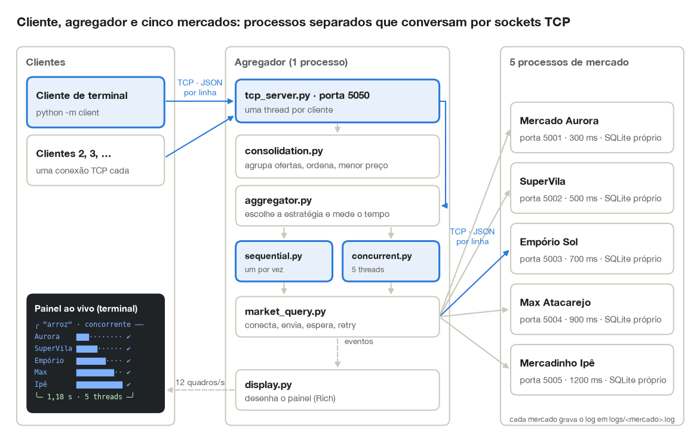
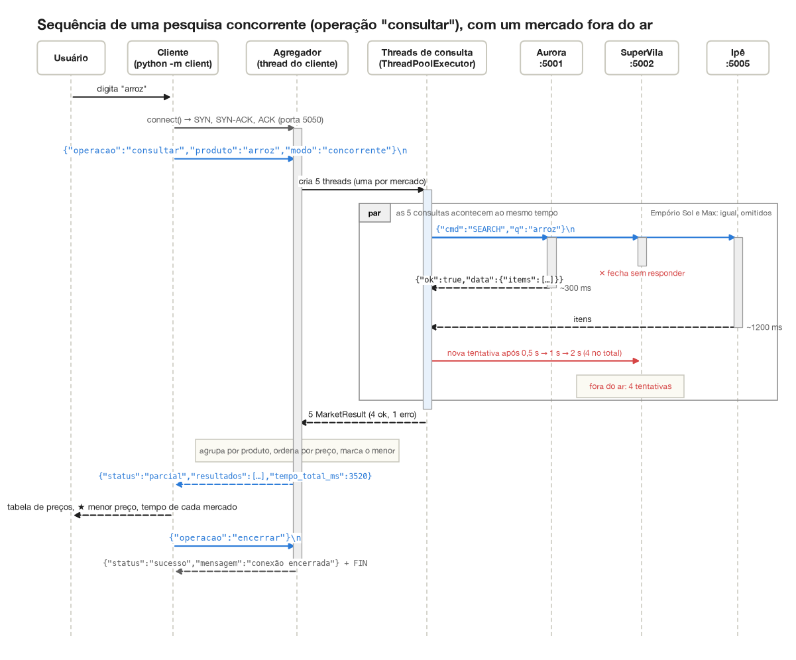

# Comparador de Preços de Supermercados — Relatório Técnico

Trabalho 1 de Sistemas Distribuídos — Engenharia de Requisitos e Desenvolvimento de um Agregador Concorrente (Tema 1)

14/11/2026

## Resumo

Consultar cinco supermercados ao mesmo tempo, com uma thread por supermercado, reduziu o tempo de uma pesquisa de 3,65 s para 1,19 s: um speedup de 3,1×.

Este relatório descreve um comparador de preços cliente-servidor desenvolvido em Python. Um **cliente de terminal** envia pesquisas a um **agregador** por socket TCP, com mensagens JSON no formato `{"operacao": "consultar", "produto": "arroz"}`. O agregador consulta cinco **supermercados**, cada um um processo independente com porta TCP, código e base SQLite próprios, de forma sequencial (um de cada vez) ou concorrente (`ThreadPoolExecutor`, uma thread por supermercado), consolida as ofertas, ordena por preço e aponta o menor. Toda a comunicação é TCP explícita, sem HTTP; o passo a passo de cada pesquisa (conexões, threads, tempos e falhas) aparece ao vivo no terminal do agregador.

Os cinco experimentos obrigatórios, feitos de ponta a ponta pelo cliente TCP, confirmam o modelo esperado: o tempo sequencial se aproxima da soma das latências dos supermercados, e o concorrente, da maior delas. Com latências iguais o ganho chegou a 4,6×. Trinta e dois clientes simultâneos foram atendidos no mesmo tempo que um só, e um supermercado que cai durante a pesquisa não impede a resposta com os outros quatro.

**Palavras-chave:** sockets TCP, multithreading, sistemas distribuídos, agregador, comparação de preços.

## 1. Introdução

Comparadores de preço, buscadores de passagens e agregadores em geral precisam consultar várias fontes independentes antes de responder ao usuário. Quando essas consultas são feitas uma após a outra, o tempo de resposta cresce com o número de fontes. Quando são feitas ao mesmo tempo, ele passa a depender apenas da fonte mais lenta.

Este trabalho implementa o Tema 1, o comparador de preços de supermercados, para estudar esse efeito com comunicação real por sockets TCP entre processos e com threads.

### 1.1 Objetivo geral

Desenvolver uma aplicação cliente-servidor que realize consultas sequenciais e concorrentes a diferentes serviços independentes, utilizando sockets TCP e multithreading.

### 1.2 Objetivos específicos

1. Especificar a aplicação com técnicas de Engenharia de Software: problema, escopo, atores, requisitos funcionais e não funcionais, restrições e critérios de aceitação (seção 2).
2. Modelar casos de uso, arquitetura, sequência de uma operação e protocolo de aplicação (seção 3).
3. Implementar a comunicação entre processos com sockets TCP e um agregador com consultas sequenciais e concorrentes (seção 4).
4. Testar o sistema de forma automatizada (seção 5).
5. Realizar os cinco experimentos obrigatórios e analisar o impacto da concorrência no desempenho (seções 6 e 7).

### 1.3 Organização

A seção 2 resume os requisitos (o documento completo está em `docs/requisitos.md`). A seção 3 apresenta a modelagem e o protocolo. A seção 4 descreve a implementação, a seção 5 os testes, a seção 6 os experimentos e a seção 7 discute os resultados. A seção 8 conclui. Os apêndices trazem as instruções de execução e o roteiro da demonstração.

## 2. Requisitos

### 2.1 Problema, objetivo e escopo

**Problema.** Para saber onde um produto é mais barato, o consumidor precisa pesquisar em cada supermercado e comparar os preços. Cada supermercado é um sistema independente, com catálogo, preços e tempo de resposta próprios. Um comparador que consulta um supermercado de cada vez faz o usuário esperar a soma dos tempos de todos; como as consultas são independentes, elas podem ser feitas ao mesmo tempo.

**Objetivo do sistema.** Permitir que o usuário informe um produto e receba, numa única resposta, os preços em pelo menos quatro supermercados independentes, ordenados do menor para o maior e com o menor preço identificado, consultando os supermercados por TCP nos modos sequencial e concorrente e medindo o tempo de cada um.

**Escopo.** Cinco supermercados simulados (processos TCP, cada um com pasta, código e base SQLite próprios), um agregador, um cliente de terminal (TCP) e um painel ao vivo no terminal do agregador; pesquisa, comparação de preços, menor preço, comparação entre os modos, medição de tempos, tratamento de falhas e os cinco experimentos. Ficam de fora preços reais, interface web, cestas de compras, login, pagamento e distribuição em várias máquinas.

### 2.2 Atores

| Ator | Tipo | Descrição |
| --- | --- | --- |
| Usuário | Principal | Quem usa o cliente de terminal: pesquisa produtos, compara preços e modos, altera latências e derruba supermercados, acompanha o painel e roda os experimentos. Não há perfis nem login, então todos os comandos estão disponíveis para qualquer usuário. |
| Serviço de supermercado | Secundário | Cada um dos cinco processos servidores TCP, que respondem com dados da própria base. |

### 2.3 Requisitos funcionais

| ID | Requisito |
| --- | --- |
| RF01 | Permitir que o usuário informe o produto a pesquisar e o modo de consulta. |
| RF02 | Consultar pelo menos quatro supermercados independentes (são cinco). |
| RF03 | Permitir consultas sequenciais: um supermercado de cada vez. |
| RF04 | Permitir consultas concorrentes: todos ao mesmo tempo, uma thread por supermercado. |
| RF05 | Apresentar o preço de cada produto encontrado em cada supermercado. |
| RF06 | Ordenar os resultados por preço (produtos pelo menor preço; ofertas de cada produto do mais barato ao mais caro). |
| RF07 | Identificar o supermercado com o menor preço de cada produto. |
| RF08 | Registrar o tempo de execução de cada pesquisa, total e por supermercado. |
| RF09 | Comparar as duas estratégias para a mesma pesquisa, informando o speedup. |
| RF10 | Informar quais supermercados não responderam e o motivo, sem descartar os resultados dos demais. |
| RF11 | Permitir alterar a latência simulada e a disponibilidade de cada supermercado durante a execução. |
| RF12 | Mostrar a situação de cada supermercado e quantos clientes estão conectados. |
| RF13 | Executar os experimentos obrigatórios automaticamente, salvando CSV, tabelas e gráficos. |
| RF14 | Mostrar em tempo real, no terminal, cada passo das consultas e a thread que o executou. |
| RF15 | Informar quantas threads cada pesquisa usou. |

### 2.4 Requisitos não funcionais

| ID | Requisito | Como é atendido |
| --- | --- | --- |
| RNF01 | A comunicação entre os componentes deverá usar sockets TCP. | Cliente → agregador na porta 5050; agregador → supermercados nas portas 5001–5005. Nenhum outro protocolo no caminho. |
| RNF02 | A estratégia concorrente deverá usar threads. | `ThreadPoolExecutor` com uma thread por supermercado. |
| RNF03 | Os servidores deverão atender múltiplas conexões simultaneamente. | Agregador e supermercados com uma thread por conexão (`ThreadingTCPServer`). Experimento 4. |
| RNF04 | O sistema deverá tratar falhas de comunicação. | Timeout de 3 s, até 3 novas tentativas com espera crescente, resultado parcial. Experimento 5. |
| RNF05 | A aplicação deverá permitir experimentos de desempenho. | Latência configurável em tempo de execução; `experiments/`, um arquivo por experimento. |
| RNF06 | O protocolo deverá ser documentado e robusto à fragmentação do TCP. | JSON por linha, testado com envio em pedaços de 7 bytes. |
| RNF07 | Cada supermercado deverá ser um processo independente. | 5 processos, cada um com pasta, código, porta e base próprios. |
| RNF08 | Com as latências padrão, a pesquisa concorrente deverá levar perto da maior latência e a sequencial perto da soma. | Experimentos 1 e 2. |
| RNF09 | O sistema deverá ter testes automatizados. | 49 testes `pytest`. |
| RNF10 | O cliente deverá destacar o menor preço e o tempo gasto, com comandos curtos. | Terminal com ★ e cores; `/seq`, `/con`, `/compare`, `/markets`, `/help`. |
| RNF11 | Encerrar o sistema não deverá cortar pesquisas em andamento nem deixar processos órfãos. | Ctrl+C: o agregador espera as pesquisas em andamento antes de fechar; os mercados fecham depois. |

### 2.5 Restrições

- Python 3.12; a comunicação TCP usa só a biblioteca padrão (`socket`, `socketserver`, `threading`, `concurrent.futures`).
- Comunicação real por sockets: nenhuma consulta é simulada sem rede.
- Supermercados, marcas, preços e estoques fictícios, gerados com semente fixa.
- Latência de rede simulada por uma espera configurável (em `localhost` a rede responde em menos de 1 ms).
- Todos os processos na mesma máquina, em portas distintas; endereços configuráveis por variáveis de ambiente.
- Apresentação de 15 a 20 minutos em 16/11/2026.

### 2.6 Critérios de aceitação

| ID | Critério | Verificação |
| --- | --- | --- |
| CA01 | Ao pesquisar "arroz" no cliente de terminal, o usuário recebe os preços dos 5 supermercados numa única resposta. | Demonstração; teste automatizado |
| CA02 | Produtos e ofertas aparecem do menor para o maior preço, com o mais barato destacado. | Teste automatizado |
| CA03 | Com as latências padrão, sequencial ≥ 95% da soma das latências; concorrente abaixo da maior latência + 250 ms. | Teste automatizado; Exp. 1 e 2 |
| CA04 | Toda resposta informa o tempo total e o de cada supermercado. | Formato da resposta |
| CA05 | `/compare arroz 3` mostra a média de cada modo e o speedup. | Teste automatizado |
| CA06 | Com um supermercado fora do ar (antes ou durante a pesquisa), o usuário recebe os outros 4 com `status: "parcial"` e o motivo. | Testes automatizados; Exp. 5 |
| CA07 | Oito clientes simultâneos são atendidos, e o tempo total fica próximo ao de um cliente. | Teste automatizado; Exp. 4 |
| CA08 | Pedidos inválidos recebem erro com código, e a conexão continua utilizável; um cliente que cai não afeta os outros. | Testes automatizados |
| CA09 | Ctrl+C durante uma pesquisa: o cliente ainda recebe a resposta antes de o sistema fechar. | Teste automatizado |
| CA10 | `lsof` mostra o agregador (5050) e os cinco supermercados (5001–5005) escutando, em processos distintos. | Demonstração |
| CA11 | `python -m experiments` executa os cinco experimentos e gera tabelas e gráficos sem intervenção. | Execução do script |

Todos os critérios foram verificados (seções 5 e 6).

## 3. Modelagem

### 3.1 Casos de uso


*Figura 1. Diagrama de casos de uso.*

O usuário pesquisa (UC01), compara os preços de um produto (UC02), escolhe o modo (UC03), compara os dois modos com speedup (UC04), acompanha as consultas no painel do terminal (UC05), roda os experimentos (UC06), configura ou derruba supermercados (UC07) e vê a situação de cada um (UC08). Pesquisa, comparação de preços, comparação de modos e experimentos incluem o UC09, a consulta TCP aos supermercados, único caso que conversa com o ator secundário.

| Caso | Fluxo principal | Fluxos alternativos |
| --- | --- | --- |
| UC01 Pesquisar produto | O usuário informa o produto; o cliente envia `consultar` ao agregador; o agregador consulta os supermercados (UC09), agrupa as ofertas por produto, ordena por preço e marca o menor; o cliente mostra os preços e os tempos. | Um supermercado não responde: novas tentativas, depois resultado parcial com o motivo. Nenhum responde: erro `NENHUM_MERCADO_RESPONDEU`. Nenhum produto: sugestão de termos mais simples. Pedido inválido: erro `PARAMETRO_INVALIDO`, conexão continua. |
| UC02 Comparar preços de um produto | Supermercados do menor para o maior preço, mais barato destacado (★), diferença de cada um. | Sem estoque: aparece como "sem estoque". |
| UC03 Escolher o modo | `/seq` ou `/con` no cliente; as próximas pesquisas usam esse modo. | — |
| UC04 Comparar os modos | `/compare arroz 3`: a mesma pesquisa nos dois modos, alternando a ordem; média, mínimo, máximo e speedup. | — |
| UC07 Configurar / derrubar supermercado | `/latency`, `/down`, `/up`: o agregador envia `CONFIG` por TCP; o supermercado muda a latência ou passa a fechar as conexões de consulta, inclusive as em andamento. | Processo inacessível: erro `MERCADO_INDISPONIVEL`. |
| UC08 Ver a situação dos supermercados | `/markets`: o agregador envia `STATUS` a cada supermercado e devolve se está no ar, a latência, os produtos e os clientes conectados. | Processo parado: "processo inacessível". |
| UC09 Consultar supermercados via TCP | Conectar, enviar a linha JSON, esperar a resposta, fechar, publicar eventos com os tempos. | Recusa ou fechamento sem resposta: novas tentativas (0,5 s, 1 s, 2 s). Mais de 3 s sem resposta: timeout. |

### 3.2 Arquitetura

O sistema tem os três componentes pedidos: o **cliente**, o **agregador** e os **serviços independentes**. Com um cliente aberto são sete processos: cinco supermercados, o agregador e o cliente; cada cliente a mais é mais um processo, com sua própria conexão.



*Figura 2. Arquitetura do sistema.*

| Trecho | Protocolo | Conexão |
| --- | --- | --- |
| Cliente → agregador (porta 5050) | TCP puro, uma mensagem JSON por linha, no formato sugerido pelo enunciado | persistente: várias operações, fechada com `encerrar` |
| Agregador → supermercados (portas 5001–5005) | TCP puro, uma mensagem JSON por linha, comandos curtos (`SEARCH`, `STATUS`, `CONFIG`) | uma por consulta |

Cada supermercado tem a própria pasta (`markets/aurora/`, `markets/supervila/`…), com `server.py`, `database.py` e o banco. O código é quase igual entre eles, de propósito: são serviços independentes, que poderiam ser escritos por equipes diferentes ou rodar em outras máquinas.

O que acontece por trás de cada pesquisa aparece num painel desenhado pelo agregador no terminal onde o sistema foi iniciado (biblioteca Rich). Cada pesquisa é um quadro com uma barra por supermercado, que cresce em tempo real até a resposta chegar; todos os quadros usam a mesma régua (no mínimo 4 s), e os terminados ficam no histórico do terminal. Abaixo, uma pesquisa em cada modo (versão resumida do painel, sem a coluna de bytes):

```
╭─ #2e23 "feijao" · sequencial ─────────────────────────────────────────────────╮
│ Aurora     ██·················· ✔  298 ms · 30 itens  thread_1 → conexão nº 6 │
│ SuperVila  ··███··············· ✔  525 ms · 28 itens  thread_1 → conexão nº 6 │
│ Empório    ·····████··········· ✔  616 ms · 26 itens  thread_1 → conexão nº 6 │
│ Max        ·········█████······ ✔  831 ms · 27 itens  thread_1 → conexão nº 6 │
│ Ipê        ··············██████ ✔  1,30 s · 22 itens  thread_1 → conexão nº 6 │
╰───────────────────────────── 3,57 s · 5 de 5 · 1 thread: a do próprio pedido ─╯
╭─ #0ff6 "arroz" · concorrente ─────────────────────────────────────────────────╮
│ Aurora     ██·················· ✔  272 ms · 48 itens  thread_1 → conexão nº 1 │
│ SuperVila  ███················· ✔  587 ms · 49 itens  thread_2 → conexão nº 1 │
│ Empório    ████················ ✔  689 ms · 39 itens  thread_3 → conexão nº 1 │
│ Max        █████··············· ✔  959 ms · 43 itens  thread_4 → conexão nº 1 │
│ Ipê        ██████·············· ✔  1,23 s · 41 itens  thread_5 → conexão nº 1 │
╰─────────────────────── 1,23 s · 5 de 5 · 5 threads novas; o pedido só espera ─╯
```

No sequencial, as barras formam uma escada, sempre na mesma thread do agregador (`thread_1`), e o tempo é a soma das latências. No concorrente, as cinco barras começam juntas, cada uma numa thread (`thread_1` a `thread_5`), e o tempo é o do supermercado mais lento. A última coluna mostra também qual conexão do supermercado atendeu (cada conexão ganha uma thread nova no supermercado), que o supermercado devolve em cada resposta. Durante novas tentativas a barra fica amarela e, na desistência, vermelha. Uma linha de status embaixo mostra a situação de cada supermercado e quantos clientes TCP estão conectados. O modo cru (`start.py --raw`) troca as barras por uma linha por evento: o pedido do cliente, o `connect` com a porta local, a mensagem enviada, a resposta, o `close` e as linhas de log dos próprios supermercados.

**Processos e threads.** Há dois níveis de concorrência, que não devem ser confundidos:

| Nível | Quem cria as threads | Quantas | Muda com o modo? |
| --- | --- | --- | --- |
| Entre clientes | `ThreadingTCPServer` do agregador | uma por cliente conectado | não |
| Dentro de uma pesquisa | a estratégia escolhida | sequencial: nenhuma nova; concorrente: 5 | **sim**: é o que os modos comparam |
| Em cada supermercado | `ThreadingTCPServer` do supermercado | uma por conexão recebida | não |

- **Supermercado:** a thread principal fica em `accept()`; cada conexão aceita ganha uma thread, que lê a pergunta, consulta o SQLite e responde.
- **Agregador, lado dos clientes:** a thread principal só faz `accept()` na porta 5050; cada cliente conectado ganha uma thread, que atende os pedidos dele um de cada vez até ele encerrar. Por isso dois clientes no modo sequencial são atendidos ao mesmo tempo: cada um tem sua thread, que faz a sua pesquisa sequencial.
- **Agregador, modo sequencial:** a própria thread do cliente faz as cinco consultas, uma após a outra (1 thread).
- **Agregador, modo concorrente:** a thread do cliente cria um `ThreadPoolExecutor` com cinco workers, um por supermercado (1 + 5 threads).
- **Painel:** cada thread de consulta avisa o `display.py` quando conecta, recebe a resposta, tenta de novo ou desiste; esses eventos atualizam o estado do painel sob uma trava, e uma thread do painel redesenha as barras 12 vezes por segundo.

### 3.3 Diagrama de sequência

A Figura 3 mostra a operação principal: uma pesquisa concorrente feita pelo cliente de terminal, com um supermercado fora do ar.



*Figura 3. Sequência de uma pesquisa concorrente, do cliente aos supermercados e de volta.*

O cliente abre uma conexão TCP com o agregador e envia o pedido. A thread do agregador que atende esse cliente cria cinco threads de consulta; cada uma abre sua conexão com um supermercado e envia `SEARCH`. As respostas chegam em tempos diferentes. A SuperVila, fora do ar, fecha a conexão sem responder; a thread dela tenta de novo três vezes e desiste. Com os cinco resultados (quatro bons e um erro), o agregador agrupa, ordena, marca o menor preço e responde ao cliente com `status: "parcial"`. No fim da sessão, o cliente envia `encerrar` e o agregador fecha a conexão.

### 3.4 Protocolo de aplicação

O protocolo completo, com exemplos de cada operação, está em `docs/protocolo.md`.

**Enquadramento.** O TCP entrega um fluxo de bytes e não preserva as fronteiras entre mensagens: um envio pode chegar em várias leituras, e duas mensagens podem chegar juntas. Por isso cada mensagem é um objeto JSON em UTF-8 numa linha, terminada por `\n`. Como o JSON nunca tem quebra de linha crua, a linha delimita a mensagem. Os dois lados usam o socket como arquivo (`sock.makefile`), e `readline()` junta os pedaços até achar o `\n`. Linhas acima de 16 MB são rejeitadas.

**Cliente ↔ agregador.** Toda requisição tem `operacao` (e um `id` opcional, devolvido na resposta); toda resposta tem `status` (`sucesso`, `parcial` ou `erro`).

| Operação | Parâmetros | Resposta |
| --- | --- | --- |
| `consultar` | `produto`, `modo` (`sequencial`/`concorrente`), `limite` | `resultados` (produtos com `menor_preco` e `ofertas` de cada `fonte`, ordenados), `tempo_total_ms`, `mercados` (tempo, tentativas e erro de cada um) |
| `comparar` | `produto`, `repeticoes` | tempo médio, mínimo e máximo de cada modo e `speedup` |
| `mercados` | — | situação de cada supermercado e clientes conectados |
| `configurar` | `mercado`, `latencia_ms`, `online` | nova configuração do supermercado |
| `encerrar` | — | confirmação; o agregador fecha a conexão |

```json
→ {"operacao": "consultar", "produto": "arroz branco 5 kg", "modo": "concorrente"}
← {"operacao": "consultar", "status": "sucesso", "produto": "arroz branco 5 kg", "tempo_total_ms": 1072.4,
   "resultados": [{"produto": "Arroz Branco Tipo 1", "marca": "Sabor da Terra", "unidade": "5 kg",
                   "menor_preco": {"fonte": "Mercado Aurora", "preco": 20.19},
                   "ofertas": [{"fonte": "Mercado Aurora", "produto": "Arroz Branco Tipo 1 Sabor da Terra 5 kg",
                                "preco": 20.19, "status": "sucesso"}, ...]}, ...],
   "mercados": [{"fonte": "Mercado Aurora", "status": "sucesso", "tempo_ms": 350.8, "tentativas": 1, "erro": null}, ...]}
```

**Agregador ↔ supermercados.** Comandos curtos: `SEARCH` (busca), `STATUS` e `CONFIG` (administração, respondem mesmo fora do ar). Toda resposta tem `ok`, com `data` ou `error`, mais `cpu_ms` e `thread` (a conexão do supermercado que atendeu). Uma conexão por consulta: o agregador conecta, envia, lê a resposta e fecha.

**Tratamento de erros.** Um pedido inválido recebe `status: "erro"` com um código: `MENSAGEM_INVALIDA` (JSON quebrado), `OPERACAO_DESCONHECIDA`, `PARAMETRO_INVALIDO`, `MERCADO_DESCONHECIDO`, `MERCADO_INDISPONIVEL`, `NENHUM_MERCADO_RESPONDEU`, `TEMPO_ESGOTADO` (cliente inativo) e `ERRO_INTERNO`. Exceto JSON truncado e inatividade, a conexão continua utilizável. Falhas de um supermercado não são erros do pedido: viram `status: "parcial"` com o motivo em `mercados[].erro`.

| Falha de um supermercado | O que o agregador vê | O que faz |
| --- | --- | --- |
| Fora do ar (antes ou durante a consulta) | conexão fechada sem resposta | tenta de novo após 0,5 s, 1 s e 2 s; depois "fora do ar (4 tentativas)" |
| Processo parado | conexão recusada | o mesmo: "conexão recusada (4 tentativas)" |
| Mais de 3 s sem resposta | timeout na leitura | desiste na hora: "tempo esgotado (3,0 s)" |
| Resposta malformada | erro de protocolo | desiste na hora |

**Encerramento das conexões.** O cliente encerra enviando `encerrar` (comando `/exit`); o agregador confirma e fecha o socket. Se o cliente some sem avisar, o `readline()` do agregador recebe fim de arquivo e a thread do cliente termina; se a conexão cai no meio de uma linha, o pedaço é descartado. Depois de 5 minutos sem mensagens, o agregador envia `TEMPO_ESGOTADO` e fecha. Do agregador para os supermercados, cada conexão é fechada logo após a resposta (ou no timeout). Ao desligar o sistema (Ctrl+C), o agregador para de aceitar clientes, espera as pesquisas em andamento responderem e só então os supermercados são encerrados.

## 4. Implementação

A diferença entre os dois modos de consulta cabe em poucas linhas: um laço `for` no sequencial e um `ThreadPoolExecutor` no concorrente.

### 4.1 Tecnologias

| Camada | Tecnologia | Responsabilidade |
| --- | --- | --- |
| Supermercados | Python 3.12, `socketserver`, `threading`, SQLite | Servidor TCP de cada supermercado e sua base |
| Agregador | Python 3.12, `socketserver` | Servidor TCP dos clientes, consultas, consolidação e medições |
| Concorrência | `concurrent.futures.ThreadPoolExecutor` | Uma thread por supermercado no modo concorrente |
| Cliente | Python 3.12, `socket` | Cliente de terminal e experimentos |
| Painel no terminal | Rich | Um quadro por pesquisa, com barras que crescem ao vivo, ou uma linha por evento (`--raw`) |
| Experimentos | matplotlib | Gráficos |
| Testes | pytest | Protocolo, servidores, estratégias, painel e cliente TCP |

O código está organizado pelos três componentes do enunciado, mais uma pasta com o que eles compartilham:

| Pasta | Componente | Arquivos principais |
| --- | --- | --- |
| `common/` | compartilhado | `config.py` (portas, latências, timeout, retry); `protocol.py` (`send`/`receive`: uma mensagem JSON por linha); `watchdog.py` |
| `client/` | ① Cliente | `connection.py` (socket TCP com o agregador); `terminal.py` (interface e comandos) |
| `aggregator/` | ② Agregador | `tcp_server.py` (recebe os clientes); `sequential.py` e `concurrent.py` (as duas estratégias, uma por arquivo); `market_query.py` (uma consulta TCP, com timeout e retry); `aggregator.py` (executa e mede); `consolidation.py` (agrupa, ordena, menor preço); `display.py` (painel ao vivo no terminal) |
| `markets/<mercado>/` | ③ Serviços independentes | `server.py` (servidor TCP de um supermercado); `database.py`; o banco `.db` — uma pasta por supermercado |
| `tools/` | — | `catalog.py` e `seed_databases.py` (geram os bancos) |
| `experiments/` | — | `exp1_sequential.py` … `exp5_unavailability.py` (um arquivo por experimento) e `shared.py` |
| `tests/` | — | um arquivo de testes por parte |

`start.py` sobe os cinco supermercados e o agregador. Uma pesquisa percorre, nesta ordem: `client/terminal.py` → `client/connection.py` → `aggregator/tcp_server.py` → `aggregator/aggregator.py` → `aggregator/sequential.py` ou `aggregator/concurrent.py` → `aggregator/market_query.py` → `markets/<mercado>/server.py`, e volta por `aggregator/consolidation.py`.

### 4.2 Estratégias de consulta

Cada estratégia está num arquivo próprio, com a mesma assinatura; o agregador escolhe uma delas pelo modo pedido (`STRATEGIES = {"sequential": sequential.search, "concurrent": concurrent.search}`).

```python
# aggregator/sequential.py
def search(markets, request, emit=None, t0=None):
    threading.current_thread().name = "thread_1"  # a própria thread do pedido faz tudo
    results = []
    for market in markets:
        result = query_market(market, request, t0=t0, emit=emit)  # bloqueia até ESTE mercado responder
        results.append(result)
    return results

# aggregator/concurrent.py
def search(markets, request, emit=None, t0=None):
    def query_one(number, market):
        threading.current_thread().name = f"thread_{number}"  # thread_1 … thread_5, uma por mercado
        return query_market(market, request, t0=t0, emit=emit)

    with ThreadPoolExecutor(max_workers=len(markets)) as pool:
        # submit() entrega cada consulta a uma thread nova e volta na hora, sem esperar a resposta
        futures = [pool.submit(query_one, number, market) for number, market in enumerate(markets, 1)]
        # result() espera cada thread terminar; o total é decidido pela mais lenta
        return [future.result() for future in futures]
```

`query_market` nunca lança exceção: timeout, conexão recusada e supermercado fora do ar viram um resultado com `ok = False` e o motivo. Assim, uma falha num supermercado não descarta as respostas dos outros.

### 4.3 Servidor de supermercado

Cada supermercado é um processo que usa `socketserver.ThreadingTCPServer`: o servidor faz `bind`, `listen` e `accept` na sua porta, e cada conexão ganha uma thread (`conexão nº N`). A conexão SQLite é aberta por requisição, porque um objeto de conexão não pode ser compartilhado entre threads.

Antes de responder a `SEARCH`, o supermercado espera a latência configurada, com variação de ±15%. A espera é feita num `threading.Event` e não num `sleep`: quando o supermercado é tirado do ar, o evento é sinalizado, as consultas que estavam esperando acordam na hora e a conexão é fechada sem resposta, como num servidor que trava de verdade. É isso que permite o Experimento 5 desativar um serviço **durante** a pesquisa.

| Supermercado | Pasta | Porta | Latência | Produtos | Perfil de preço |
| --- | --- | --- | --- | --- | --- |
| Mercado Aurora | `markets/aurora` | 5001 | 300 ms | 1.689 | referência |
| SuperVila | `markets/supervila` | 5002 | 500 ms | 1.639 | 3% mais barato |
| Empório Sol | `markets/emporio_sol` | 5003 | 700 ms | 1.489 | 10% mais caro |
| Max Atacarejo | `markets/max_atacarejo` | 5004 | 900 ms | 1.544 | 12% mais barato |
| Mercadinho Ipê | `markets/ipe` | 5005 | 1200 ms | 1.369 | 4% mais caro |

As bases são geradas por `tools/seed_databases.py` a partir de um catálogo de 1.740 itens (95 tipos de produto, marcas fictícias, sabores e tamanhos). Cada supermercado vende parte do catálogo, aplica seu perfil de preço e uma variação de ±12%; somadas, as bases têm 7.730 produtos. O gerador usa semente fixa, então os dados são sempre os mesmos.

### 4.4 Agregador TCP e cliente de terminal

O servidor TCP do agregador (`aggregator/tcp_server.py`) também é um `ThreadingTCPServer`. A thread de cada cliente lê uma linha, valida os parâmetros, chama a operação e responde, em laço, até o cliente enviar `encerrar` ou fechar o socket. Parâmetros inválidos levantam um `RequestError` com o código, que vira a resposta de erro; uma exceção inesperada vira `ERRO_INTERNO` sem derrubar a thread.

O cliente de terminal (`client/terminal.py`, que usa `client/connection.py`) abre uma conexão no início da sessão e a mantém. Cada linha digitada vira uma pesquisa; os comandos chamam as demais operações:

| Comando | Operação |
| --- | --- |
| `/seq`, `/con` | troca o modo das próximas pesquisas |
| `/compare arroz 3` | `comparar` |
| `/markets` | `mercados` |
| `/down supervila`, `/up supervila`, `/latency ipe 2500` | `configurar` |
| `/json` | mostra a resposta JSON crua |
| `/help`, `/exit` | lista os comandos; `encerrar` |

A saída mostra o tempo de cada supermercado, os produtos do mais barato para o mais caro e uma ★ no menor preço:

```
sequencial> arroz

  'arroz' · modo sequencial · 3,50 s · 5/5 mercados responderam
    Mercado Aurora  ✔   304 ms
    SuperVila       ✔   498 ms
    Empório Sol     ✔   631 ms
    Max Atacarejo   ✔   799 ms
    Mercadinho Ipê  ✔   1,27 s

  50 produtos, 220 ofertas. Mostrando o mais barato:

   1. Arroz Branco Tipo 1 · Sabor da Terra · 1 kg
     ★ Max Atacarejo       R$ 4,39   menor preço
       SuperVila           R$ 4,69   +R$ 0,30
       Empório Sol         R$ 5,09   +R$ 0,70
       Mercado Aurora      R$ 5,39   +R$ 1,00
       Mercadinho Ipê      R$ 5,89   +R$ 1,50
```

A classe `AggregatorClient` é reaproveitada pelos experimentos, de modo que eles passam pelo mesmo caminho que o usuário.

## 5. Testes

Os 49 testes automatizados passam (`pytest`). Eles sobem os cinco supermercados em threads, em portas livres, com bancos temporários e latências reduzidas (100 a 300 ms, sem variação), e usam conexões TCP reais.

| Grupo | Testes | O que verificam |
| --- | --- | --- |
| Protocolo (`test_protocol.py`) | 7 | Ida e volta com acentos; uma mensagem por linha; mensagem enviada em pedaços de 7 bytes; duas mensagens grudadas; fechamento limpo; fechamento no meio da linha; JSON inválido |
| Supermercado (`test_markets.py`) | 7 | Busca ordenada por preço; sem acento; por marca e tamanho; sortimento inteiro; comando desconhecido; fora do ar com `STATUS` respondendo; preços diferentes entre supermercados |
| Estratégias (`test_strategies.py`) | 10 | Concorrente mais rápido; sequencial sem sobreposição; concorrente sobreposto em 5 threads; retry e desistência; sucesso quando o supermercado volta; esperas crescentes; conexão recusada; timeout sem retry; bytes medidos; eventos |
| Painel do terminal (`test_display.py`) | 6 | No sequencial, as barras formam uma escada na mesma thread; no concorrente, as 5 barras começam juntas, em 5 threads; falha com novas tentativas aparece; modo silencioso não escreve nada; o modo cru mostra cada passo de cada chamada, as novas tentativas e a resposta vazia |
| Cliente ↔ agregador TCP (`test_tcp_server.py`) | 19 | `consultar` nos dois modos (ordenação, menor preço, formato `fonte`/`produto`/`preco`/`status`); concorrente mais rápido por TCP; `comparar`; várias operações na mesma conexão e `encerrar`; pedidos inválidos com o código certo; JSON inválido sem perder a conexão; supermercado fora do ar (`parcial`); todos fora do ar (`NENHUM_MERCADO_RESPONDEU`); supermercado caindo durante a pesquisa; 8 clientes simultâneos; desconexão abrupta; encerramento que espera as pesquisas em andamento |

Além dos testes automatizados, o sistema foi verificado com os processos no ar: pesquisas pelo cliente de terminal nos dois modos, `/compare`, `/markets`, `/latency`, vários clientes conectados ao mesmo tempo com o painel ao vivo e o modo `--raw`, e `lsof -nP -iTCP -sTCP:LISTEN` mostrando as portas 5050 e 5001–5005.

## 6. Experimentos

### 6.1 Metodologia

- **Ambiente:** Apple M1 (8 núcleos), macOS, Python 3.12, todos os processos em `127.0.0.1`. Medições de 14/11/2026.
- **Caminho medido:** `python -m experiments` faz tudo pelo cliente TCP: cliente → agregador → supermercados. Latência e disponibilidade são alteradas com a operação `configurar`. Cada experimento é um arquivo em `experiments/` e também roda sozinho.
- **Pesquisa:** "arroz", que devolve 220 ofertas somando os cinco supermercados.
- **Medição:** o agregador mede cada pesquisa com `time.perf_counter()`, do início da primeira consulta até a última resposta. O cliente também mede o tempo que viu, incluindo a ida e volta TCP até o agregador.
- **Latência:** cada supermercado espera o tempo configurado com variação de ±15%. Latências padrão: 300, 500, 700, 900 e 1200 ms.
- **Ordem alternada:** a ordem dos modos alterna a cada rodada, para que nenhum seja favorecido por cache ou aquecimento.
- **Modelo esperado:** com latências l₁ … lₙ, o sequencial deve levar cerca de l₁ + … + lₙ e o concorrente cerca de max(l₁ … lₙ).

Todos os números estão em `docs/relatorio/dados/` (um CSV por experimento) e podem ser refeitos com o script.

### 6.2 Experimentos 1 e 2 — consulta sequencial e concorrente

Dez pesquisas em cada modo, latências padrão (`exp1_sequential.py` e `exp2_concurrent.py`).

| Experimento | Modo | Média | Mín. | Máx. | Desvio padrão | Visto pelo cliente | Previsto |
| --- | --- | --- | --- | --- | --- | --- | --- |
| 1 | Sequencial | 3,65 s | 3,43 s | 3,92 s | 177 ms | 3,66 s | 3,60 s (soma) |
| 2 | Concorrente | 1,19 s | 1,03 s | 1,32 s | 113 ms | 1,20 s | 1,20 s (maior) |


*Figura 4. Tempo de cada rodada nos dois modos, com o previsto pelo modelo.*

O speedup médio foi de 3,1×, contra 3,0× do modelo (3,6 s ÷ 1,2 s). O sequencial ficou 1,4% acima da soma das latências: além da espera, cada consulta gasta alguns milissegundos com conexão, SQLite e JSON, e no sequencial esses custos também se somam. O concorrente ficou na maior latência (a do Mercadinho Ipê). O concorrente foi mais rápido em todas as rodadas, sem sobreposição entre as faixas: o pior concorrente (1,32 s) levou menos da metade do melhor sequencial (3,43 s). O tempo visto pelo cliente ficou cerca de 10 ms acima do medido no agregador, o custo da ida e volta TCP entre os dois.

### 6.3 Experimento 3 — simulação de latência

Sete configurações de atraso, alteradas pela operação `configurar`, cinco rodadas cada (`exp3_latency.py`).

| Cenário | Latências | Sequencial | Previsto | Concorrente | Previsto | Speedup |
| --- | --- | --- | --- | --- | --- | --- |
| Sem atraso | 0 ms em todos | 10 ms | 0 ms | 3 ms | 0 ms | 3,0× |
| 200 ms | 200 ms em todos | 1,02 s | 1,00 s | 231 ms | 200 ms | 4,4× |
| 500 ms | 500 ms em todos | 2,48 s | 2,50 s | 562 ms | 500 ms | 4,4× |
| 1000 ms | 1000 ms em todos | 5,05 s | 5,00 s | 1,09 s | 1,00 s | 4,6× |
| Padrão | 300 a 1200 ms | 3,65 s | 3,60 s | 1,18 s | 1,20 s | 3,1× |
| Um lento | padrão, Ipê com 2500 ms | 4,87 s | 4,90 s | 2,56 s | 2,50 s | 1,9× |
| Um em timeout | padrão, Ipê com 4000 ms | 5,43 s | 5,40 s | 3,00 s | 3,00 s | 1,8× |

O previsto limita cada latência ao timeout de 3 s.


*Figura 5. Tempo médio por cenário de latência.*

- **Latências iguais dão o maior ganho.** Com cinco mercados iguais o limite teórico é 5×; o medido ficou entre 4,4× e 4,6×. O concorrente espera o mais lento de cinco sorteios de ±15%, que tende a ficar acima da média (1,09 s com 1000 ms configurados).
- **Latências diferentes reduzem o ganho.** No cenário padrão o limite é 3,6 ÷ 1,2 = 3,0×; o medido foi 3,1×.
- **Um mercado lento domina o concorrente.** Com o Ipê em 2500 ms, o concorrente passa a esperar só por ele (2,56 s) e o ganho cai para 1,9×.
- **O timeout limita o estrago.** Com o Ipê em 4000 ms, o agregador desiste aos 3 s: o concorrente responde em 3,00 s com os outros quatro mercados; o sequencial, em 5,43 s (os outros quatro somados mais o timeout).
- **Sem atraso** sobra só o trabalho real (TCP, SQLite, JSON), feito em paralelo pelos cinco processos: 10 ms contra 3 ms. Com tempos tão pequenos, alguns milissegundos de diferença mudam muito a razão, então esse speedup é o menos estável da tabela.

### 6.4 Experimento 4 — múltiplos clientes

De 1 a 32 clientes, cada um com sua própria conexão TCP, começando juntos (barreira); cada cliente faz 3 pesquisas seguidas (`exp4_multiple_clients.py`). Nenhuma pesquisa falhou.

| Clientes | Sequencial: resposta média | Sequencial: vazão | Concorrente: resposta média | Concorrente: vazão |
| --- | --- | --- | --- | --- |
| 1 | 3,53 s | 0,28 pesquisas/s | 1,09 s | 0,92 pesquisas/s |
| 2 | 3,61 s | 0,55 pesquisas/s | 1,18 s | 1,60 pesquisas/s |
| 4 | 3,58 s | 1,11 pesquisas/s | 1,20 s | 3,27 pesquisas/s |
| 8 | 3,68 s | 2,10 pesquisas/s | 1,25 s | 6,18 pesquisas/s |
| 16 | 3,65 s | 4,18 pesquisas/s | 1,20 s | 12,10 pesquisas/s |
| 32 | 3,66 s | 8,37 pesquisas/s | 1,20 s | 23,97 pesquisas/s |


*Figura 6. Tempo de resposta e vazão conforme o número de clientes simultâneos.*

O tempo de cada pesquisa praticamente não mudou com mais clientes, e a vazão cresceu na proporção dos clientes: 32 clientes fizeram 96 pesquisas concorrentes em 4,00 s, 26 vezes a vazão de um só. Isso vale também para o modo sequencial (8,37 contra 0,28 pesquisas/s), porque o servidor do agregador é multithread nos dois modos: cada cliente tem sua própria thread, e cada thread faz a sua pesquisa sequencial ao mesmo tempo que as outras. Com 32 clientes no modo concorrente, o agregador tinha 32 threads de cliente, cada uma com 5 threads de consulta (160 conexões simultâneas com os supermercados), e cada supermercado atendia 32 consultas ao mesmo tempo, cada uma numa thread.

### 6.5 Experimento 5 — indisponibilidade de serviço

A SuperVila (porta 5002, 500 ms, a segunda na ordem de consulta) foi desativada (operação `configurar` com `online: false`, por uma segunda conexão TCP) antes da pesquisa, 0,3 s depois do início, ou 0,3 s depois do início e reativada em 1,0 s. Três rodadas por cenário (`exp5_unavailability.py`).

| Cenário | Modo | Tempo médio | Supermercados com resposta | Tentativas na SuperVila |
| --- | --- | --- | --- | --- |
| Todos no ar | Sequencial | 3,63 s | 5 de 5 | 1 |
| | Concorrente | 1,14 s | 5 de 5 | 1 |
| Fora do ar antes | Sequencial | 6,67 s | 4 de 5 | 4 |
| | Concorrente | 3,51 s | 4 de 5 | 4 |
| Cai durante | Sequencial | 6,74 s | 4 de 5 | 4 |
| | Concorrente | 3,82 s | 4 de 5 | 4 |
| Cai e volta | Sequencial | 5,25 s | 5 de 5 | 3 |
| | Concorrente | 2,33 s | 5 de 5 | 3 |


*Figura 7. A SuperVila cai 0,3 s depois do início da pesquisa. Barras: início e fim da consulta a cada supermercado.*

Em todos os cenários com a SuperVila fora do ar o cliente recebeu os preços dos outros quatro, com `status: "parcial"` e o motivo `fora do ar (4 tentativas)`. Nos dois modos, a consulta à SuperVila já estava em andamento quando ela caiu (no sequencial ela é a segunda, e começa logo depois dos ~0,3 s do Aurora): a conexão foi fechada na hora e as três novas tentativas levaram a desistência a 0,3 + 0,5 + 1 + 2 = 3,8 s. No concorrente, os outros quatro já tinham respondido em 1,2 s, então a resposta saiu aos 3,82 s. No sequencial, Empório Sol, Max e Ipê só começaram depois da desistência, e os 3,5 s das tentativas se somaram a eles (6,48 s na pesquisa da figura).

No cenário "cai e volta", a terceira tentativa (aos 1,8 s) encontrou a SuperVila de volta e a pesquisa terminou com os cinco supermercados nos dois modos. No concorrente, isso fez a SuperVila, e não mais o Ipê, decidir o tempo total (1,8 s + 0,5 s de latência = 2,33 s); no sequencial, os 1,5 s de espera das tentativas se somaram aos outros (5,25 s). A posição do supermercado que falha importa no sequencial: o que cai no começo da fila atrasa todos os seguintes.

Encerrar o processo do supermercado produz conexão recusada, tratada da mesma forma ("conexão recusada (4 tentativas)"), o que é coberto por teste automatizado.

## 7. Resultados e discussão

### 7.1 Comparação entre as estratégias

| Aspecto | Sequencial | Concorrente |
| --- | --- | --- |
| Tempo de uma pesquisa (padrão) | soma das latências: 3,65 s | maior latência: 1,19 s |
| Ganho | — | 3,1× no padrão; até 4,6× com latências iguais |
| Threads por pesquisa no agregador | 1 (a do próprio pedido) | 1 + 5 |
| Supermercado em timeout | soma dos outros + 3 s: 5,43 s | 3 s: 3,00 s |
| Supermercado fora do ar | soma dos outros + 3,5 s de retry: 6,67 s | 3,5 s de retry: 3,51 s |
| 32 clientes simultâneos | 8,4 pesquisas/s | 24,0 pesquisas/s |
| Trabalho feito | o mesmo | o mesmo, sobreposto numa janela menor |

### 7.2 Conclusões sobre multithreading

- **Threads compensam quando a tarefa espera E/S.** Cada consulta passa quase todo o tempo esperando a rede. Uma thread bloqueada em `recv()` libera o GIL do Python, e as outras seguem. Por isso cinco threads reduziram o tempo a cerca de um terço, como o modelo `soma ÷ máximo` previa.
- **O ganho tem teto: a fonte mais lenta.** Nenhuma quantidade de threads torna a pesquisa mais rápida que o supermercado mais lento (Exp. 3, "Um lento").
- **Sem espera, sobra pouco para ganhar.** Sem latência, a pesquisa inteira leva poucos milissegundos nos dois modos: criar threads e abrir conexões tem custo fixo, e trabalho de CPU em Python não se paraleliza dentro de um processo, por causa do GIL. O ganho que sobra vem dos cinco processos de supermercado, que trabalham em paralelo de verdade.
- **A concorrência no servidor é o que permite vários clientes.** Com uma thread por conexão, 32 clientes foram atendidos no mesmo tempo que um (Exp. 4), nos dois modos. Os dois níveis se somam: concorrência entre clientes (threads do servidor) e dentro de cada pesquisa (threads de consulta).
- **Timeouts e retries fazem parte da concorrência.** Sem timeout, um supermercado travado seguraria a resposta para sempre. O retry recupera falhas curtas (Exp. 5, "cai e volta"), mas custa 3,5 s quando a falha persiste. Os valores de timeout e de espera são um compromisso entre não perder supermercados e não fazer o usuário esperar.
- **Concorrência não economiza trabalho.** As mesmas cinco consultas são feitas nos dois modos; a concorrência troca espera por paralelismo, ao custo de mais threads e conexões abertas ao mesmo tempo.

### 7.3 Limitações

- Todos os processos rodam na mesma máquina, e a latência de rede é simulada com uma espera. Não há perda de pacotes, variação real de rota nem limite de banda.
- De 3 a 10 rodadas por cenário; mais repetições dariam intervalos de confiança mais estreitos.
- No Experimento 4, os 32 clientes são threads de um mesmo processo Python; com espera dominante isso não interfere, mas numa carga de CPU eles disputariam o GIL.
- Uma thread por cliente e uma por consulta é simples, mas não escala para milhares de conexões; nesse caso, um pool limitado ou `asyncio` seria mais adequado.

## 8. Conclusão

O comparador atende às funcionalidades mínimas do Tema 1, com cliente, agregador e cinco supermercados como processos separados que conversam só por sockets TCP, usando um protocolo de aplicação documentado em JSON. O agregador consulta os supermercados de forma sequencial ou concorrente, atende vários clientes ao mesmo tempo, registra o tempo de cada pesquisa e trata lentidão, queda e processo parado sem perder os resultados dos demais.

O trabalho percorreu as etapas pedidas: análise de requisitos com atores, requisitos funcionais e não funcionais, restrições e critérios de aceitação; diagramas de casos de uso, arquitetura e sequência; implementação; 49 testes automatizados; e os cinco experimentos obrigatórios. A consulta concorrente reduziu o tempo de resposta a cerca de um terço (3,1×), chegando a 4,6× com latências iguais. O ganho depende de quanto tempo as consultas passam esperando a rede, de quantas fontes são consultadas e de haver threads suficientes para todas; a fonte mais lenta é o limite.

### 8.1 Trabalhos futuros

- Comparação de cestas de compras e identificação do supermercado de menor custo total (evolução sugerida no enunciado).
- Rodar os supermercados em outras máquinas da rede, para medir latência real em vez de simulada.
- Cache das respostas no agregador, para não esperar o supermercado mais lento em pesquisas repetidas.
- Responder com os supermercados que já responderam após um prazo, completando depois (resposta parcial antecipada).
- Comparar a versão com threads a uma versão com `asyncio`.
- Manter um pool de conexões TCP abertas com cada supermercado, eliminando o handshake a cada consulta.

## Apêndice A. Como executar

Requisitos: Python 3.12 e LibreOffice (só para gerar o DOCX/PDF do relatório). Todos os comandos rodam da raiz do projeto.

1. Instalar, uma vez: `python3.12 -m venv .venv` e `.venv/bin/pip install -r requirements.txt`.
2. Subir os cinco supermercados e o agregador: `.venv/bin/python start.py`. Na primeira execução as bases SQLite são geradas. `--raw` mostra cada chamada linha a linha; `--quiet` desliga o painel.
3. Em outro terminal, o cliente: `.venv/bin/python -m client`. Uma pesquisa só: `.venv/bin/python -m client arroz --mode seq`.
4. Os experimentos, com `start.py --quiet` no ar: `.venv/bin/python -m experiments` (cerca de 6 minutos), ou um só: `.venv/bin/python -m experiments.exp3_latency`.
5. Os testes: `.venv/bin/python -m pytest`.
6. Conferir os processos TCP: `lsof -nP -iTCP:5001-5005 -iTCP:5050 -sTCP:LISTEN`.
7. Um supermercado sozinho: `.venv/bin/python -m markets.aurora` (opção `--latency 800`).

## Apêndice B. Roteiro da demonstração

1. `start.py` sobe os seis processos de servidor; `lsof` mostra as portas 5050 e 5001–5005, cada supermercado com seu PID.
2. No cliente de terminal: `arroz branco 5 kg` no modo concorrente; `/seq` e a mesma pesquisa; `/compare arroz 3` mostra o speedup; `/json` mostra a mensagem do protocolo.
3. Dois ou três terminais com o cliente ao mesmo tempo; `/markets` mostra quantos clientes estão conectados.
4. `/down supervila` e pesquisar: a resposta vem dos outros quatro, com o motivo; `/up supervila`.
5. Durante tudo isso, o painel do `start.py` fica ao lado: no concorrente as cinco barras saem juntas, em cinco threads; no sequencial elas formam uma escada numa thread só; com a SuperVila fora do ar, a barra dela fica amarela nas novas tentativas e vermelha na desistência.
6. `start.py --raw` para mostrar cada chamada TCP: connect com a porta local, mensagem enviada, resposta e close, dos dois lados.
7. Gráficos dos experimentos (Figuras 4 a 7).

## Referências

- TANENBAUM, Andrew S.; VAN STEEN, Maarten. *Distributed Systems: Principles and Paradigms*. 2. ed. Prentice Hall, 2007.
- SOMMERVILLE, Ian. *Software Engineering*. 10. ed. Pearson, 2015.
- KUROSE, James F.; ROSS, Keith W. *Redes de computadores e a Internet: uma abordagem top-down*. Pearson.
- PYTHON SOFTWARE FOUNDATION. *socket — Low-level networking interface*. Disponível em: https://docs.python.org/3/library/socket.html.
- PYTHON SOFTWARE FOUNDATION. *socketserver — A framework for network servers*. Disponível em: https://docs.python.org/3/library/socketserver.html.
- PYTHON SOFTWARE FOUNDATION. *threading — Thread-based parallelism*. Disponível em: https://docs.python.org/3/library/threading.html.
- PYTHON SOFTWARE FOUNDATION. *concurrent.futures — Launching parallel tasks*. Disponível em: https://docs.python.org/3/library/concurrent.futures.html.
