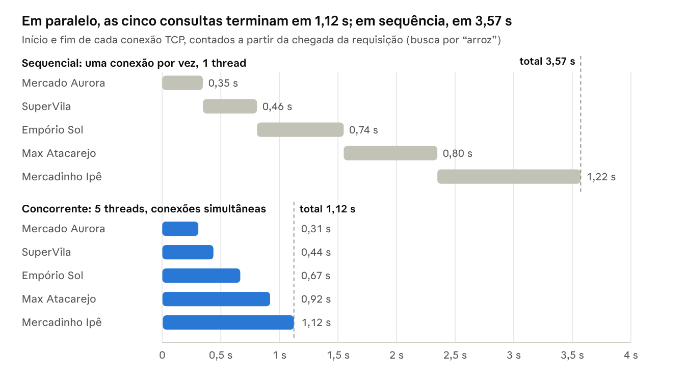
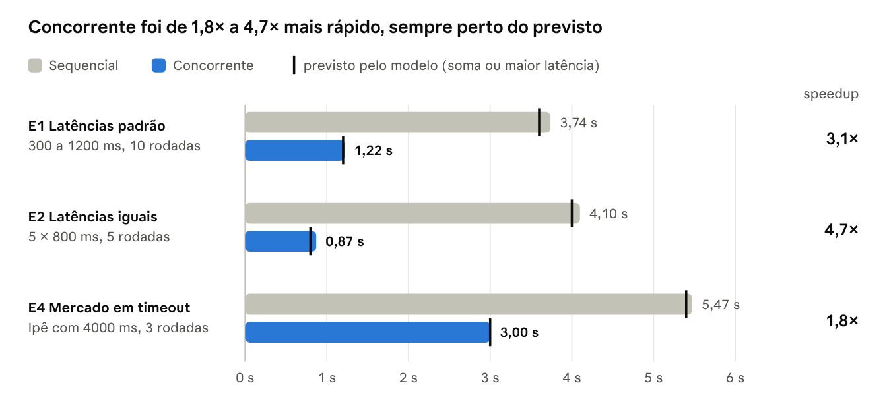
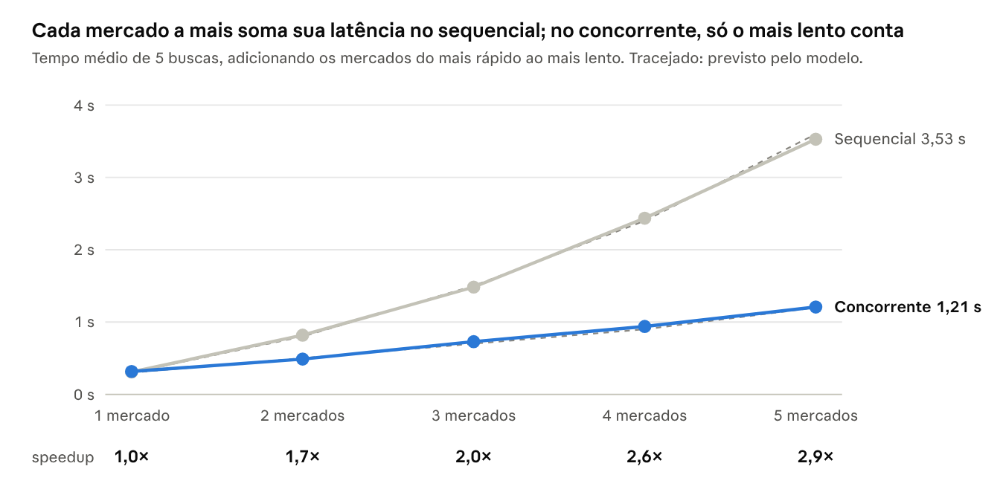
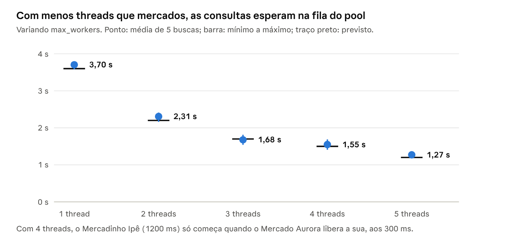
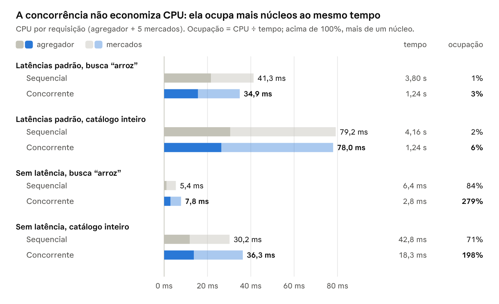

# Comparador de Preços de Supermercados — Relatório Técnico

13/11/2026

## Resumo

Consultar cinco supermercados ao mesmo tempo, com uma thread por mercado, reduziu o tempo de resposta de 3,74 s para 1,22 s: um speedup de 3,1×.

Este relatório descreve um comparador de preços cliente-servidor desenvolvido em Python. Um agregador HTTP (FastAPI) consulta cinco processos independentes, um por supermercado, por meio de sockets TCP e de um protocolo de aplicação próprio. Cada mercado mantém sua própria base SQLite, com 1.352 a 1.690 produtos e entre 243 e 304 mil preços históricos; somados, os cinco bancos têm 7.692 produtos, 1,38 milhão de registros de preço e 82 MB. O agregador oferece duas rotas de busca: uma sequencial, que consulta um mercado de cada vez, e outra concorrente, que usa um `ThreadPoolExecutor`. A interface web (React) exibe os preços ordenados, destaca o menor preço, compara cestas de compras e mostra métricas em tempo real recebidas por WebSocket.

Os experimentos confirmam o modelo esperado: o tempo sequencial se aproxima da soma das latências dos mercados, e o concorrente, da maior delas. Mercados lentos ou fora do ar não interrompem a consulta, que devolve os resultados parciais. A medição de recursos mostra que a concorrência não economiza CPU: o trabalho é o mesmo, mas sobreposto, ao custo de 5 threads extras por requisição.

**Palavras-chave:** sockets TCP, multithreading, sistemas distribuídos, agregador, comparação de preços.

## 1. Introdução

Comparadores de preço, buscadores de passagens e agregadores em geral precisam consultar várias fontes independentes antes de responder ao usuário. Quando essas consultas são feitas uma após a outra, o tempo de resposta cresce com o número de fontes. Quando são feitas ao mesmo tempo, ele passa a depender apenas da fonte mais lenta.

Este trabalho implementa o Tema 1, o comparador de preços de supermercados, para estudar esse efeito com comunicação real por sockets TCP, processos e threads.

### 1.1 Objetivo geral

Desenvolver uma aplicação cliente-servidor que consulte diferentes serviços independentes de forma sequencial e concorrente, usando sockets TCP e multithreading.

### 1.2 Objetivos específicos

1. Especificar a aplicação com técnicas de Engenharia de Software: atores, requisitos e casos de uso (seções 2 e 3).
2. Modelar a arquitetura e o protocolo de comunicação (seções 4 e 5).
3. Implementar a comunicação entre processos com sockets TCP e um agregador com consultas sequenciais e concorrentes (seção 6).
4. Testar o sistema de forma automatizada (seção 7).
5. Medir o impacto da concorrência no desempenho e analisar os resultados (seções 8 e 9).

### 1.3 Escopo

O sistema atende às seis funcionalidades mínimas do enunciado (pesquisa, consulta a pelo menos quatro mercados, apresentação e ordenação dos preços, destaque do menor preço e comparação de desempenho) e às duas evoluções sugeridas: comparação de cestas e identificação do mercado com menor custo total. As bases de produtos e preços são simuladas, como o enunciado permite.

## 2. Requisitos

O sistema tem dois atores humanos e um ator secundário, 17 requisitos funcionais e 10 não funcionais.

### 2.1 Atores

| Ator | Descrição |
| --- | --- |
| Consumidor | Pesquisa produtos, compara preços e monta cestas de compras na loja. |
| Avaliador / Operador | Acompanha o painel em tempo real, roda benchmarks, altera latências e tira mercados do ar para observar o comportamento do sistema. |
| Serviço de mercado (secundário) | Cada um dos cinco processos servidores TCP, que respondem com dados da própria base SQLite. |

### 2.2 Requisitos funcionais

| ID | Requisito |
| --- | --- |
| RF01 | Pesquisar produtos por nome, marca, categoria, tamanho ou palavra-chave, sem diferenciar acentos e maiúsculas. |
| RF02 | Consultar pelo menos quatro supermercados independentes (o sistema tem cinco). |
| RF03 | Exibir o preço de cada produto em cada supermercado. |
| RF04 | Ordenar os resultados por preço: produtos pelo menor preço e ofertas de cada produto do menor para o maior. |
| RF05 | Destacar o supermercado com o menor preço. |
| RF06 | Oferecer duas rotas de consulta: sequencial e concorrente. |
| RF07 | Medir e comparar o tempo das consultas sequenciais e concorrentes. |
| RF08 | Comparar uma cesta de compras e indicar o mercado com menor custo total. |
| RF09 | Calcular o custo da cesta comprando cada item no mercado onde ele é mais barato. |
| RF10 | Exibir em tempo real os eventos de cada conexão TCP (conexão, resposta com tamanho, erro). |
| RF11 | Exibir a linha do tempo (Gantt) das últimas consultas de cada modo. |
| RF12 | Executar benchmark com N repetições e calcular média, mínimo, máximo, desvio padrão e speedup. |
| RF13 | Exportar o histórico de métricas em CSV. |
| RF14 | Alterar a latência simulada de cada mercado e tirá-lo do ar. |
| RF15 | Filtrar por categoria, ordenar (destaques, menor preço, maior diferença, nome) e paginar os resultados. |
| RF16 | Exibir o histórico de preço de um produto em cada mercado. RF17: medir e comparar o consumo de recursos (CPU, threads e memória) dos modos sequencial e concorrente. |

### 2.3 Requisitos não funcionais

| ID | Requisito | Como é atendido |
| --- | --- | --- |
| RNF01 | Comunicação real por sockets TCP entre agregador e mercados. | `socket.create_connection` no cliente; `bind`, `listen` e `accept` no servidor. |
| RNF02 | Concorrência com multithreading. | `ThreadPoolExecutor` no agregador; uma `threading.Thread` por conexão em cada mercado. |
| RNF03 | Tolerância a falhas: um mercado lento ou fora do ar não derruba a consulta. | Timeout de 3 s por conexão; falhas viram resultado parcial em vez de exceção. |
| RNF04 | Independência dos serviços. | Cinco processos, portas 5001 a 5005, um arquivo SQLite por mercado. |
| RNF05 | Desempenho: busca concorrente perto da maior latência, sequencial perto da soma. | Verificado na seção 8. |
| RNF06 | Protocolo robusto à fragmentação do TCP. | Framing com prefixo de tamanho, testado com envio em pedaços de 7 bytes. |
| RNF07 | Interface em português, responsiva e acessível por teclado. | Layout para celular, foco visível, rótulos ARIA. |
| RNF08 | Dados reprodutíveis. | Geração das bases com semente fixa por mercado. |
| RNF09 | Testabilidade. | 34 testes automatizados com pytest (seção 7). |

O requisito RNF10, volume de dados realista, é atendido por um catálogo gerado de 1.740 SKUs (95 tipos de produto, 10 marcas fictícias por categoria, sabores e tamanhos). Cada mercado vende de 78% a 97% dele e guarda 180 dias de preço diário por produto.

## 3. Casos de uso

Nove casos de uso cobrem os dois atores humanos; os quatro que buscam preços incluem a consulta TCP aos mercados (UC09).


*Figura 1. Diagrama de casos de uso.*

O consumidor usa a loja (UC01 a UC04) e o avaliador usa o painel (UC03, UC05 a UC08). Os dois escolhem o modo de consulta. Busca, comparação de um produto, cesta e benchmark incluem o UC09, único caso que conversa com o ator secundário, o serviço de mercado.

| Caso | Ator | Fluxo principal | Fluxos alternativos |
| --- | --- | --- | --- |
| UC01 Pesquisar produto | Consumidor | Digita o termo (produto, marca ou tamanho); o agregador consulta os mercados (UC09), agrupa as ofertas por produto, ordena por preço, marca o menor e pagina; a loja exibe 40 produtos por página, as categorias com contagem, o tempo e a linha do tempo. | Um mercado não responde: a busca segue com os demais e a loja informa qual faltou. Nenhum produto encontrado: a loja sugere termos mais simples. |
| UC02 Comparar preços de um produto | Consumidor | Abre um produto; o sistema lista os mercados do menor para o maior preço, com o selo “Menor preço” e a diferença de cada um; abaixo, o histórico de preço dos últimos 90 dias, pedido a cada mercado com o comando HISTORY (UC09). | Mercados sem o produto, sem estoque ou sem resposta aparecem separados. |
| UC03 Escolher o modo de consulta | Consumidor, Avaliador | Seleciona Sequencial ou Concorrente; as próximas buscas e cestas usam a rota correspondente. | — |
| UC04 Montar e comparar cesta | Consumidor | Adiciona itens e quantidades e pede a comparação; o sistema mostra o total por mercado, a cesta completa mais barata e o custo comprando cada item onde é mais barato. | Nenhum mercado tem todos os itens: totais parciais com a lista do que falta. |
| UC05 Acompanhar métricas ao vivo | Avaliador | Abre o painel; recebe por WebSocket cada conexão, resposta e erro, e vê speedup, linha do tempo e histórico atualizados. | Conexão WebSocket cai: o painel reconecta sozinho. |
| UC06 Rodar benchmark | Avaliador | Define rodadas e termo; o agregador executa a busca nos dois modos alternando a ordem e devolve média, mínimo, máximo, desvio e speedup. | — |
| UC07 Exportar métricas (CSV) | Avaliador | Baixa o histórico com uma linha por mercado por requisição. | — |
| UC08 Configurar ou derrubar mercado | Avaliador | Altera a latência ou tira o mercado do ar; o agregador envia `CONFIG` por TCP. | Mercado inacessível: o painel mostra o erro. |
| UC09 Consultar mercados via TCP | Serviço de mercado | Conecta, envia o comando, espera a resposta, fecha a conexão e publica os eventos com os tempos medidos. | Recusa, fechamento sem resposta ou timeout viram resultado de erro. |

## 4. Arquitetura

O sistema roda em seis processos: cinco mercados independentes, cada um com sua porta TCP e sua base SQLite, e um agregador que os consulta e atende o navegador.


*Figura 2. Arquitetura do sistema.*

A requisição do navegador chega às rotas HTTP, que escolhem a estratégia de consulta. O cliente TCP faz uma conexão por mercado e publica cada passo no EventBus, que o repassa por WebSocket ao painel e à loja. Ao fim de cada requisição, as rotas registram os tempos no MetricsStore.

### 4.1 Protocolos

| Trecho | Protocolo | Motivo |
| --- | --- | --- |
| Navegador → agregador | HTTP/1.1 com JSON | Rotas simples, testáveis no navegador e na documentação automática do FastAPI. |
| Agregador → mercados | TCP puro com framing próprio | Exigência do trabalho; expõe o que o HTTP esconde: fronteiras de mensagem, timeouts, conexão recusada. |
| Agregador → navegador | WebSocket | Envia cada evento no momento em que acontece, sem o navegador precisar perguntar. |

### 4.2 Processos e threads

- **Mercados.** A thread principal de cada processo fica em `accept()`; cada conexão aceita ganha uma thread própria. Assim um mercado atende várias consultas ao mesmo tempo, por exemplo duas abas buscando juntas.
- **Agregador, modo sequencial.** A própria thread que atende a requisição HTTP faz as cinco consultas, uma após a outra: 1 thread.
- **Agregador, modo concorrente.** A requisição cria um `ThreadPoolExecutor` com cinco workers, um por mercado, e recolhe as respostas na ordem em que chegam: 5 threads.
- **Eventos.** As consultas rodam em threads comuns, mas os WebSockets vivem no event loop do asyncio. O EventBus entrega cada evento com `loop.call_soon_threadsafe`, a forma segura de falar com o event loop a partir de outra thread.
- **Rotas síncronas.** As rotas de consulta são funções comuns (`def`), que o FastAPI executa num pool de threads; a espera pelos sockets não trava o event loop que atende os WebSockets.

### 4.3 Decisões de projeto

- **Latência simulada.** Em `localhost` uma consulta leva menos de 1 ms. Cada mercado espera um tempo configurável antes de responder, imitando um servidor remoto; o valor pode ser alterado em tempo de execução.
- **Uma conexão por consulta.** Torna explícito o custo do `connect` e evita compartilhar sockets entre threads. O servidor aceita várias mensagens na mesma conexão, o que permite evoluir para um pool de conexões.
- **Erros como dados.** Falhas viram resultados marcados como erro, nunca exceções, para que a consulta concorrente não perca as respostas boas.
- **“Fora do ar” sem encerrar o processo.** O mercado fecha as conexões de consulta sem responder, mas continua aceitando os comandos administrativos, para poder voltar pelo painel. Encerrar o processo de verdade produz “conexão recusada”.
- **Métricas em memória.** Suficiente para a demonstração; a exportação em CSV preserva os dados.

## 5. Protocolo de comunicação TCP

Agregador e mercados trocam objetos JSON precedidos por 4 bytes que informam o tamanho da mensagem.

### 5.1 Framing

O TCP entrega um fluxo contínuo de bytes e não preserva as fronteiras entre mensagens: um envio de 500 bytes pode chegar em duas leituras de 250, e duas mensagens seguidas podem chegar juntas numa única leitura. Por isso cada mensagem é enviada como um frame:

| Campo | Tamanho | Conteúdo |
| --- | --- | --- |
| Cabeçalho | 4 bytes | Tamanho N do corpo, inteiro sem sinal em ordem de rede (big-endian) |
| Corpo | N bytes | Objeto JSON codificado em UTF-8 |

O receptor lê exatamente 4 bytes, depois exatamente N bytes, repetindo `recv()` até completar cada parte. Mensagens acima de 8 MiB são rejeitadas, para que um cabeçalho corrompido não provoque uma alocação enorme. Se a conexão fecha antes do primeiro byte, a leitura indica fim normal; se fecha no meio de um frame, é um erro de protocolo.

Exemplo: `{"cmd":"PING"}` tem 14 bytes, então o frame começa com `00 00 00 0E`.

### 5.2 Comandos

Toda requisição tem o campo `cmd`. Toda resposta tem `ok`, acompanhado de `data` em caso de sucesso ou de `error` em caso de falha.

| Comando | Parâmetros | Resposta |
| --- | --- | --- |
| `SEARCH` | `q`: termo de busca (vazio = sortimento inteiro) | Itens que contêm todas as palavras (nome, marca, categoria, tamanho), ordenados por preço, com estoque |
| `BASKET` | `items`: lista de `slug` e `qty` | Linhas com subtotal, itens ausentes e total da cesta |
| `HISTORY` | `slug` e `days` (até 365) | Preço diário do produto, lido da tabela `price_history` |
| `PING` | nenhum | Estado do mercado; recusado quando o mercado está fora do ar |
| `STATUS` | nenhum | Igual ao `PING`, mas responde mesmo fora do ar; inclui o tamanho do banco |
| `CONFIG` | `latency_ms` e/ou `online` | Novo estado do mercado |

Exemplo de troca:

```json
→ {"cmd": "SEARCH", "q": "feijão"}
← {"ok": true, "data": {"market": {"id": "aurora", "name": "Mercado Aurora"},
    "items": [{"slug": "feijao-carioca-1kg", "name": "Feijão Carioca", "unit": "1 kg",
               "price": 9.29, "stock": 81}, ...]}}
```

### 5.3 Ciclo de uma consulta e tratamento de falhas

Para cada mercado, o agregador abre uma conexão (`connect`), envia o frame, espera a resposta e fecha a conexão. Mede três tempos: conexão, envio e espera pela resposta. Qualquer falha é convertida em um resultado marcado como erro, e a consulta segue com os demais mercados.

| Situação | O que o cliente observa | Mensagem registrada |
| --- | --- | --- |
| Processo do mercado parado | Conexão recusada no `connect` | conexão recusada (processo do mercado não está rodando) |
| Mercado fora do ar | Conexão aceita e fechada sem resposta | o mercado encerrou a conexão sem responder |
| Latência acima de 3 s | Timeout na leitura | tempo esgotado (3,0 s) |
| Frame inválido | Erro de protocolo | texto do erro |

O cliente também registra o tamanho de cada frame recebido. Somando os cinco mercados, uma busca por “arroz grao nobre” traz 5 KB, uma por “arroz” traz 44 KB (217 ofertas) e o catálogo inteiro traz 1,5 MB (7.692 ofertas).

## 6. Implementação

A diferença entre os dois modos de consulta cabe em poucas linhas: um laço `for` no sequencial e um `ThreadPoolExecutor` no concorrente.

### 6.1 Tecnologias

| Camada | Tecnologia | Responsabilidade |
| --- | --- | --- |
| Mercados | Python 3.12, `socket`, `threading`, SQLite | Servidor TCP de cada supermercado e sua base de dados |
| Agregador | Python 3.12, FastAPI, Uvicorn | Rotas HTTP, consultas TCP, eventos e métricas |
| Concorrência | `concurrent.futures.ThreadPoolExecutor` | Uma thread por mercado no modo concorrente |
| Tempo real | WebSocket | Envio dos eventos de cada conexão ao painel |
| Interface | React, TypeScript, Tailwind CSS, Recharts | Loja, cesta e painel de métricas |
| Testes | pytest, httpx | Testes de protocolo, servidor, estratégias e API |

### 6.2 Estratégias de consulta

As duas funções recebem a mesma lista de mercados e o mesmo comando; só muda a forma de disparar as consultas.

```python
def sequential(markets, payload, emit=None, t0=None):
    results = []
    for market in markets:  # um de cada vez
        results.append(query_market(market, payload, t0=t0, emit=emit))
    return results

def concurrent(markets, payload, emit=None, t0=None):
    results = []
    with ThreadPoolExecutor(max_workers=len(markets)) as pool:
        futures = [pool.submit(query_market, m, payload, t0=t0, emit=emit) for m in markets]
        for future in as_completed(futures):  # na ordem em que terminam
            results.append(future.result())
    return results
```

A função `query_market` nunca lança exceção: timeout, conexão recusada e mercado fora do ar viram um resultado com `ok = False`. Assim, uma falha num mercado não descarta as respostas dos outros.

### 6.3 Servidor de mercado

Cada mercado é um processo separado que cria um socket, faz `bind` e `listen` na sua porta e fica em `accept()`. Cada conexão aceita ganha uma `threading.Thread`, que lê os frames, consulta o SQLite e responde. A conexão com o banco é aberta por requisição, porque um objeto de conexão SQLite não pode ser compartilhado entre threads.

Antes de responder a `SEARCH` e `BASKET`, o mercado espera uma latência simulada, com variação de ±15%. Sem ela, todas as consultas em `localhost` levariam menos de 1 ms e a diferença entre os modos desapareceria no ruído. As latências iniciais são:

| Mercado | Porta | Latência | Produtos | Preços históricos | Banco |
| --- | --- | --- | --- | --- | --- |
| Mercado Aurora | 5001 | 300 ms | 1.690 | 304.200 | 18,1 MB |
| SuperVila | 5002 | 500 ms | 1.621 | 291.780 | 17,3 MB |
| Empório Sol | 5003 | 700 ms | 1.488 | 267.840 | 15,9 MB |
| Max Atacarejo | 5004 | 900 ms | 1.541 | 277.380 | 16,5 MB |
| Mercadinho Ipê | 5005 | 1200 ms | 1.352 | 243.360 | 14,4 MB |

### 6.4 Bases de dados simuladas

Os cinco bancos somam 7.692 produtos, 1,38 milhão de registros de preço e 82 MB, gerados em cerca de 4 s por `seed.py`. O catálogo comum combina 95 tipos de produto (arroz, café, ração, shampoo…) com 10 marcas fictícias por categoria, sabores e tamanhos, num total de 1.740 SKUs em 11 categorias. Cada mercado vende parte desse catálogo (de 78% no Mercadinho Ipê a 97% no Mercado Aurora) e aplica sobre o preço da marca seu perfil de loja (o atacarejo é 12% mais barato, o empório 10% mais caro) e uma variação de ±12%. Cada produto tem estoque, código de barras EAN-13 fictício e 180 dias de preço diário, gerado como um passeio aleatório que termina no preço atual. O gerador usa semente fixa, então os dados são sempre os mesmos.

### 6.5 Interface

A loja exibe 40 produtos por página, com foto real do tipo de produto (Open Food Facts e bases irmãs), marca, tamanho e o menor preço em destaque. Categorias com contagem, ordenação e paginação são calculadas pelo agregador, e cada mudança consulta os cinco mercados de novo. Um alternador no topo escolhe o modo de consulta, e uma faixa abaixo da busca mostra o tempo total, os bytes recebidos e uma barra por mercado, desenhada ao vivo conforme as respostas chegam. Ao abrir um produto, os mercados aparecem do menor para o maior preço, com o selo “Menor preço”, seguidos do histórico de preço dos últimos 90 dias em cada mercado. A cesta mostra o total em cada mercado, a cesta completa mais barata e o custo comprando cada item onde ele é mais barato.

O painel em tempo real mostra o speedup médio, a linha do tempo das últimas consultas de cada modo, o histórico de tempos, a latência média por mercado, os controles de latência e disponibilidade de cada mercado, o consumo de recursos de cada modo (CPU do agregador e dos mercados, ocupação da CPU, threads extras e memória de cada processo), o benchmark e um feed das requisições ao vivo, com a linha do tempo das cinco conexões em cada cartão e os eventos TCP sob demanda. O histórico de métricas pode ser exportado em CSV.

## 7. Testes

Os 34 testes automatizados passaram em 16,9 s (`pytest`), e o fluxo completo foi verificado manualmente no navegador.

### 7.1 Estratégia

Os testes automatizados sobem os cinco mercados em threads, em portas livres, com bancos temporários completos (gerados uma vez por execução, com 14 dias de histórico para ficar rápido) e latências reduzidas (100 a 300 ms, sem variação aleatória). Assim a suíte é rápida, não depende de processos já rodando e usa conexões TCP reais. Os testes de API usam o `TestClient` do FastAPI apontado para esses mercados.

### 7.2 Testes automatizados

| ID | Caso de teste | Entrada | Resultado esperado | Obtido |
| --- | --- | --- | --- | --- |
| T01 | Ida e volta de uma mensagem | Objeto com “feijão açúcar” por um par de sockets | Objeto idêntico, acentos preservados | Passou |
| T02 | Prefixo de tamanho | Frame de `{"a": 1}` | Cabeçalho igual ao tamanho do corpo | Passou |
| T03 | Mensagem fragmentada | Frame enviado em pedaços de 7 bytes | Mensagem remontada corretamente | Passou |
| T04 | Duas mensagens grudadas | Dois frames num único envio | Duas leituras, uma mensagem cada | Passou |
| T05 | Fechamento limpo | Conexão fechada sem dados | Leitura devolve “fim” sem erro | Passou |
| T06 | Fechamento no meio do frame | Cabeçalho de 100 bytes e corpo incompleto | Erro de protocolo | Passou |
| T07 | Tamanho absurdo | Cabeçalho anunciando 2 GiB | Erro de protocolo, sem alocação | Passou |
| T08 | Busca ordenada | `SEARCH` “arroz” | Apenas arroz, preços crescentes | Passou |
| T09 | Busca sem acento | “Feijão” e “feijao” | Mesmos resultados, pelo menos 20 itens | Passou |
| T10 | Busca por marca e tamanho | “arroz grao nobre 5 kg” | Só itens da marca Grão Nobre, 5 kg | Passou |
| T11 | Sortimento inteiro | `SEARCH` com termo vazio | Todos os produtos do banco (mais de 1.000) | Passou |
| T12 | Total da cesta | 2 unidades de um arroz + 1 produto inexistente | Total = 2 × preço; inexistente em `missing` | Passou |
| T13 | Histórico de preço | `HISTORY` de um café, 7 dias | 7 dias em ordem; o último igual ao preço atual | Passou |
| T14 | Comando desconhecido | `DANCE` | `ok = false` com mensagem de erro | Passou |
| T15 | Mercado fora do ar | `CONFIG online=false`, depois `SEARCH` e `STATUS` | Busca sem resposta; `STATUS` responde | Passou |
| T16 | Preços independentes | “arroz branco” nos 5 mercados | Pelo menos dois preços diferentes | Passou |
| T17 | Concorrente mais rápido | Mesma busca nos dois modos | Sequencial ≥ soma das latências; concorrente < maior + 250 ms e < metade do sequencial | Passou |
| T18 | Sequencial sem sobreposição | Busca sequencial | Cada consulta começa depois do fim da anterior | Passou |
| T19 | Concorrente sobreposto | Busca concorrente | Consultas sobrepostas, 5 threads distintas | Passou |
| T20 | Tolerância a mercado fora do ar | Um mercado offline, busca concorrente | 4 respostas boas, 1 erro | Passou |
| T21 | Processo parado | Porta sem servidor | Erro “conexão recusada” | Passou |
| T22 | Timeout | Latência 1500 ms, timeout 0,5 s | Erro “tempo esgotado” em menos de 1 s | Passou |
| T23 | Bytes recebidos | Busca específica e catálogo inteiro | Tamanho medido e maior no catálogo | Passou |
| T24 | Eventos emitidos | Busca concorrente | 5 eventos de conexão e 5 de resposta | Passou |
| T25–T26 | Rota de busca, nos dois modos | `GET /api/search/{modo}?q=arroz` | 5 mercados; ofertas e produtos ordenados; menor preço correto | Passou |
| T27 | Modo inválido | `GET /api/search/paralelo` | HTTP 422 | Passou |
| T28 | Paginação e categorias | Catálogo inteiro, páginas 1 e 2, filtro Bebidas | Páginas sem repetição; contagens batem com o total e com o filtro | Passou |
| T29 | Rota de histórico | `GET /api/history/{slug}?days=7` | 5 mercados, séries de 7 dias | Passou |
| T30 | Cesta mais barata | Dois arrozes com maior diferença de preço | Mercado mais barato entre os completos; combinação ≤ cesta mais barata | Passou |
| T31 | Configuração e métricas | Mercado offline, busca, histórico e CSV | 1 erro registrado; CSV com 5 linhas e coluna de bytes | Passou |
| T32 | Benchmark | 2 rodadas de “cafe” | 2 medidas por modo, speedup > 2 | Passou |
| T33 | WebSocket | Busca com o painel conectado | `request_start`, 5 respostas, `request_end` | Passou |

O teste T34 confere a medição de recursos: numa busca por “arroz”, o modo concorrente registra pelo menos 5 threads extras, o sequencial no máximo 1, e a CPU de cada mercado, a CPU do agregador e a memória são medidas.

### 7.3 Testes de sistema (manuais)

Com os seis processos rodando, foram verificados no navegador: busca nos dois modos com a linha do tempo desenhada ao vivo; ordenação e selo de menor preço; cesta com três itens; benchmark de 3 rodadas; retirada de um mercado do ar, com a loja informando “4 de 5 mercados responderam”; arraste do controle de latência até 3,65 s, com o valor mantido após a resposta e o poll seguinte; paginação do catálogo inteiro e histórico de preço no detalhe do produto; e layout em tela de celular (375 px), sem rolagem horizontal. O comando `lsof -iTCP:5001-5005 -sTCP:LISTEN` confirmou cinco processos Python escutando em portas TCP.

## 8. Experimentos e resultados

Com as latências padrão, a consulta concorrente foi 3,1× mais rápida que a sequencial (1,22 s contra 3,74 s, média de 10 rodadas); com cinco mercados de latência igual, o ganho chegou a 4,7×.

### 8.1 Metodologia

- **Ambiente:** macOS em Apple Silicon, Python 3.12, todos os processos em `127.0.0.1`, timeout do cliente de 3 s. Bancos com 1.352 a 1.690 produtos por mercado; a busca “arroz” devolve 217 ofertas (44 KB) somando os cinco.
- **Medição:** o agregador mede cada requisição com `time.perf_counter()`, do início da primeira consulta até a última resposta, e registra início e fim de cada conexão.
- **Latência:** cada mercado espera o tempo configurado com variação aleatória de ±15% antes de responder.
- **Benchmark:** a mesma busca (“arroz”) roda nos dois modos, alternando a ordem a cada rodada para que nenhum modo seja favorecido por cache ou aquecimento.
- **Modelo esperado:** com latências l₁ … lₙ, o sequencial deve levar cerca de l₁ + … + lₙ e o concorrente cerca de max(l₁ … lₙ).

### 8.2 Uma consulta em detalhe



*Figura 3. Linha do tempo de uma consulta em cada modo.*

No sequencial, cada mercado só é consultado depois que o anterior responde, e as barras formam uma escada. No concorrente, as cinco conexões abrem nos primeiros 10 ms e o total é decidido pelo mercado mais lento, o Mercadinho Ipê.

### 8.3 Cenários de latência e falha

| Cenário | Configuração | Rodadas | O que se quer observar |
| --- | --- | --- | --- |
| E1 | Latências padrão: 300, 500, 700, 900 e 1200 ms | 10 | Caso típico, mercados com velocidades diferentes |
| E2 | Todos os mercados com 800 ms | 5 | Ganho máximo quando as latências são iguais |
| E3 | Todos os mercados com 0 ms | 20 | Custo real de TCP, SQLite e threads em `localhost` |
| E4 | Padrão, mas Mercadinho Ipê com 4000 ms | 3 | Mercado lento além do timeout de 3 s |
| E5 | Padrão, Mercadinho Ipê fora do ar | manual | Tolerância a falha |



*Figura 4. Tempo médio por cenário, comparado ao previsto.*

Em todos os cenários, as médias ficaram a menos de 9% do previsto. No E1, o sequencial variou de 3,43 s a 3,97 s (desvio de 150 ms) e o concorrente de 1,03 s a 1,35 s (desvio de 103 ms). No E4, o Mercadinho Ipê esgotou o timeout nas seis consultas e os dois modos devolveram os preços dos outros quatro mercados.

O cenário E3, sem latência, fica fora do gráfico porque está em outra escala: 17,7 ms no sequencial contra 7,4 ms no concorrente, um ganho de 2,4× (ver seção 8.6). No E5, com o Mercadinho Ipê fora do ar, o mercado fechou a conexão em 1,4 ms e a busca concorrente caiu para 911 ms em média (a latência do Max Atacarejo, 900 ms) e a loja exibiu “4 de 5 mercados responderam”.

### 8.4 Efeito do número de mercados



*Figura 5. Tempo pelo número de mercados.*

Com um único mercado, os dois modos empatam: não há o que paralelizar. A cada mercado acrescentado, o sequencial soma a latência dele, enquanto o concorrente só cresce porque o novo mercado é mais lento que os anteriores. O speedup sobe de 1,0× para 2,9× e tende a crescer com o número de fontes consultadas.

### 8.5 Efeito do número de threads



*Figura 6. Tempo pelo número de threads do pool.*

O previsto vem de simular o pool: cada consulta, na ordem de envio, vai para a primeira thread livre. Com 2 threads, por exemplo, o Empório Sol começa aos 300 ms, o Max Atacarejo aos 500 ms e o Mercadinho Ipê só aos 1000 ms, terminando em 2,2 s; mediu-se 2,31 s. Com 3 e 4 threads, o medido (1,68 s e 1,55 s) ficou a menos de 50 ms do previsto. Com uma única thread, o modo concorrente vira sequencial. O ganho máximo só aparece com uma thread por mercado.

### 8.6 Volume de dados

Trazer 300 vezes mais dados custou poucos milissegundos: sem latência, o catálogo inteiro (1,5 MB) levou 67 ms no sequencial e 31 ms no concorrente; com as latências padrão, a diferença entre as buscas some na variação.

| Busca | Ofertas | Recebido (5 mercados) | Sem latência: sequencial | Sem latência: concorrente | Latências padrão: sequencial | Latências padrão: concorrente |
| --- | --- | --- | --- | --- | --- | --- |
| “arroz grao nobre” | 23 | 5 KB | 9,4 ms | 5,1 ms | 3,61 s | 1,20 s |
| “arroz” | 217 | 44 KB | 18,2 ms | 9,5 ms | 3,81 s | 1,19 s |
| Catálogo inteiro | 7.692 | 1,53 MB | 66,6 ms | 31,3 ms | 3,77 s | 1,25 s |

Média de 5 buscas por célula (E8). Em `localhost`, a espera simulada pela rede domina; o volume só pesaria numa rede lenta ou com respostas muito maiores.

### 8.7 Consumo de recursos

A concorrência não reduz o processamento: com espera de rede, os dois modos gastam praticamente a mesma CPU por requisição (78 ms contra 79 ms no catálogo inteiro); o concorrente só a concentra numa janela 3× menor e cria 5 threads extras.



*Figura 7. Consumo de CPU por requisição.*

- **Como foi medido (E9).** Cada mercado informa a CPU gasta pela thread que atendeu a consulta (`time.thread_time()`, que não conta o sleep da latência). O agregador mede a CPU do próprio processo durante a requisição com `psutil`, o pico de threads com `threading.active_count()` e a memória residente. Foram 10, 5, 20 e 10 rodadas por cenário, na ordem do gráfico.
- **Com espera de rede**, a CPU dos mercados é a mesma nos dois modos (19,7 ms contra 19,3 ms na busca “arroz”). A CPU do agregador aparece maior no sequencial (21,6 ms contra 15,6 ms) porque a janela de medição é 3× mais longa e inclui tarefas de fundo, como o WebSocket. A CPU fica ocupada de 1% a 6% do tempo: o resto é espera.
- **Sem espera de rede**, o concorrente gasta de 20% a 43% mais CPU, pelo custo de criar threads e trocar de contexto, mas ocupa de 2 a 2,8 núcleos ao mesmo tempo, contra menos de um no sequencial. É esse paralelismo, nos cinco processos dos mercados, que dá o ganho de 2,3× mesmo sem latência.
- **Threads e memória.** O sequencial não cria threads; o concorrente cria uma por mercado (5) a cada requisição. Cada processo de mercado ocupa cerca de 18 MB de memória residente, e o agregador entre 30 e 50 MB.

Os tempos sem latência variam entre rodadas (6 a 18 ms na busca “arroz”, comparando E3 e E9) porque dependem da carga do computador; o speedup ficou entre 2,3× e 2,4× nas duas medições.

## 9. Discussão

Os resultados confirmam o modelo simples: o tempo sequencial é a soma das latências e o concorrente é a maior delas, de modo que o speedup máximo é a soma dividida pelo máximo.

- **Speedup previsível.** Com as latências padrão, 3,6 s ÷ 1,2 s = 3,0; o medido foi 3,1×. Com cinco latências iguais o limite teórico é 5×, e o medido foi 4,7×. A diferença vem da variação de ±15%: o modo concorrente espera o mais lento de cinco sorteios, que tende a ficar acima de 800 ms (871 ms na média).
- **Concorrência compensa quando se espera E/S.** Sem latência (E3), o ganho ainda foi de 2,4×: sobra o trabalho real de cada mercado (consultar o SQLite e montar o JSON), que os cinco processos fazem em paralelo. Com os bancos pequenos da primeira versão, esse trabalho levava cerca de 1 ms e o ganho era de apenas 1,4×, pois o custo de criar o pool pesava mais. Em Python, uma thread parada em `recv()` libera o GIL e as outras seguem trabalhando; para tarefas de CPU, threads não trariam o mesmo ganho.
- **Timeouts são indispensáveis.** No E4, sem timeout, um único mercado travado seguraria a resposta inteira. Com timeout de 3 s, o concorrente respondeu em 3,0 s e o sequencial em 5,5 s (soma dos outros quatro mais o timeout). O valor do timeout é um compromisso: curto demais descarta mercados apenas lentos; longo demais atrasa o usuário.
- **Uma thread por fonte.** Com menos threads que mercados, as consultas excedentes esperam na fila do pool e o tempo volta a crescer (seção 8.5). Para dezenas ou centenas de fontes, um pool fixo e limitado ou um modelo assíncrono (`asyncio`) seria mais adequado que uma thread por fonte.
- **Tolerância a falhas.** Tratar falhas como dados, e não como exceções, fez com que mercado fora do ar, processo parado e timeout produzissem resultados parciais em vez de erro para o usuário.

### 9.1 Limitações

- Todos os processos rodam na mesma máquina, e a latência de rede é simulada com uma espera. Não há perda de pacotes, variação real de rota nem limite de banda.
- Os cenários usaram de 3 a 20 rodadas; mais repetições dariam intervalos de confiança mais estreitos. A CPU e as threads do agregador são medidas no processo inteiro, então requisições simultâneas de outras abas entram na conta; por isso o E9 foi medido sem outras consultas em andamento (0 threads extras no sequencial).
- Numa primeira rodada, com bancos pequenos, 3 e 4 threads ficaram 120 a 160 ms acima do previsto; refeito com os bancos atuais, o desvio caiu para menos de 50 ms. Com 5 buscas por ponto, diferenças dessa ordem estão dentro da variação esperada.
- Cada consulta abre uma nova conexão TCP; um pool de conexões reduziria o custo do handshake, que em `localhost` é desprezível mas numa rede real não seria.

## 10. Conclusão

O comparador atende a todas as funcionalidades mínimas do Tema 1 e às duas evoluções sugeridas, com comunicação real por sockets TCP entre seis processos. A consulta concorrente com threads reduziu o tempo de resposta a cerca de um terço, como o modelo previa.

O trabalho percorreu as etapas pedidas: levantamento de atores e requisitos, casos de uso, modelagem da arquitetura e do protocolo, implementação, 34 testes automatizados e experimentos com análise. Os experimentos mostraram que o ganho da concorrência depende de quanto tempo as consultas passam esperando a rede, de quantas fontes são consultadas e de haver threads suficientes para todas. A concorrência não reduz o processamento: troca espera por paralelismo, ao custo de threads e, quando não há espera de rede, de um pouco mais de CPU.

### 10.1 Trabalhos futuros

- Rodar os mercados em outras máquinas da rede local, com um endereço configurável por mercado, para medir latência real em vez de simulada.
- Comparar a versão com threads a uma versão com `asyncio`, que atende muitas conexões numa única thread.
- Manter um pool de conexões TCP abertas para cada mercado, eliminando o handshake a cada consulta.
- Guardar as métricas em banco, para que o histórico sobreviva a reinicializações do agregador.

## Apêndice A. Como executar

Requisitos: Python 3.12 e Node.js 20 ou superior.

1. Instalar o backend, uma vez: `cd backend`, `python3.12 -m venv .venv` e `.venv/bin/pip install -r requirements.txt`.
2. Subir os cinco mercados e o agregador: `cd backend && .venv/bin/python run_all.py`. Na primeira execução, as bases SQLite são geradas (cerca de 4 s, 82 MB); para gerá-las de novo, \`.venv/bin/python -m markets.seed\`.
3. Subir a interface, em outro terminal: `cd frontend && npm install && npm run dev`, e abrir `http://localhost:5173`.
4. Rodar os testes: `cd backend && .venv/bin/python -m pytest`.
5. Conferir os processos TCP: `lsof -nP -iTCP:5001-5005 -sTCP:LISTEN`.

A documentação interativa da API fica em `http://localhost:8000/docs`. Com `npm run build`, o próprio agregador passa a servir a interface em `http://localhost:8000`.

## Apêndice B. Rotas da API

| Rota | Descrição |
| --- | --- |
| `GET /api/search/sequential?q=&category=&sort=&page=` | Consulta os mercados um de cada vez; filtra, ordena e pagina |
| `GET /api/search/concurrent?q=&category=&sort=&page=` | Consulta todos os mercados ao mesmo tempo; filtra, ordena e pagina |
| `GET /api/history/{slug}?days=` | Histórico de preço do produto nos cinco mercados (comando `HISTORY`) |
| `POST /api/basket/{modo}` | Total de uma cesta em cada mercado |
| `POST /api/benchmark` | Executa N rodadas de cada modo e devolve estatísticas |
| `GET /api/markets` | Estado de cada mercado, obtido pelo comando `STATUS` |
| `POST /api/markets/{id}/config` | Altera latência e disponibilidade (comando `CONFIG`) |
| `GET /api/metrics/history` | Histórico de requisições |
| `GET /api/metrics/export.csv` | Histórico em CSV, com bytes recebidos por mercado |
| `WS /ws/events` | Eventos em tempo real |

## Referências

- Python Software Foundation. [socket — Low-level networking interface](https://docs.python.org/3/library/socket.html).
- Python Software Foundation. [concurrent.futures — Launching parallel tasks](https://docs.python.org/3/library/concurrent.futures.html).
- Python Software Foundation. [threading — Thread-based parallelism](https://docs.python.org/3/library/threading.html).
- [FastAPI — documentação oficial](https://fastapi.tiangolo.com/).
- [Open Food Facts](https://world.openfoodfacts.org/), fonte das fotos dos produtos (licença CC BY-SA).
- Kurose, J. F.; Ross, K. W. *Redes de computadores e a Internet: uma abordagem top-down*. Pearson.
- Tanenbaum, A. S.; Van Steen, M. *Sistemas distribuídos: princípios e paradigmas*. Pearson.
