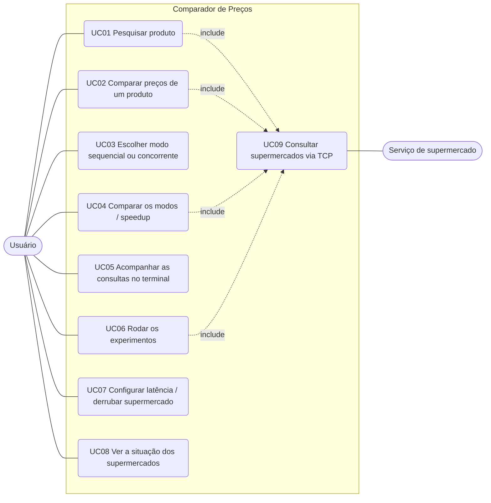

# Documento de requisitos — Comparador de Preços de Supermercados

Trabalho 1 de Sistemas Distribuídos, Tema 1. Este documento cobre a seção 5 do enunciado: análise de requisitos, requisitos funcionais e não funcionais, restrições, critérios de aceitação e casos de uso.

## 1. Descrição do problema

Quem quer economizar nas compras precisa saber quanto o mesmo produto custa em cada supermercado. Hoje isso significa abrir o site de cada loja, pesquisar o produto várias vezes e comparar os preços de cabeça. Cada supermercado é um sistema independente, com seu próprio catálogo, preços e estoque, e responde no seu próprio tempo.

Um comparador automatiza essa tarefa: recebe a pesquisa, consulta todos os supermercados e devolve os preços já ordenados, apontando o mais barato. O desafio técnico é o tempo de resposta. Se o comparador consulta um supermercado de cada vez, o usuário espera a **soma** dos tempos de todos. Como as consultas são independentes, elas podem ser feitas ao mesmo tempo, e o usuário passa a esperar só o supermercado **mais lento**. O comparador também precisa continuar funcionando quando um supermercado está lento ou fora do ar.

## 2. Objetivo do sistema

Permitir que o usuário informe um produto e receba, em uma única resposta, os preços desse produto em pelo menos quatro supermercados independentes, ordenados do menor para o maior, com o menor preço identificado. O sistema deve consultar os supermercados por sockets TCP de duas formas, sequencial e concorrente (com threads), e medir o tempo de cada uma para que a diferença possa ser estudada em experimentos.

## 3. Escopo

**Dentro do escopo**

- Cinco supermercados simulados, cada um um processo servidor TCP com sua própria base SQLite (produtos, preços e estoque fictícios), cada um na sua pasta (`markets/<mercado>/`).
- Um agregador que recebe pesquisas por TCP, consulta os supermercados no modo sequencial ou concorrente, consolida e ordena os resultados.
- Um **cliente de terminal** (`client/`), que conversa com o agregador por socket TCP. Vários clientes podem estar conectados ao mesmo tempo.
- Um painel no terminal do agregador que mostra cada passo das consultas, em duas versões: gráfica (uma barra por mercado, threads, tempos, novas tentativas e falhas) e crua (`--raw`, uma linha por evento TCP).
- Pesquisa de produtos, comparação de preços, identificação do menor preço e comparação entre os modos sequencial e concorrente.
- Medição de tempos, tratamento de falhas (lentidão, queda, processo parado) e scripts que executam os cinco experimentos obrigatórios.

**Fora do escopo**

- Preços reais ou integração com sites de supermercados de verdade.
- Interface web ou gráfica: toda a comunicação é TCP explícita, e a interface é o terminal.
- Comparação de cestas de compras (a "possibilidade de evolução" do enunciado).
- Cadastro de usuários, login, pagamento ou finalização de compra.
- Distribuição em várias máquinas, balanceamento de carga e replicação (o sistema roda em `127.0.0.1`, mas os endereços são configuráveis).

## 4. Atores

| Ator | Tipo | Descrição |
|---|---|---|
| **Usuário** | Principal | Quem usa o cliente de terminal. Pesquisa produtos e compara preços, escolhe e compara os modos, altera a latência e derruba supermercados, acompanha o painel do agregador e roda os experimentos. O sistema não tem perfis nem login: qualquer pessoa com o cliente tem acesso a todos os comandos. |
| **Serviço de supermercado** | Secundário | Cada um dos cinco processos servidores TCP. Responde às consultas do agregador com dados da própria base. |

## 5. Requisitos funcionais

| ID | Requisito | Prioridade | Onde está |
|---|---|---|---|
| RF01 | O sistema deverá permitir que o usuário informe o produto a pesquisar e o modo de consulta. | Essencial | `client/terminal.py` (operação `consultar`; `/seq`, `/con`, `--mode`) |
| RF02 | O sistema deverá consultar pelo menos quatro supermercados independentes (são cinco). | Essencial | `markets/<mercado>/server.py`, `common/config.py` |
| RF03 | O sistema deverá permitir consultas sequenciais: um supermercado de cada vez. | Essencial | `aggregator/sequential.py` |
| RF04 | O sistema deverá permitir consultas concorrentes: todos os supermercados ao mesmo tempo, com uma thread por supermercado. | Essencial | `aggregator/concurrent.py` |
| RF05 | O sistema deverá apresentar o preço de cada produto encontrado em cada supermercado. | Essencial | resposta `resultados[].ofertas`; lista de preços no cliente |
| RF06 | O sistema deverá ordenar os resultados por preço: os produtos pelo menor preço e, dentro de cada produto, as ofertas do mais barato para o mais caro. | Essencial | `aggregator/consolidation.py` |
| RF07 | O sistema deverá identificar o supermercado com o menor preço de cada produto. | Essencial | campo `menor_preco`; marca ★ no cliente |
| RF08 | O sistema deverá registrar o tempo de execução de cada pesquisa (total e de cada supermercado). | Essencial | `tempo_total_ms` e `mercados[].tempo_ms` na resposta; painel do agregador |
| RF09 | O sistema deverá comparar as estratégias sequencial e concorrente para a mesma pesquisa, informando o speedup. | Essencial | operação `comparar` (`/compare` e `--compare` no cliente) |
| RF10 | O sistema deverá informar quais supermercados não responderam e o motivo, sem descartar os resultados dos demais. | Essencial | `status: "parcial"`, `mercados[].erro` |
| RF11 | O sistema deverá permitir alterar a latência simulada e a disponibilidade de cada supermercado durante a execução. | Essencial (experimentos) | operação `configurar` (`/latency`, `/down`, `/up` no cliente), comando `CONFIG` do mercado |
| RF12 | O sistema deverá mostrar a situação de cada supermercado (no ar, latência, produtos) e quantos clientes estão conectados. | Desejável | operação `mercados` (`/markets` no cliente), comando `STATUS` do mercado |
| RF13 | O sistema deverá executar os experimentos obrigatórios de forma automática e salvar os resultados em CSV, tabelas e gráficos. | Essencial (experimentos) | `experiments/` → `docs/relatorio/dados/` e `docs/relatorio/figuras/` |
| RF14 | O sistema deverá mostrar em tempo real cada passo das consultas (conexão, envio, resposta, nova tentativa, falha) e a thread que o executou. | Desejável | `aggregator/display.py` (painel gráfico e `start.py --raw`) |
| RF15 | O sistema deverá informar quantas threads cada pesquisa usou. | Desejável | rodapé de cada quadro do painel; campo `threads` do registro |

## 6. Requisitos não funcionais

| ID | Categoria | Requisito | Como é atendido |
|---|---|---|---|
| RNF01 | Comunicação | A comunicação entre cliente, agregador e supermercados deverá usar sockets TCP. | Cliente → agregador: porta 5050. Agregador → supermercados: portas 5001–5005. `socket.create_connection` nos clientes, `socketserver.ThreadingTCPServer` nos servidores. Não há HTTP nem outro protocolo no caminho. |
| RNF02 | Concorrência | A estratégia concorrente deverá usar threads. | `threading.Thread`, uma thread por supermercado (`thread_1` … `thread_5`). |
| RNF03 | Escalabilidade | Os servidores deverão atender múltiplas conexões simultaneamente. | Agregador: uma thread por cliente TCP. Supermercado: uma thread por conexão (`conexão nº N`). Medido no Experimento 4. |
| RNF04 | Confiabilidade | O sistema deverá tratar falhas de comunicação sem derrubar a pesquisa. | Timeout de 3 s por supermercado; até 3 novas tentativas (0,5 s → 1 s → 2 s) quando a conexão é recusada ou fechada sem resposta; resultado parcial com o erro de cada supermercado. Medido no Experimento 5. |
| RNF05 | Mensurabilidade | A aplicação deverá permitir experimentos de desempenho reproduzíveis. | Latência configurável em tempo de execução, `experiments/` (um arquivo por experimento), CSV com os dados brutos. |
| RNF06 | Interoperabilidade | O protocolo de aplicação deverá ser documentado e robusto à fragmentação do TCP. | JSON em UTF-8, uma mensagem por linha (`docs/protocolo.md`); testado com envio em pedaços de 7 bytes. |
| RNF07 | Independência | Cada supermercado deverá executar como processo independente, com porta, código e base próprios. | 5 processos, portas 5001–5005, uma pasta por mercado com `server.py`, `database.py` e o próprio `.db`. |
| RNF08 | Desempenho | Com as latências padrão, a pesquisa concorrente deverá levar perto da maior latência (~1,2 s) e a sequencial perto da soma (~3,6 s). | Experimentos 1 e 2. |
| RNF09 | Testabilidade | O sistema deverá ter testes automatizados para protocolo, servidores, estratégias e painel. | 49 testes `pytest`. |
| RNF10 | Usabilidade | O cliente deverá mostrar claramente o menor preço e o tempo gasto, com comandos curtos. | Terminal com cores e ★; comandos `/seq`, `/con`, `/compare`, `/markets`, `/help`. |
| RNF11 | Robustez operacional | Encerrar o sistema não deverá cortar pesquisas em andamento nem deixar processos órfãos. | Ctrl+C: o agregador espera as pesquisas em andamento (até 7 s) e só depois os mercados são encerrados; cada processo filho encerra sozinho se o `start.py` morrer. |

## 7. Restrições

- **Linguagem e bibliotecas:** Python 3.12. A comunicação TCP usa só a biblioteca padrão (`socket`, `socketserver`, `threading`, `concurrent.futures`), sem frameworks de RPC ou mensageria. `rich` desenha o painel e `matplotlib` os gráficos.
- **Comunicação real:** não é aceita uma implementação que simule a comunicação sem sockets. Toda consulta aos supermercados atravessa uma conexão TCP.
- **Dados simulados:** supermercados, marcas, preços e estoques são fictícios, gerados com semente fixa (`tools/seed_databases.py`).
- **Latência simulada:** em `localhost` a rede responde em menos de 1 ms. Cada supermercado espera um tempo configurável (±15%) antes de responder, imitando um servidor remoto.
- **Ambiente:** todos os processos rodam na mesma máquina, em portas distintas (`127.0.0.1`). Os endereços podem ser trocados por variáveis de ambiente (`MARKET_HOST`, `AGGREGATOR_HOST`, `AGGREGATOR_TCP_PORT`).
- **Prazo e equipe:** trabalho em dupla, apresentação em 16/11/2026, com 15 a 20 minutos e demonstração prática.

## 8. Critérios de aceitação

Cada critério pode ser verificado com o sistema no ar (`start.py`) ou pelos testes automatizados indicados.

| ID | Critério | Requisitos | Como verificar |
|---|---|---|---|
| CA01 | Ao pesquisar "arroz" no cliente de terminal, o usuário recebe os preços dos 5 supermercados em uma única resposta. | RF01, RF02, RF05 | `python -m client arroz`; `test_search_returns_prices_sorted_with_cheapest` |
| CA02 | Os produtos aparecem do menor para o maior preço e, em cada produto, as ofertas também. | RF06 | mesmo teste acima; inspeção da saída |
| CA03 | O supermercado mais barato de cada produto é destacado (★ no terminal, campo `menor_preco`). | RF07 | inspeção da saída; mesmo teste |
| CA04 | Com as latências padrão, a pesquisa sequencial leva pelo menos 95% da soma das latências, e a concorrente fica abaixo da maior latência mais 250 ms. | RF03, RF04, RNF08 | `test_concurrent_is_faster_than_sequential`, `test_concurrent_is_faster_than_sequential_over_tcp`; Experimentos 1 e 2 |
| CA05 | Toda resposta informa o tempo total e o tempo de cada supermercado. | RF08 | campos `tempo_total_ms` e `mercados[].tempo_ms` |
| CA06 | `/compare arroz 3` mostra a média de cada modo e o speedup. | RF09 | `test_compare_reports_speedup` |
| CA07 | Com um supermercado fora do ar (antes ou durante a pesquisa), o usuário recebe os preços dos outros 4, com `status: "parcial"` e o motivo da falha. | RF10, RNF04 | `test_offline_market_gives_partial_result`, `test_market_going_down_during_search`; Experimento 5 |
| CA08 | Com todos os supermercados fora do ar, a resposta é um erro identificado (`NENHUM_MERCADO_RESPONDEU`), não um travamento. | RNF04 | `test_all_markets_down_is_an_error` |
| CA09 | Oito clientes pesquisando ao mesmo tempo são todos atendidos, e o tempo total fica próximo ao de um cliente sozinho. | RNF03 | `test_many_clients_at_the_same_time`; Experimento 4 |
| CA10 | Um pedido inválido (JSON quebrado, operação desconhecida, parâmetro faltando) recebe uma resposta de erro com código, e a conexão continua utilizável. | RNF06 | `test_invalid_requests_get_error_codes`, `test_invalid_json_gets_error_and_connection_survives` |
| CA11 | Um cliente que cai no meio da conversa não afeta o agregador nem os outros clientes. | RNF04 | `test_abrupt_disconnect_does_not_hurt_the_server` |
| CA12 | Ctrl+C durante uma pesquisa: o cliente ainda recebe a resposta antes de o sistema fechar. | RNF11 | `test_shutdown_waits_for_searches_in_progress` |
| CA13 | `lsof -nP -iTCP -sTCP:LISTEN` mostra o agregador na porta 5050 e os cinco supermercados nas portas 5001–5005, cada um num processo. | RNF01, RNF07 | comando na demonstração |
| CA14 | `python -m experiments` executa os cinco experimentos e gera tabelas e gráficos sem intervenção. | RF13, RNF05 | execução do script |

## 9. Casos de uso

Diagrama em `docs/relatorio/figuras/fig-01-casos-de-uso.png`.

### UC01 — Pesquisar produto
- **Ator:** Usuário. **Pré-condição:** agregador e supermercados no ar (`start.py`).
- **Fluxo principal:**
  1. O usuário digita um produto no cliente de terminal.
  2. O cliente envia `{"operacao": "consultar", "produto": "arroz", "modo": "concorrente"}` ao agregador pela conexão TCP aberta.
  3. O agregador envia `SEARCH` a cada supermercado por TCP (UC09), um por vez ou todos ao mesmo tempo.
  4. O agregador agrupa as ofertas por produto, ordena por preço e marca o menor.
  5. O cliente mostra os produtos, o preço em cada supermercado, o menor preço e o tempo de cada supermercado.
- **Fluxo alternativo 3a:** um supermercado não responde (fora do ar, processo parado ou timeout). O agregador tenta de novo quando faz sentido, registra o erro e segue com os demais; a resposta vem com `status: "parcial"` e o motivo.
- **Fluxo alternativo 3b:** nenhum supermercado responde. A resposta é um erro `NENHUM_MERCADO_RESPONDEU`.
- **Fluxo alternativo 4a:** nenhum produto encontrado. O cliente sugere termos mais simples.
- **Fluxo de exceção 2a:** o pedido é inválido (sem produto, modo desconhecido). O agregador responde `PARAMETRO_INVALIDO` e a conexão continua aberta.

### UC02 — Comparar preços de um produto
- **Fluxo:** 1. O usuário pesquisa um produto específico (ex.: `arroz branco 5 kg`). 2. O sistema mostra os supermercados do menor para o maior preço, com o mais barato destacado (★) e a diferença de cada um para ele. 3. Supermercados sem estoque aparecem como "sem estoque".

### UC03 — Escolher modo sequencial ou concorrente
- **Fluxo:** o usuário digita `/seq` ou `/con` no cliente (ou usa `--mode seq|con` numa pesquisa avulsa). As próximas pesquisas usam esse modo, e o tempo de cada uma aparece na resposta.

### UC04 — Comparar os modos / speedup
- **Fluxo:** 1. O usuário digita `/compare arroz 3` (ou `python -m client arroz --compare 3`). 2. O agregador executa a pesquisa nos dois modos, alternando a ordem a cada rodada. 3. O cliente mostra média, mínimo e máximo de cada modo, o tempo de cada supermercado e o speedup.

### UC05 — Acompanhar as consultas no terminal
- **Fluxo:** 1. O usuário deixa o terminal do `start.py` visível. 2. A cada pesquisa, de qualquer cliente, o painel abre um quadro com uma barra por mercado, que cresce até a resposta chegar (amarela durante novas tentativas, vermelha na desistência), com a thread do agregador e a conexão do mercado. 3. No fim, o rodapé do quadro mostra o tempo total, quantos mercados responderam e quantas threads foram usadas, e o quadro fica no histórico do terminal, que pode ser rolado.
- **Alternativo:** `start.py --raw` mostra cada passo como uma linha (connect, mensagem enviada, resposta, close), dos dois lados da conexão; `start.py --quiet` desliga o painel (para os experimentos).

### UC06 — Rodar os experimentos
- **Fluxo:** 1. Com o sistema no ar (`start.py --quiet`), o usuário roda `python -m experiments` (ou um experimento só, ex.: `python -m experiments.exp3_latency`). 2. O script faz as pesquisas pelo cliente TCP, configurando latências e quedas quando o experimento pede. 3. As medições são gravadas em `docs/relatorio/dados/*.csv`, e as tabelas e gráficos são gerados a partir delas (`--analyze` refaz só essa parte).

### UC07 — Configurar latência / derrubar supermercado
- **Fluxo:** 1. O usuário altera a latência ou tira um supermercado do ar (`/latency ipe 2500`, `/down supervila`, `/up supervila`). 2. O agregador envia `CONFIG` ao supermercado por TCP. 3. O supermercado passa a esperar a nova latência, ou a fechar as conexões de consulta sem responder, inclusive as que já estavam em andamento.
- **Pós-condição:** as próximas pesquisas refletem a mudança (timeout acima de 3 s; resultado parcial quando fora do ar).

### UC08 — Ver a situação dos supermercados
- **Fluxo:** o usuário digita `/markets`. O agregador envia `STATUS` a cada supermercado e devolve, para cada um, se está no ar, a latência e o número de produtos, além de quantos clientes TCP estão conectados ao agregador.
- **Alternativo:** um processo de supermercado parado aparece como "processo inacessível", com o erro.

### UC09 — Consultar supermercados via TCP
- **Fluxo:** 1. Abrir a conexão (`connect`). 2. Enviar a linha JSON com o comando. 3. Aguardar a linha de resposta. 4. Fechar a conexão. 5. Publicar os eventos `market_connect` e `market_response` / `market_error` com os tempos medidos.
- **Alternativo 3a:** conexão recusada ou fechada sem resposta: nova tentativa após 0,5 s, 1 s e 2 s. **3b:** passou de 3 s sem resposta: desiste (timeout).
