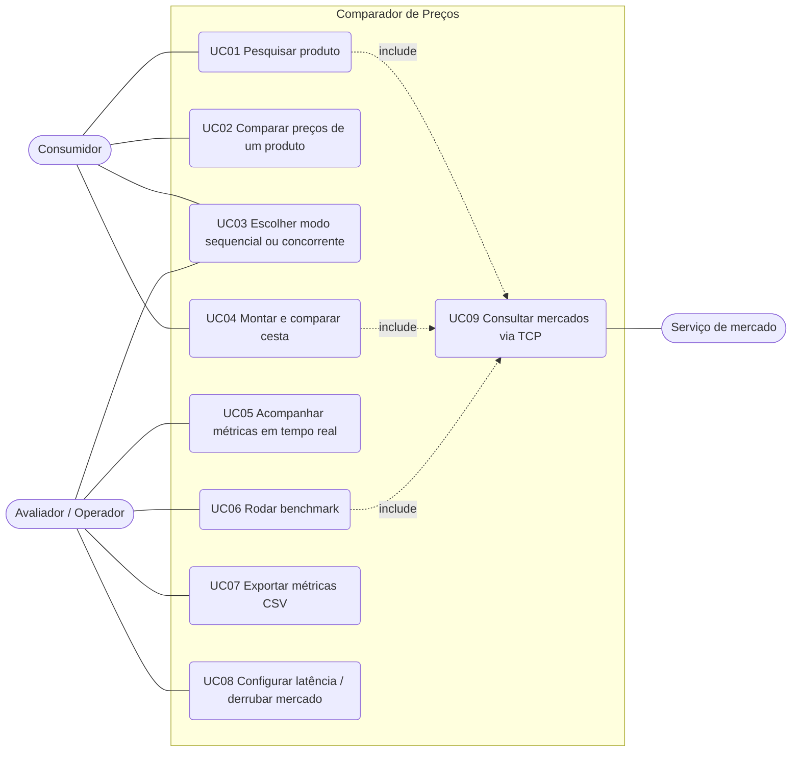

# Requisitos e casos de uso

## Atores

| Ator | Descrição |
|---|---|
| **Consumidor** | Pessoa que pesquisa produtos, compara preços e monta uma cesta de compras na loja (`/`). |
| **Avaliador / Operador** | Professor ou membro do grupo que acompanha o painel (`/painel`), compara os modos, escolhe cenários (lento, timeout, fora do ar) para os mercados para observar o comportamento do sistema. |
| **Serviço de mercado** (ator secundário) | Cada um dos 5 processos servidores TCP que respondem às consultas com dados do próprio SQLite. |

## Requisitos funcionais

| ID | Requisito | Onde está |
|---|---|---|
| RF01 | Permitir pesquisar produtos por nome, categoria ou palavra-chave, sem diferenciar acentos e maiúsculas. | Loja, campo de busca; `SEARCH` no servidor |
| RF02 | Consultar pelo menos quatro supermercados independentes (o sistema tem cinco processos). | `config.py`, `run_all.py` |
| RF03 | Exibir o preço de cada produto em cada supermercado. | Painel lateral do produto |
| RF04 | Ordenar os resultados por preço (produtos pelo menor preço, ofertas de cada produto do menor para o maior). | `build_search_response`, `markets/server.py` |
| RF05 | Destacar o supermercado com o menor preço. | Selo "Menor preço" e etiqueta vermelha |
| RF06 | Oferecer duas rotas de consulta: sequencial e concorrente. | `GET /api/search/sequential` e `/concurrent` |
| RF07 | Medir e comparar o tempo das consultas sequenciais e concorrentes. | Faixa de tempo na loja, painel, benchmark |
| RF08 | Comparar uma cesta de compras e identificar o mercado de menor custo total (evolução sugerida no enunciado). | `POST /api/basket/{mode}`, gaveta "Sua cesta" |
| RF09 | Indicar os mercados que não têm todos os itens da cesta (a cesta mais barata só considera cestas completas). | `missing` / `complete` na resposta da cesta |
| RF10 | Exibir em tempo real os eventos de cada conexão TCP (connect, resposta, erro). | WebSocket `/ws/events`, "Eventos ao vivo" |
| RF11 | Exibir o diagrama de tempo (Gantt) das últimas consultas de cada modo. | "Linha do tempo das conexões TCP" |
| RF12 | Rodar benchmark com N repetições e calcular média, mínimo, máximo, desvio padrão e speedup. | `POST /api/benchmark` |
| RF13 | Exportar o histórico de métricas em CSV. | `GET /api/metrics/export.csv` |
| RF14 | Permitir alterar a latência simulada de cada mercado e tirá-lo do ar. | Comando `CONFIG`, botões de cenário na seção "Mercados" |
| RF15 | Filtrar por categoria, ordenar (destaques, menor preço, maior diferença, nome) e paginar os resultados. | Parâmetros de `GET /api/search/{mode}` |
| RF16 | Comparar os dois modos lado a lado com a mesma busca. | Botão "Comparar os dois modos" em `/painel` |
| RF17 | Medir e comparar o consumo de recursos (CPU, threads, memória) dos dois modos. | Seção "Consumo de recursos" do painel, colunas de recursos no CSV |

## Requisitos não funcionais

| ID | Requisito | Como é atendido |
|---|---|---|
| RNF01 | Comunicação real por sockets TCP entre agregador e mercados. | `socket.create_connection` no cliente; `socket/bind/listen/accept` no servidor. Verificável com `lsof -iTCP:5001-5005 -sTCP:LISTEN`. |
| RNF02 | Concorrência com multithreading. | Agregador: `ThreadPoolExecutor` com uma thread por mercado. Mercado: uma `threading.Thread` por conexão aceita. |
| RNF03 | Tolerância a falhas: um mercado lento ou fora do ar não pode derrubar a consulta. | Timeout de 3 s por conexão; erros viram resultado parcial (`ok=false`) em vez de exceção. |
| RNF04 | Independência dos serviços: cada mercado tem processo, porta e banco próprios. | 5 processos, portas 5001–5005, `data/<mercado>.db`. |
| RNF05 | Desempenho: com as latências padrão, a busca concorrente deve levar perto da maior latência (~1,2 s), e a sequencial perto da soma (~3,6 s). | Ver `experimentos.md`. |
| RNF06 | Protocolo robusto a fragmentação do TCP. | Uma mensagem JSON por linha, lida com `readline()` (`protocol.py`), testado com envio em pedaços de 7 bytes. |
| RNF07 | Interface em português, utilizável em celular e acessível por teclado. | Layout responsivo, foco visível, rótulos ARIA. |
| RNF08 | Reprodutibilidade dos dados. | `seed.py` usa semente fixa por mercado e data de referência fixa. |
| RNF09 | Testabilidade. | 35 testes `pytest` cobrindo protocolo, servidor, estratégias e API. |
| RNF10 | Volume de dados realista. | 1.740 SKUs no catálogo e 7.730 produtos nos 5 bancos. |

## Casos de uso

### UC01 — Pesquisar produto
- **Ator:** Consumidor. **Pré-condição:** agregador e mercados rodando.
- **Fluxo principal:** 1. O consumidor digita um termo e confirma. 2. O front chama `GET /api/search/{modo}?q=termo`. 3. O agregador envia `SEARCH` a cada mercado por TCP (UC09), um por vez ou todos ao mesmo tempo. 4. O agregador agrupa as ofertas por produto, ordena por preço e marca o menor. 5. A loja exibe os produtos, o tempo total e a linha do tempo das conexões.
- **Fluxo alternativo 3a:** um mercado não responde (fora do ar, processo parado ou timeout). O agregador registra o erro e segue com os demais; a loja informa quais mercados não responderam.
- **Fluxo alternativo 4a:** nenhum produto encontrado. A loja sugere termos mais simples.

### UC02 — Comparar preços de um produto
- **Fluxo:** 1. O consumidor abre um produto. 2. O sistema lista os mercados do menor para o maior preço, com o selo "Menor preço" e a diferença de cada um para o mais barato. 3. Mercados sem o produto, sem estoque ou sem resposta aparecem separados.

### UC04 — Montar e comparar cesta
- **Fluxo:** 1. O consumidor adiciona itens e quantidades. 2. Pede a comparação. 3. O agregador envia `BASKET` a cada mercado. 4. O sistema mostra o total por mercado, aponta a cesta completa mais barata e quantos itens faltam nos outros.
- **Alternativo 4a:** nenhum mercado tem todos os itens; os totais parciais aparecem com a lista do que falta.

### UC06 — Rodar benchmark
- **Fluxo:** 1. O avaliador define rodadas e termo. 2. O agregador executa a busca nos dois modos alternando a ordem. 3. O painel mostra o progresso ao vivo e, no fim, média, mínimo, máximo, desvio e speedup.

### UC08 — Configurar latência / derrubar mercado
- **Fluxo:** 1. O avaliador move o controle de latência ou clica em "Tirar do ar". 2. O agregador envia `CONFIG` ao mercado por TCP. 3. O mercado passa a dormir a nova latência antes de responder, ou a fechar as conexões de consulta sem responder.
- **Pós-condição:** as próximas consultas refletem a mudança (timeout acima de 3 s, resposta parcial quando fora do ar).

### UC09 — Consultar mercados via TCP
- **Fluxo:** 1. Abrir conexão (`connect`). 2. Enviar frame com o comando. 3. Aguardar o frame de resposta. 4. Fechar a conexão. 5. Publicar eventos `market_connect` e `market_response`/`market_error` com os tempos medidos.
